

  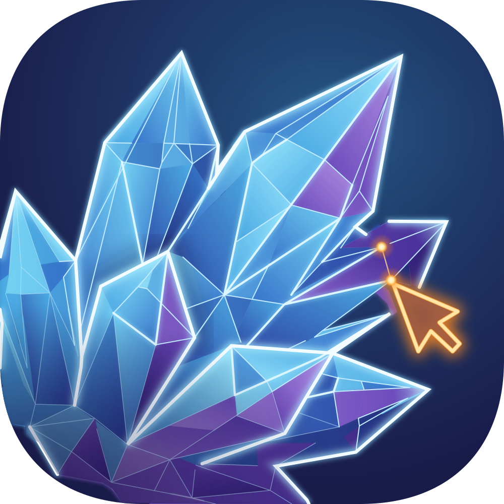

<h1 align="center">Kelcite</h1>

  A 3D modeling app for Makers, focused on 3D printing, that runs in the browser. 
  <a href="https://kelcite.app"><b>kelcite.app</b></a>

  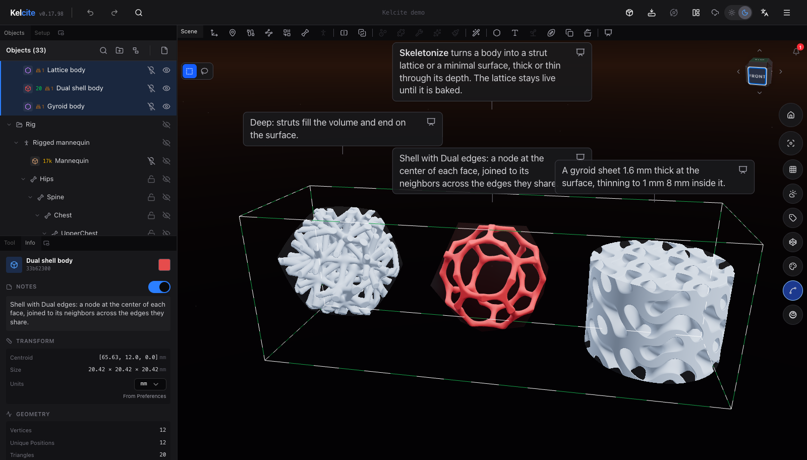

## Philosophy

Kelcite exists because the mesh tools many Makers relied on, such as Autodesk MeshMixer and Microsoft 3D Builder, were abandoned. It aims to fill that gap, with a focus on fast mesh prep for 3D printing. Its design philosophy is transferable knowledge. Each tool is designed around a function, so someone who makes things in wood or another craft should recognize what it is for.

The app's own FAQ states what it stands for.

| Principle | What it means |
|---|---|
| **Free** | No paywalls, no subscriptions, no tiers, no "Pro" versions, no tokens and no ads. Donations help with the costs and are never required. |
| **In the browser** | Kelcite is a progressive web app, so it needs no installation. Chrome and other browsers can also install it locally. |
| **Local** | All processing happens on your machine. Files stay in the browser's own storage, and Kelcite has no analytics, no ad tracking and no cloud data. |
| **Offline** | Once the page has loaded, an internet connection is optional. |

Kelcite has no third-party trackers and no online compute services. In the FAQ's words, "Privacy isn't a setting; it's how the tool is built." A few optional components, such as STEP import, are separate downloads under their own licenses, which the Downloads panel lists with links to their texts.

Development happens in a private repository. This repository tracks the deployed app at kelcite.app, along with feature requests and bug reports.

## Quick start

Kelcite needs only a browser: open [kelcite.app](https://kelcite.app).

- **The demo tour.** The start screen links to a demo scene with an exhibit for each tool. The arrows in the tour panel, or the ← and → keys, step between stops, and each stop frames and selects its exhibit.
- **Moving the view.** Right-drag orbits, middle-drag pans and the wheel zooms. **H** resets the view, and **F** frames the selection.
- **Selecting.** A click on an object in the scene or in the Objects panel selects it, and **Escape** clears the selection. **Ctrl+F** (Cmd+F on a Mac) searches the Objects panel by name.
- **Running a tool.** A tool works on the selection. Pick one from the tool palette above the scene, press its key, or search for it with **Ctrl+K** (Cmd+K). Most tools preview their change, and the status bar shows hints for using them. **Space** or the blue button applies the change.

**Import mesh** (**Ctrl+I**, Cmd+I on a Mac) brings in your own model, and so does dropping the file onto the window. Kelcite reads STL, OBJ, PLY, 3MF, glTF, FBX and other mesh formats, and exports STL, OBJ, 3MF, GLB and FBX.

The [Getting Started](https://github.com/kelnishi/kelcite-app/wiki/Workflow-Getting-Started) page in the wiki covers the same ground in more detail.

### Repair a scan for printing

A slicer needs a closed surface, and a scan often has holes where the scanner could not see. **Repair** (**R**) opens on a mesh that is not manifold and lists its holes, cracks, flipped faces, and fins and duplicate faces. A click on a hole, outlined in red, patches it; **Repair All** (**Tab**) patches every hole, fixes normals, and removes fins and duplicate faces.

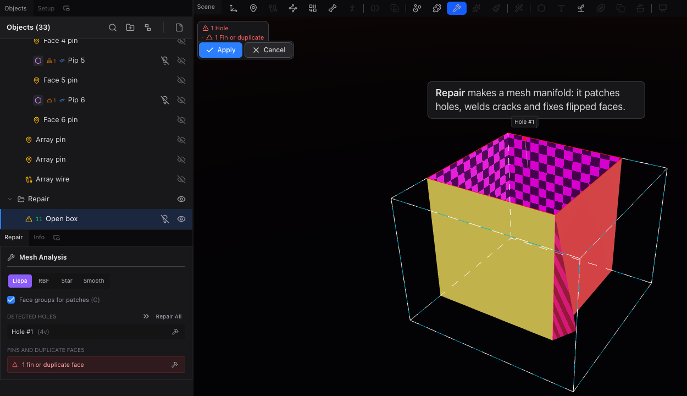

How-to: [Repair a Scan for Printing](https://github.com/kelnishi/kelcite-app/wiki/Workflow-Repair-a-Scan-for-Printing)

### Sculpt with clay, then bake it

**Clay** (**A**) primitives are signed-distance shapes that stay editable until baked, and Round, Tension and Draft reshape them. A slicer needs triangles, so **Bake** (**B**) turns the clay into a mesh at a cell size or triangle count you choose, by Dual Contouring, Surface Nets or Marching Cubes.

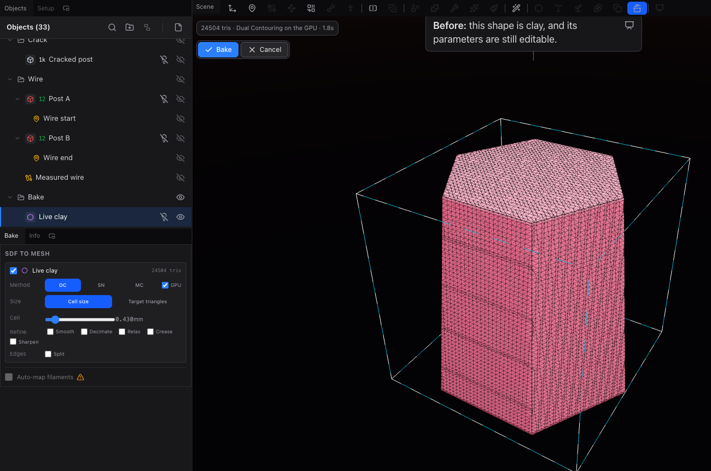

How-to: [Sculpt with Clay](https://github.com/kelnishi/kelcite-app/wiki/Workflow-Sculpt-with-Clay) and [Bake an SDF to a Mesh](https://github.com/kelnishi/kelcite-app/wiki/Workflow-Bake-an-SDF-to-a-Mesh)

### Split and combine parts

A model larger than the print bed has to print in pieces. **Split** (**S**) cuts a model with a plane into A and B pieces, with a pin on each cut face. **Combine** (**C**) sets up a live Boolean modifier: union, intersection or difference.

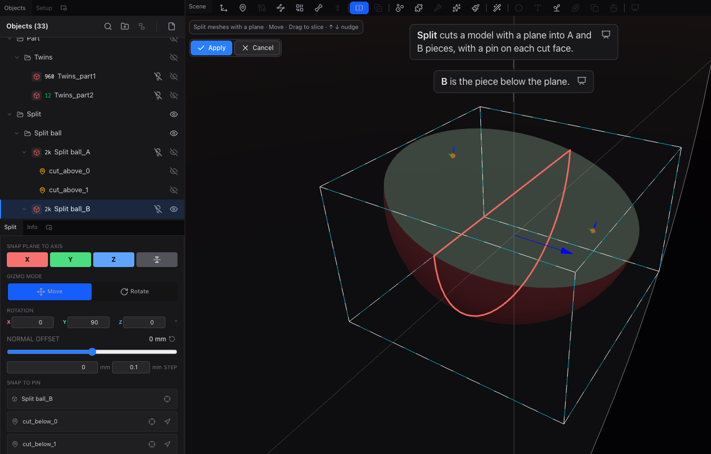

How-to: [Split and Cut a Model](https://github.com/kelnishi/kelcite-app/wiki/Workflow-Split-and-Cut-a-Model)

### Assign filaments for a multi-color print

A multi-material printer has to know which spool prints each region. Filament profiles in the **Setup** panel describe each spool by name, type, color and slot, and each material links to one profile. **Auto setup** creates the profiles from the scene's colors, and a 3MF export writes the links for the slicer.

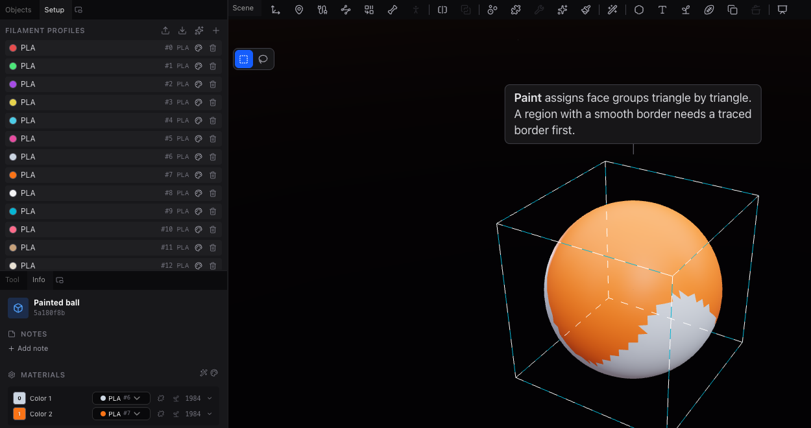

How-to: [Manage Filaments](https://github.com/kelnishi/kelcite-app/wiki/Workflow-Manage-Filaments)

## Feature highlights

Each tool in the palette is built for one job, and the demo scene has an exhibit for each tool shown here. The letter after a tool's name is its key.

<table>
  <tr>
    <td width="33%" valign="top">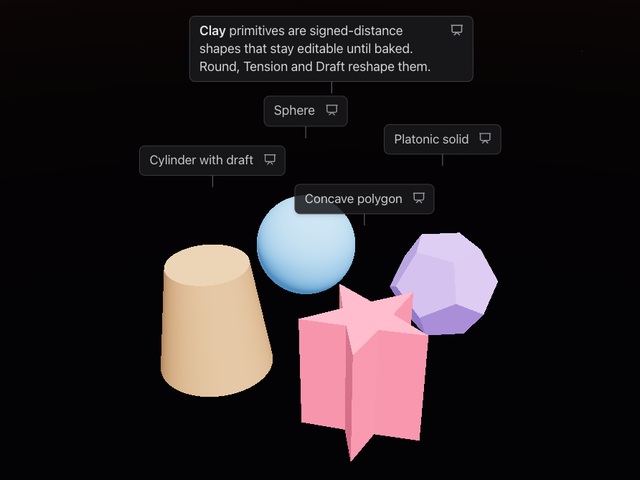 <b>Clay</b> (A): Signed-distance primitives that stay editable until baked. Round, Tension and Draft reshape them.</td>
    <td width="33%" valign="top">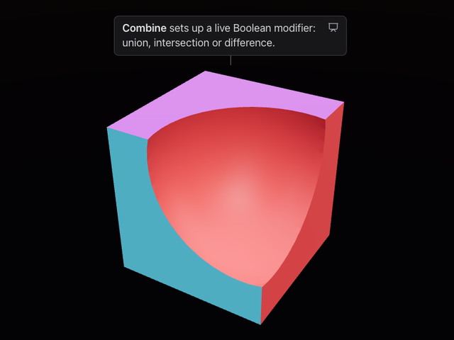 <b>Combine</b> (C): A live Boolean modifier: union, intersection or difference.</td>
    <td width="33%" valign="top">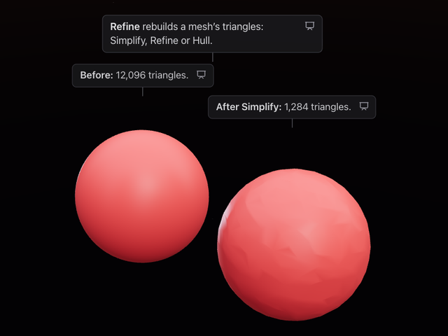 <b>Refine</b> (T): Rebuilds a mesh's triangles: Simplify, Refine or Hull.</td>
  </tr>
  <tr>
    <td width="33%" valign="top">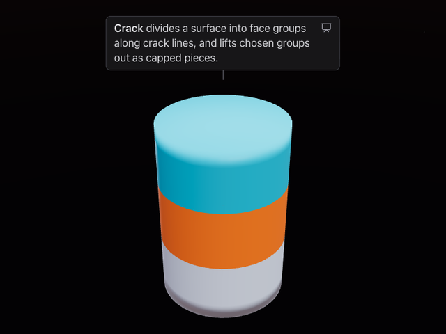 <b>Crack</b> (K): Divides a surface into face groups along crack lines, and lifts chosen groups out as capped pieces.</td>
    <td width="33%" valign="top">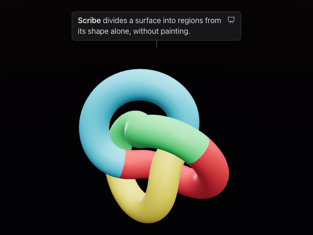 <b>Scribe</b> (G): Divides a surface into regions from its shape alone, without painting.</td>
    <td width="33%" valign="top">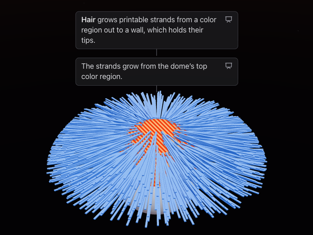 <b>Hair</b> (Y): Grows printable strands from a color region out to a wall, which holds their tips.</td>
  </tr>
  <tr>
    <td width="33%" valign="top">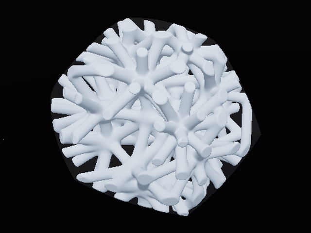 <b>Skeletonize</b> (L): Turns a body into a strut lattice or a minimal surface. The lattice stays live until it is baked.</td>
    <td width="33%" valign="top">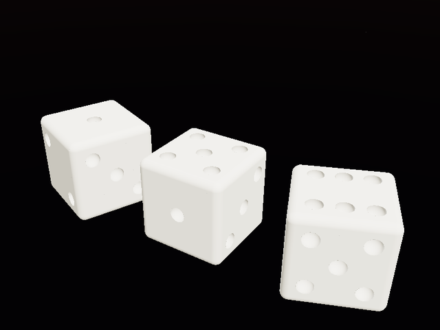 <b>Array</b> (D): Repeats a mesh, clay or a posed figure in a line, a ring or a grid, with a variation for each copy.</td>
    <td width="33%" valign="top">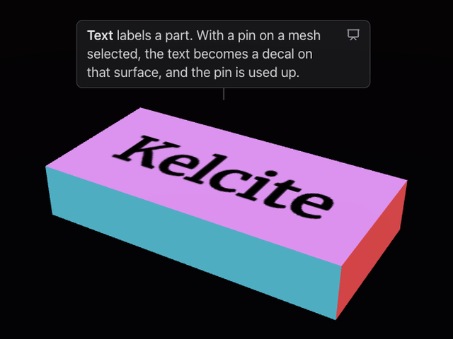 <b>Text</b> (X): Labels a part. With a pin on a mesh selected, the text becomes a decal on that surface.</td>
  </tr>
  <tr>
    <td width="33%" valign="top">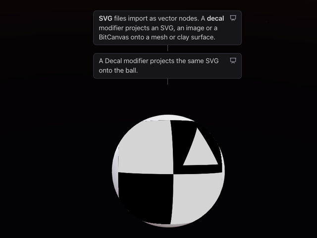 <b>SVG decals</b>: SVG files import as vector nodes, and a Decal modifier projects one onto a mesh or clay surface.</td>
    <td width="33%" valign="top">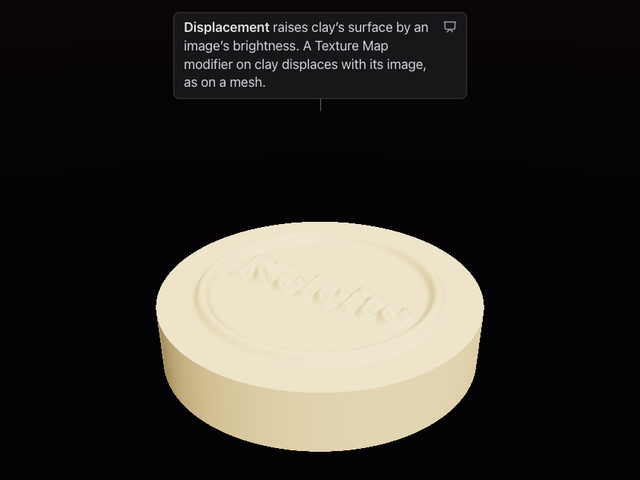 <b>Displacement</b>: A Texture Map modifier raises clay's surface by an image's brightness, and the relief stays editable until Bake.</td>
    <td width="33%" valign="top">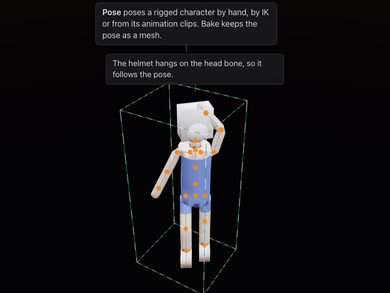 <b>Rig and Pose</b> (I, E): Rig builds a skeleton and binds the meshes to it. Pose turns the bones by hand, by IK or from animation clips.</td>
  </tr>
</table>

Rigging and posing a figure for printing is a workflow of its own: [Rig and Pose a Character](https://github.com/kelnishi/kelcite-app/wiki/Workflow-Rig-and-Pose-a-Character). The wiki's tool reference describes each tool in more detail, starting at [Create and Bake](https://github.com/kelnishi/kelcite-app/wiki/Tool-Create-and-Bake).

## Documentation

The [Kelcite wiki](https://github.com/kelnishi/kelcite-app/wiki) holds three kinds of pages.

| Kind | Answers | Start with |
|---|---|---|
| How-to workflows | How do I get a particular job done? | [Getting Started](https://github.com/kelnishi/kelcite-app/wiki/Workflow-Getting-Started), [Import and Export](https://github.com/kelnishi/kelcite-app/wiki/Workflow-Import-and-Export) |
| Tool reference | What does each tool and modifier do? | [Create and Bake](https://github.com/kelnishi/kelcite-app/wiki/Tool-Create-and-Bake), [Cut and Join](https://github.com/kelnishi/kelcite-app/wiki/Tool-Cut-and-Join), [Modifiers](https://github.com/kelnishi/kelcite-app/wiki/Tool-Modifiers) |
| Architecture | Why does Kelcite behave the way it does? | [Overview](https://github.com/kelnishi/kelcite-app/wiki/Architecture-Overview), [Storage and Privacy](https://github.com/kelnishi/kelcite-app/wiki/Architecture-Storage-and-Privacy) |

What changed in each version is in the app itself. A click on the version number beside the Kelcite name, at the top left, opens **About**, which holds the changelog.

## Take part

Kelcite grows with its users' feedback, and the [issue tracker](https://github.com/kelnishi/kelcite-app/issues) is where that feedback goes.

- **Report a bug.** A bug that can be reproduced can be fixed, so a report needs:
  - the browser and operating system;
  - the version number at the top left of the app, where a click opens About and the changelog;
  - the steps that lead to the problem, from opening the app;
  - the model, as a GLB (Kelcite's own document format, written by **Save**) or a 3MF, if you can share it.
- **Request a feature.** A missing tool for your workflow, or an idea for improving one, belongs in an issue too.
- **Improve the wiki.** A page that disagrees with the app, or a workflow the wiki does not cover yet, is worth an issue or an edit.
- **Sponsor.** Kelcite is funded out of the developer's own pocket: the domain, the hosting and the software used to build it. [GitHub Sponsors](https://github.com/sponsors/kelnishi) helps offset these costs.
