# Architecture: Rigging and Pose

Many printed figures start as a character in a neutral stance, such as an A-pose or T-pose. Reposing one by editing its triangles is slow and breaks the surface. A rig moves the surface with a skeleton instead, so a new pose is a matter of turning joints. Bake then freezes that pose into an ordinary mesh for printing. Kelcite's Rig tool builds the skeleton and its weights, the Pose tool and the Timeline move it, and the Pose step of Bake makes the result printable ([rigging and posing a character](Workflow-Rig-and-Pose-a-Character) walks through the whole path).

## The pieces of a rig

A rig is a subtree in the [scene](Architecture-Scene-Model). Copying, deleting or saving the rig's group takes all of it along.

| Piece | What it is |
|---|---|
| Bones | Scene nodes, one per joint. A bone's transform is its current pose relative to its parent, so moving a bone moves everything below it |
| Skin | Attached to each mesh the rig moves. It records, per vertex, which bones move it and by how much (its **weights**) |
| Rest pose | The pose the skin was bound in. Every other pose is measured from it |
| Joint limits | Allowed rotation ranges per bone, which the Pose tool respects |
| Saved poses | Poses kept with the rig, stored by bone name |
| Clips | Named animations, imported with a file or keyed in the Timeline |

A skinned mesh draws by blending each vertex between the bones that weight it. Its stored vertices stay in the rest pose, and only what you see changes. Tools that edit a mesh's triangles are therefore unavailable on a skinned mesh: changing the triangles would leave the weights describing vertices that no longer exist. A posed figure is picked where it stands. A large one is picked through the graphics card that draws it, so a new pose brings no pause before the next click ([performance](Architecture-Performance)).

## Rig: building the skeleton

The Rig tool fits a skeleton to a figure in one of three ways.

| Path | How it works |
|---|---|
| Automatic | Kelcite finds the figure's body and limbs from its shape and builds a skeleton through them. A wizard lets you correct each stage, and later stages re-run from the correction |
| Humanoid | A fit made for human-shaped figures, which places standard humanoid joints, so poses and exports follow common character conventions |
| By hand | You place joints and grow chains of bones yourself |

**New rig** stands the rig upright along the scene's Y, whatever Up Axis Preferences sets for [files](Architecture-Units-and-Files). A rig made in a document while Up Axis was Z lies along the scene's Z; Move turns its group to stand it up.

Both fits run in a [worker](Architecture-Geometry-Engine), so the view stays responsive. The optional Refine with vision step uses an image-segmentation model to find and name limbs more reliably. That model is an [optional download](Architecture-Storage-and-Privacy), and it runs locally like everything else: on the graphics card through WebGPU, or, in Chrome and Firefox without WebGPU, on up to four CPU threads.

A rig also carries a **template** — the naming and axis conventions it follows and exports with.

## Weights

Automatic weights are solved on the figure's own meshes, one connected piece at a time, in a worker. Pieces that touch only along an edge or across a face count as separate, as they do in Part. Each piece is first classed by how it should move.

| Class | How it follows the skeleton |
|---|---|
| Body | Bends smoothly across joints |
| Clothing | Bends with the bones near it, solved apart from the body beneath |
| Rigid | Moves with one bone, without bending |

The weights panel shows why each piece got its class, and you can override it. You can also paint weights by hand with add, subtract, replace and smooth brushes. The weight view colors a bone's influence on a [ramp](Architecture-Rendering) from none to full. Those colors mean an amount, never a selection or a warning.

## Pose and the Timeline

The Pose tool turns bones with a gizmo or with typed angles, mirrors one side of the figure onto the other, and keeps named poses. A saved pose is stored relative to the rest pose and keyed by bone name, so it also applies to another rig that names its bones the same way.

The Timeline panel plays, scrubs and steps through a rig's clips frame by frame. During playback the figure follows the clip without writing anything to the document. Where playback stops (on release, on pause or on a step), the current pose is written to the scene as one undo step. Turning a bone afterwards shows the pose as edited from the clip.

The Timeline also authors clips. You pose the figure and key that pose at the playhead; between keys, a clip blends from one pose to the next. A new clip can start from the current pose, and the clip menu renames, duplicates, trims and reorders clips. Each of these edits is one undo step. Keyed clips play exactly as imported ones do. A clip's name is how an Array's frame variation finds it, so an Array can stand a figure in a sequence of poses from one clip. In place holds a walking or running figure at one spot while its limbs move.

## Baking a pose

The Pose step of Bake writes each skinned mesh in its current pose as an ordinary mesh. Skinning moves vertices and nothing else, so each mesh keeps its triangles, face groups and materials. Closed meshes can then be unioned into one solid for printing; a mesh with holes, a flipped face or a fin is baked as an open mesh and stays separate, and Bake says which.

Before you bake, Kelcite checks in a worker where the pose makes the figure pass through itself, and shows those places. An arm sunk into a torso prints as a single fused lump, so it is worth seeing first.
