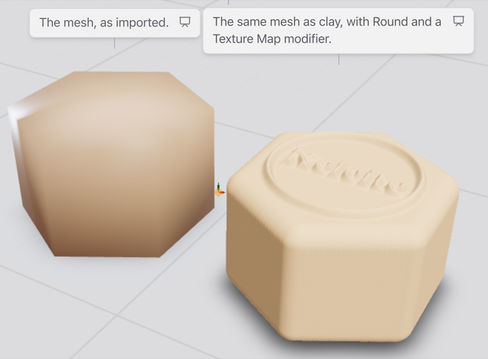

# Changelog Feature Release 0.14.88

Released 2026-10-26.

**Meshes can become clay**, models carry a **unit**, large scenes stay responsive, and Bake is much faster with many tools. 3MF files shrink to about a seventh of their size.

## Clay

Wiki: [Sculpt with Clay](Workflow-Sculpt-with-Clay)

- Meshes can become clay: Convert to Clay, in a mesh's menu in the Objects panel, makes clay you can round, offset, cut, join and blend with other clay, previewed live and baked back to a mesh. Exact edges, in the Info panel, keeps a mesh's sharp edges sharp
  
- Clay saved in earlier versions can change shape: a scaled tool's Round and Threshold now act at the tool's own size, cuts no longer flatten the body at the cutter's box, and a cylinder with Tension, tapered clay and negative Tension are no longer cut off. Check such clay before baking it again

## Modifiers

Wiki: [Modifiers](Tool-Modifiers)

- GLB export keeps vertex colors; a hair wall shows behind an SVG or a decal where its mask clears it; the first band selection in a document selects what it covers; a link to a missing document no longer leaves the editor without panels

## Bake

Wiki: [Bake an SDF to a Mesh](Workflow-Bake-an-SDF-to-a-Mesh)

- Bake is much faster with many tools: a body cut by 64 spheres, solids, cylinders or polygons bakes in 14 s, where it took over 3 minutes, and bodies cut by meshes bake in under 20 s

## Paint

Wiki: [Paint Decals and Texture Maps](Workflow-Paint-Decals-and-Texture-Maps)

- Wrapped texture maps and decals solve faster, on meshes of up to about 1.8 million triangles, without freezing the page. Exact solve, on their cards, keeps the exact layout, and a wrap that can't be solved says so on its card
- The Paint brush highlights the triangles it will paint, paints every triangle it touches, and keeps up on large meshes

## Objects and the interface

- An open tool's status and its Accept and Cancel buttons float over the top left of the scene, so opening a tool no longer resizes the scene
- The About panel has Check for updates: it asks for the latest version and says whether you have it, offering the update when a newer one is out, even after you dismissed the update banner

## Files and the tour

Wiki: [Getting Started](Workflow-Getting-Started#the-demo-tour)

- Models carry a unit: the Info panel's Units row reads a model in another unit, and Commit converts it into the scene's. 3MF and STEP files open in the unit they were written in, and every length in the panels shows its unit
- Opening a document, importing a large file and File \> Open show a loading screen that lists each step, instead of a frozen page, and the scene answers its first click as soon as it shows. A document with clay made from a mesh opens faster the second time
- 3MF files are about a seventh of their old size, with Compress the file in the export options, on by default; OBJ files are about a quarter. Both export meshes of any size, and OBJ writes textures and every material
- A file from a newer Kelcite, or holding something this version can't read, opens as far as it can, and a warning says what was left out or may look different, instead of the missing parts going unmentioned
- Every file Kelcite exports names the Kelcite version that wrote it, now in 3MF, STL, OBJ, PNG and JPEG files too, as GLB and FBX files already did
- Updating from the banner or the About panel saves your open document first, and loads the new version without downloading the whole app again
- STL, 3MF and OBJ exports that hold visible clay, Extrude, displacing texture maps or, in 3MF and OBJ, SVG decals are refused until those are baked; earlier versions wrote the file without them. The Export dialog says why and opens Bake on them, or hide them to export
- If your scene unit isn't millimeters: STL, OBJ and PLY files now open, and STL and OBJ export, in the file unit set in Preferences, millimeters until you change it, and Kelcite files saved earlier open as millimeters. Set the units to match your files
- This version upgrades the browser's document storage the first time it runs, and older versions of Kelcite can't open your documents afterward. Close other Kelcite tabs before updating
- The demo is replaced by this version's when you open it, along with any changes you made to it

## Rendering and performance

- Large scenes stay responsive: with 20,000 parts, the scene draws about three times faster, and clicking, hovering, selecting, band selection, dragging, pasting, undo and the Objects panel respond in a fraction of a second, where some took seconds or minutes
