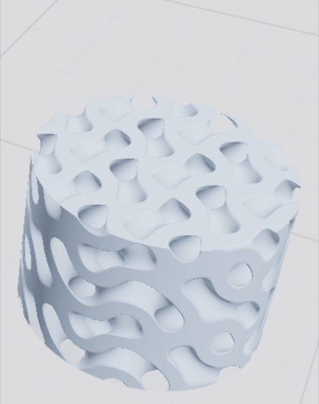
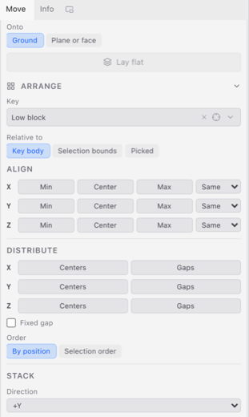

# Changelog Feature Release 0.16.203

Released 2026-11-01.

Move gains **Drop to ground, Align, Distribute and Stack**, the Timeline keys bones as you pose, **Retarget** copies clips between rigs, and Skeletonize adds **minimal surfaces**. A **performance overlay** shows how the scene is doing.

## Clay

Wiki: [Sculpt with Clay](Workflow-Sculpt-with-Clay)

- An arrayed clay's color maps now ride with each instance, as its relief does. Before, each instance past the first showed the subject's map shifted, and Materialize Nodes now places each copy's images as they sit on the subject, so a turned or scaled copy shows its map the same way.

## Modifiers

Wiki: [Modifiers](Tool-Modifiers)

### Skeletonize

- Five minimal-surface patterns sit under Minimal surfaces in the Pattern list: Gyroid, Schwarz P, Schwarz D, Neovius and Schoen I-WP. Each is a smooth surface repeating in a cube of Cell size, cut by the body.
  
- Form sets a minimal surface as a Sheet or a Network. A Sheet is a wall of constant thickness that splits each cell into two channels open to the outside, and a Network is rods along one of the two channels. The Radius is half a sheet's wall, and the rods' radius at their thinnest.
- Shell and Shell + volume lay a Skin on a minimal surface, a wall twice the radius thick along the body's surface, sunk inside the body or centered on it, which closes the lattice off. A pin sets the minimal surface's origin and axes and, with Scale with pin, its cell size, as it does for unit cells.
- A minimal surface on Clay draws in the viewport straight from its field, as strut lattices on Clay do, so a Radius, Form or Cell size edit shows at once. The mesh that Bake, export and a mesh body's preview build matches it: all but a hundredth of its vertices lie within 0.01 mm of the viewport's surface.
- The Graded thickness section changes the lattice's radius through the body, from the Radius to a Radius at the far end, over a Distance to the far end. It works on strut patterns and on minimal surfaces, where it grades the wall or rod and the skin.
- Grade by sets what the distance is measured from: Depth below the surface, the distance From pin (or from the body's origin without one), or the distance Along axis from the pattern's origin. The grade changes thickness and not the pattern, so every cell and strut stays where it was and the lattice stays joined.
- The panel shows the thinnest and thickest part across. It warns when a wall is under 3 grid cells thick, which breaks up when meshed, when a minimal surface's thickest wall is over 30% of its cell, which fills the cells in, and when the radius changes faster than 0.25 mm per mm.
- A minimal surface graded by Depth reads the body's distance across the whole range, so it builds with a wider band and takes longer than one at a single radius.
- A new shell layout, Dual edges, puts a node at the center of each polygon of the body and joins it to its neighbors across the edges they share. A triangulated surface becomes hexagons, and an icosahedron becomes a dodecahedron.
- Dual edges takes each polygon from a face and the neighbors that Merge faces flatter than joins to it, so a smooth curve splits into polygons instead of merging into one.
- The shell layout called Polygon edges is now Mesh edges and builds the same lattice as before. Mesh edges and Dual edges both use the Merge faces flatter than and Surface deviation sliders.
- A hollow shell's inner cavity stays in the mesh instead of being dropped as a chip, and the Loose pieces count leaves it out.

### Array

- Materialize Nodes on an Array of a mesh makes copies that share the mesh, so 1,024 copies hold it once instead of 1,024 times, and the scene file, the autosave and the viewport's memory shrink to match. Bake of an arrayed clay node to meshes shares one mesh among its instances the same way.
- Copies that share a mesh edit together, like linked duplicates. A Repair, a paint stroke or a material change on one applies to all of them, and one Undo takes it back from all. The Info panel says "Shared by N objects" for such a mesh and lights the others while the pointer is over it.
- Make unique, in the Info panel and the Objects panel's context menu, gives the selected objects a copy of the mesh of their own, as one undo step. Baking a rotation or scale into a shared mesh does the same for that object first, so the others keep their shape.
- Deleting one copy keeps the mesh while another still draws it, and Duplicate, Copy and Paste keep the sharing among the objects they copy.

## Jig

Wiki: [Construction and Rigging](Tool-Construction-and-Rigging#jig)

- An orientation constraint now turns a pin that points exactly opposite its target. Before, such a pin read as already aligned, so two pins both facing up could not be mated and a body lying upside down stayed upside down.
- A document with an exactly opposed Orientation or Align-to-surface constraint turns that body half a turn on its next solve, such as a drag with Auto-solve constraints on. Nothing in the document changes until a solve runs.

## Move

Wiki: [Construction and Rigging](Tool-Construction-and-Rigging#move)

- The Move tool has a Body section below Transform Origin. Drop to ground sets each selected body on the ground in one step. Onto picks the ground, a plane or a face, or Surface below, which lands a body on whatever lies under it.
- In Drop to ground, Contact: Surface finds the lowest point of a round clay shape, where Bounds uses its box. Gap leaves room between the body and what it lands on, and As one drops a selection together by its lowest body. Hovering the button outlines where each body would land, and nothing moves until you press it.
- Move to anchor puts a place on the selection on a place elsewhere: a point, or the shortest way onto a line or plane. The place starts as the Transform Origin; a point of a body's bounds, a pin, a surface point or a vertex also work. Axes limit the move to X, Y or Z, Gap leaves room along the target's direction, Turn keeps the place's direction, matches the target's or faces it, and As one moves a selection together.
- Move to origin stands the selection's bounds on the origin. A pin or body picked as the target cannot be on a body that moves, and the button says why. Bodies wired to the moved ones follow when Auto-solve constraints is on, as they do after a drag.
- Flip to axis swings a direction of the body onto a world direction, about its bounds' center or the Transform Origin. It starts with the axis now pointing down, so one press turns the body over, and Then drop sets it back on the ground. A half turn goes about World X, or World Z if you choose it.
- Square up snaps each selected body's rotation to the nearest quarter turn about each world axis.
- Lay flat turns a face you click onto the ground, or onto another face or plane, and lands it there. On a mesh the face is its face group, or the faces around the click that lie flat together; on clay it is the tangent plane at the click. Best face steps through the faces a mesh can rest on, largest first, and if part of the body would end below the ground, an alert says the face isn't on its outside.
- With two or more bodies selected, the Arrange section aligns, distributes and stacks them. Align has Min, Center and Max for each of X, Y and Z, and each button acts at once: every body but the key moves along that axis until its edge meets the key's.
  
- The key is the primary selection unless the Key picker changes it. A Meets menu per row sets a body's min against the key's max, which sets parts side by side, and Relative to takes the selection's bounds or a point or plane you pick instead of the key.
- Distribute spaces the bodies along an axis while the two ends stay, by equal spacing of their centers, equal gaps between them, or a fixed gap measured from the first. Order follows their position or the order you selected them.
- Stack sets each body on the one before it along a direction (Y up by default), by its bounds or, for round clay, by its surface. Gap leaves room between bodies, and Center on lines each up on the one below or on the key.
- With a pin selected, the Pins section fits bodies by their pins. Select two or more pins and the first is the key, which the others' bodies move to; with one pin, pick a place as To. Mate turns the pin's up against the target's and lands it there, Coaxial turns it along the target's up and slides it onto that line, Coincide only lands the pin, and Align only turns it.
- In the Pins section, Flip reverses the direction, Twist can match the pins' north (plus an Angle), and Gap holds the pins apart along the target's up. Moves chooses whether the pin's body or the key's body moves, and Carry whether the body or the top group above it does. Pair by order fits two bodies with the same number of pins at once, from the pins in selection order; that fit is not recorded for history replay.
- Every Body, Arrange and Pins edit is one Undo step, a whole Mate included.
- The grid and the ground now sit at y = 0, where the origin is, instead of half a unit below it. A body dropped to the ground, an imported model and a clay shape placed on the ground now touch the grid you see.

## Crack and Scribe

Wiki: [Surface and Refine](Tool-Surface-and-Refine)

### Crack

- The Method row, above the Bite radius, chooses how a click finds its crack: Edge walk, the way Crack found it before, Plane slice or Isoline. Crack remembers the Method you chose, and each crack undoes like any other.
- Plane slice cuts a ring where a plane through your click meets the surface. The plane holds the surface normal and the direction the surface curves most within the bite radius, so a click on a limb cuts a ring around it, along the mesh edges nearest the plane.
- With Plane slice, the Bite radius sets how much of the surface the plane is fitted to, and a larger radius smooths over bumps. The Falloff row and the guide steer Edge walk only, so they are hidden or off with Plane slice and Isoline.
- Isoline cuts a ring along a level line of the mesh's spectral modes, the eigenvectors Scribe uses. On a limb that bends or tapers, its rings stay around the limb where a straight plane would not.
- The first time you choose Isoline on a mesh, Crack computes its eigenvectors in the background and shows the progress in the Method row. A mesh Scribe has already opened has them, so there is nothing to wait for; Refine and Subdivide drop them, and Isoline computes them again.
- Isoline's Mode sets which mode the ring follows. Automatic tries the first modes and keeps the shortest ring at least as long as the bite radius's circle; Mode 1, 2 and so on follow one mode. Lower modes cut across larger parts of the mesh, and higher ones cut finer features.
- Where no plane fits (a flat area, a surface that curves the same every way, or a plane that runs off an open edge), where Isoline finds no ring, or where the eigenvectors cannot be computed, the status line and the Method row say why, and no crack is added.
- A mesh that carries traces, such as the ones Scribe outputs in its trace mode, shows a Traces row with a Load traces button. Each trace becomes a crack, snapped to the nearest path over the mesh's edges and editable like any other. Loading again skips traces already loaded, and one Undo takes the whole load back.
- A trace that cannot be loaded, because it was made on another version of the mesh or is not on its edges, is named in an alert with its reason, and the rest still load.

## Rig and Pose

Wiki: [Rig and Pose a Character](Workflow-Rig-and-Pose-a-Character)

### Timeline

- Moving a bone in the Pose tool keys it at the playhead in the clip shown, or edits the key already there. Only the bones you move are keyed, and a Mirror edit keys both sides. The Key pose at playhead button and menu entry are gone.
- The Pose tool has a Dismiss button in place of Apply and Cancel, since each edit is its own undo step. With no clip shown, moving a bone only poses it, and New clip from pose in the clip menu starts a clip.
- Moving the playhead, by scrubbing, stepping or jumping, is an undo step, and Undo puts the playhead back where it was. Undoing a key edit shows the key it took back. A drag is one step however long it runs, and so is holding an arrow key; playing a clip adds none, and posing during playback pauses it first.
- Bone keys opens a row for each bone of the rig, as an expandable tree beside a key lane. Drag a bone's key to move it, Shift-click it to delete it, or click it to go to its time; each move or delete is one undo step.
- Clicking a bone's row selects the bone, and a bone selected in the viewport or the Objects panel shows in the list with its branch opened. A closed bone shows the keys of the bones below it. Rigs with a hundred or more bones scroll without slowing the Timeline.
- A frame ruler sits above the scrubber and the bone rows, with a tick on every frame the width allows and a number every few, so each key diamond sits under its frame. Clicking or dragging on the ruler or an empty part of a lane moves the playhead.
- Keys too dense for diamonds, as in a clip keyed on every frame, show as one band in the clip lane and in a bone's row.
- Reduce keys in the clip menu drops the keys that the curve between their neighbors reproduces, within 0.1° of rotation and 0.1% of the rig's size, and says how many it dropped. Undo restores them.
- Clips imported from FBX and glTF files come in reduced the same way, and the import warning says how many keys were dropped. Reduce keys on import, in the Pose tool's Clips section, turns this off; it is on by default.
- The Timeline collapses when no rig is selected, and its place in the layout returns when one is. Selecting a rig, one of its bones or a mesh skinned to it shows it, and so does opening the Pose tool on a rig. The playhead and playing state stay while it is collapsed.

### Retarget

- Retarget… in the Timeline's clip menu copies the clip you are watching onto another humanoid rig as a new clip. Pick the rig in the bar that opens (in the scene, in the Objects panel or from the list), then press Retarget.
- The copy follows the original's hands and feet on the other rig's own proportions, and its travel scales by that rig's leg length, so a tall figure's walk fits a short one without sliding. Bone rotations are not copied one for one.
- Both rigs need their humanoid bones mapped in the Pose tool's Humanoid section, and when one is not, the bar names the bones it lacks. The new clip is an ordinary clip on the target rig: rename, trim, key and export it like an imported one, and one Undo removes it.

### Rig weights

- The Rig tool's Weights stage has a Bone regions section, which Show bone regions opens. It lists each region of the figure with the bones that move it, and a bone that reaches into a neighbor shows how far, from 0 to 1.
- Add a bone to a region, or remove one, to change which bones belong to it. Your changes save with the rig, follow it when it is copied, and Undo takes them back; Reset bone regions takes them all off.
- Scale weights by region, in the Bone regions section, makes Bind weight each region of a figure mainly from the bones that apply to it, so a foot takes less weight from the other leg's bones where the two sides touch. It is off by default and saves with the rig.
- The scaling blends smoothly across a region's edge, so no seam shows where two regions meet. It follows the Bone regions table, so adding or removing a bone there changes the next Bind, and re-weighting a bone and its children follows the table too.
- Scale weights by region works on rigs the generic wizard built and on humanoid and imported rigs. On a rig without regions, Bind first finds them (the button reads Finding regions while it does), and the Bone regions section lists what it found. If they can't be found, or a mesh changed after they were found, Bind says so and binds without scaling.

## Objects and the interface

- When a mesh's analysis fails, the alert and the Info panel say why.

### Selection

- When more than one body is selected, the selection box carries a label at its top-left corner with the number of bodies inside it (for example "3 bodies"). It stands by the measurement labels and follows the box, and it hides with them when measurement labels are off.
- While you drag a marquee or lasso, a label on the band says how releasing will change the selection: "+4" for bodies added, "−2" for bodies removed, "+3 −1" for both, and "±0" when nothing changes. It follows Shift (add) and Alt (remove) and updates as the band moves.

## Files and the tour

Wiki: [Getting Started](Workflow-Getting-Started#the-demo-tour)

### The tour

- New stops for Move quick edits (two blocks hanging above the ground, for Drop to ground), Performance guard and Performance overlay.
- The Skeletonize stop adds a Dual edges shell and a Gyroid closed by a skin and graded in thickness. The Crack stop shows the Method row and Load traces, and the Pose stop shows Retarget… and keying by moving a bone.
- The demo's Rig and Pose figures are bound with Scale weights by region on.
- The Object search stop is removed. Search in the Objects panel is unchanged.

## Rendering and performance

- A performance overlay shows how the scene is doing. Press Alt+P, or choose Performance overlay in the menu at the right of the toolbar, between Keybindings and About, and a panel at the bottom left of the scene graphs the frame rate (with the guard's floor marked, 20 fps by default), the CPU and GPU time of a frame, the JS heap and the GPU buffers the scene holds.
- Under the graphs, the overlay lists the triangles and draw calls of the last frame, the shader programs, the fullest caches, and what the overlay itself costs a frame.
- A performance guard watches the scene while you work. By default, when the scene draws below 20 fps for five seconds, a notification names the nodes with the most triangles, as links, and offers Stop drawing the scene. Stopping leaves the Objects and Info panels working so you can hide or delete what costs the most, and Draw the scene brings the view back.
- The guard also warns when the page's JavaScript memory reaches 80% of the browser's limit, and when the scene's GPU buffers reach 80% of a budget set from what the browser reports about the device (1 GiB where it reports nothing). Each warning has a button that shows the performance overlay, which names the budget and what set it. The guard never stops drawing on its own.
- When the last session of a document ended without closing, Kelcite asks on opening it whether to open it without drawing the scene, so a document that froze the page can be opened and repaired. Stop or resume drawing the scene is also in the command search.
- Preferences › Performance has a Performance guard section. It turns the guard off, and sets the frame rate the scene must hold and for how many seconds, the share of JS memory that warns, the GPU buffer budget (from the device, or a Custom MB figure) and the share of it that warns, and how many minutes pass before a warning repeats. Each change applies at once, without a reload.
- Each of the three warnings (frame rate, JS memory, GPU buffers) has its own switch, and a warning's notification offers Don’t warn about this again, which turns that warning off and says where to turn it back on. Where the browser does not report JS memory, the memory warning shows as unavailable, with the reason.
- Offer to open without drawing turns off the question asked on opening a document whose last session ended without closing; off, Kelcite also stops recording that a session is open. Restore defaults returns the Performance guard section to its defaults.
- A scene too costly to draw smoothly no longer keeps the page busy while you are not working in it. The view draws every display frame while you work or while anything animates, and four times a second when idle; a playing clip, a camera fly-to and an import or delete reveal always draw at the display rate.
- Clay cut by an Array of tools, such as the dice in the demo's Array exhibit, draws about three times faster up close, so a die filling the view no longer slows the viewport down.
