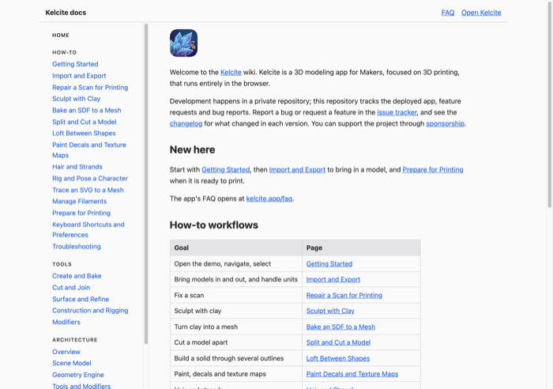

# Changelog Feature Release 0.17.413

Released 2026-11-15.

This release puts the documentation on the web at **kelcite.app/docs**, where the wiki's how-to, tool and architecture pages open beside the app. **About** and the changelog link to a release's own notes there, and docs pages carry link previews.

## Objects and the interface

- The documentation is at **kelcite.app/docs**: the wiki's how-to, tool, architecture and changelog pages, with the wiki's page list beside them, in light and dark mode and on a phone. The version in **About** and **kelcite.app/changelog** open a release's notes there; a release whose page is not published yet opens the changelog's index instead.
  
