# Changelog Feature Release 0.17.506

Released 2026-11-21.

This release brings **Clone**, which draws a copy of a part at a Wire's end, a pin or along its length, **BCC Tetrahedra** as a fourth Bake method, and **Regularize** and **Remesh** in Refine. A right-click on an SVG or text offers **Add Loft** and **Add Sweep**. **Loft as Clay** and **Sweep as Clay** are held back while their performance is improved.

## Clay

Wiki: [Sculpt with Clay](Workflow-Sculpt-with-Clay)

- A clay body, its Array instances and its Clones stay clickable after an edit to the body's shape, such as its base type, its sides or its **Tension**.
- **Focus** on a clay Sweep or a clay Loft centers the view on the body and fits it, wherever its node stands.
- A polygon or star's Radius and Height sliders keep their range while dragged, so a drag no longer pushes the value toward infinity.
- The Position, Rotation and Scale cards fit a narrow tool panel: the X, Y and Z fields wrap onto a second line instead of running past the panel's right edge.
- A clay body that combines a Lattice, mesh clay, displacement and four decals draws on GPUs with 16 texture units, where it drew nothing.

### Sweep

- A clay Sweep turns about its Wire as the mesh Sweep does: by each pin's **North**, or kept upright when the Loft's Spine row is set to **Upright**. A rectangle or star swept as clay now faces the way the mesh Sweep faced, and a Sweep converted to clay keeps its facing.
  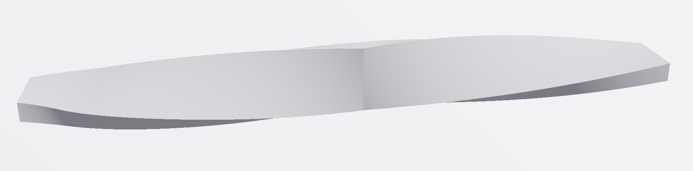

## Loft

Wiki: [Loft Between Shapes](Workflow-Loft-Between-Shapes)

- **Loft as Clay** and **Sweep as Clay** are held back from this release while their performance is improved. Saved clay Lofts still open, draw, move and bake, and **Add Loft** makes a mesh Loft.
- An SVG or text section keeps its holes and has a **Paths** list on the Loft card, as a clay Outline does.
- A right-click or long press on an SVG or text in the scene view offers **Add Loft**, **Extrude as Clay** and **Add Sweep**, which make a Loft through the selected sections from the lowest up, an Outline of the drawing, or a Sweep along the selected open Wire.
- An SVG that a Loft ends on no longer draws over the Loft's end cap, so a star at the top of a Loft shows its cap lit like the walls instead of black.
- **Twist** turns a Loft without a spine by its angle; a Twist under a half turn used to leave the walls straight.
- A mesh that a Loft's body is combined into, or cut or intersected with, now follows the Loft while one of its ends is dragged, and shows the result where the Loft is after the move, instead of keeping the result from before.
- Orbiting the view around a clay Loft draws faster, and no longer stalls on frames where the pointer pauses.
- Placing a match point on a section's loop no longer selects what lies under the pointer when the press is held longer than a moment.

### Sweep

- A Sweep whose pin's **North** rolls the section along a straight Wire now turns with the roll instead of joining its two ends with flat walls, for an outline of few points such as a Trace of a rectangle's corners. It adds rings in proportion to the roll, and a **Twist** that turns the other way asks for fewer. Saved Sweeps like these gain rings when they open, and match their clay form.
  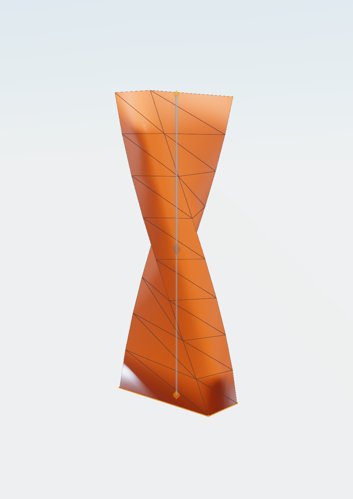

## Modifiers

Wiki: [Modifiers](Tool-Modifiers)

### Clone

- **Clone**, on a Wire, a Pin or a Trace, draws a copy of an SVG, text, mesh, clay or figure at the Wire's end, one of its pins or a share of its length; the copy follows its target's edits, and its place, turn and scale are its own.
  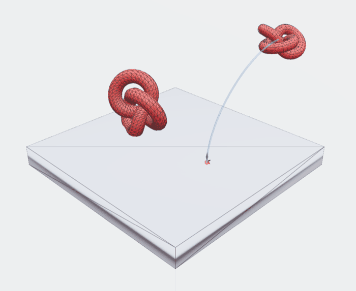
  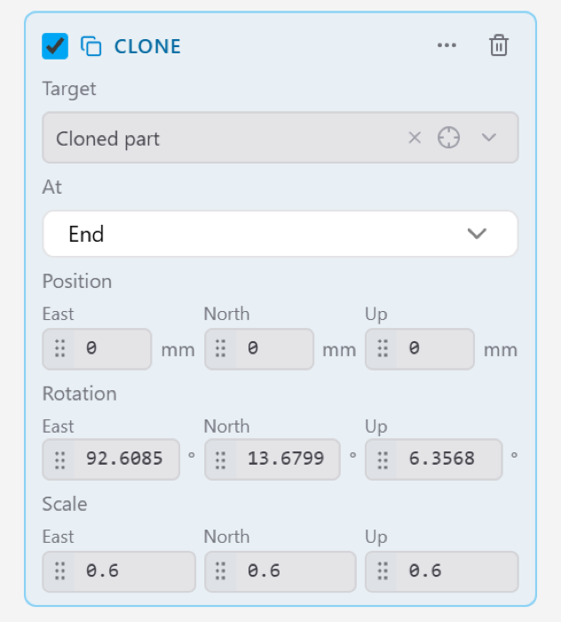
- **Convert to clone**, in the scene view's right-click menu on an Array instance, replaces that instance with a Clone of the Array's body standing in the same place.
  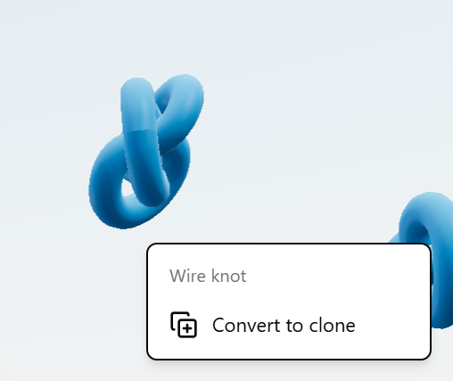
  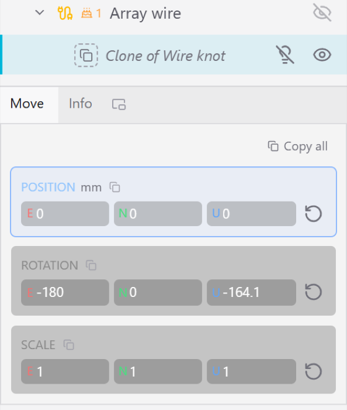
- Delete, Backspace, or Delete on a Clone's row in Objects removes a selected Clone instance, as one undo step.

## Bake

Wiki: [Bake an SDF to a Mesh](Workflow-Bake-an-SDF-to-a-Mesh)

- **BCC Tetrahedra** is a fourth method in the Method row of Bake's clay card. It meshes clay on tetrahedra that are the same in every direction, so a sphere's tiling has no seam where the surface turns past an axis.
  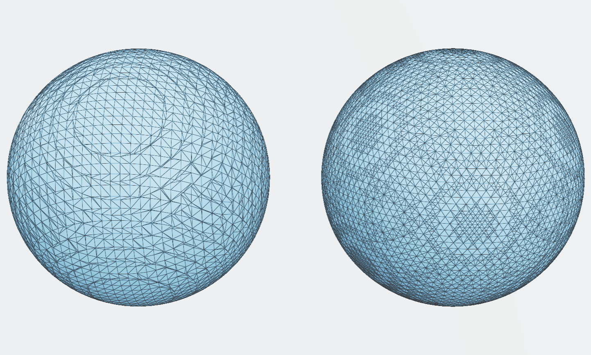
  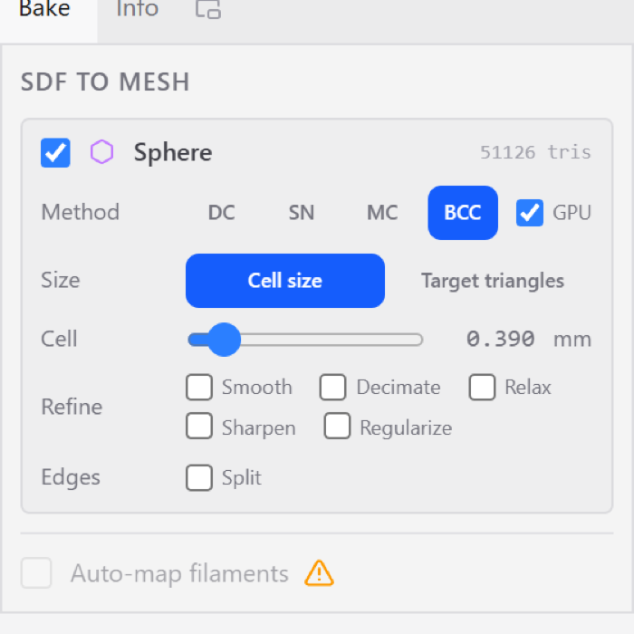
- The Bake panel's controls fit narrow panels instead of running off the edge.
- A **Dual Contouring** bake on the CPU (where WebGPU is missing) keeps a turned box's edges sharp: some of its edge vertices sat up to a cell off the edge, on a face.
- The wireframe over Bake's and Refine's previews takes the line weight and wire color set in Preferences.
- The mesher's name in the status line is translated.

### Refine

- Refine has two new operations: **Regularize** evens a mesh's triangles toward one shape on the same surface, and **Remesh** rebuilds a closed mesh on a lattice that is the same in every direction.
  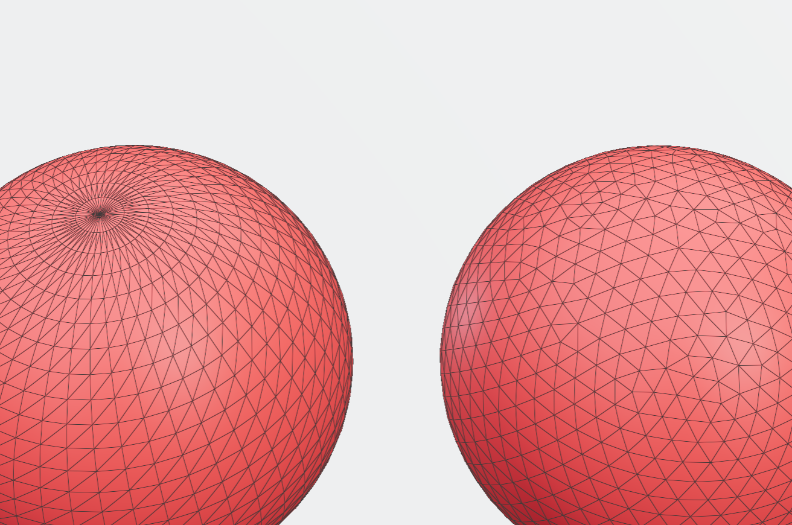
  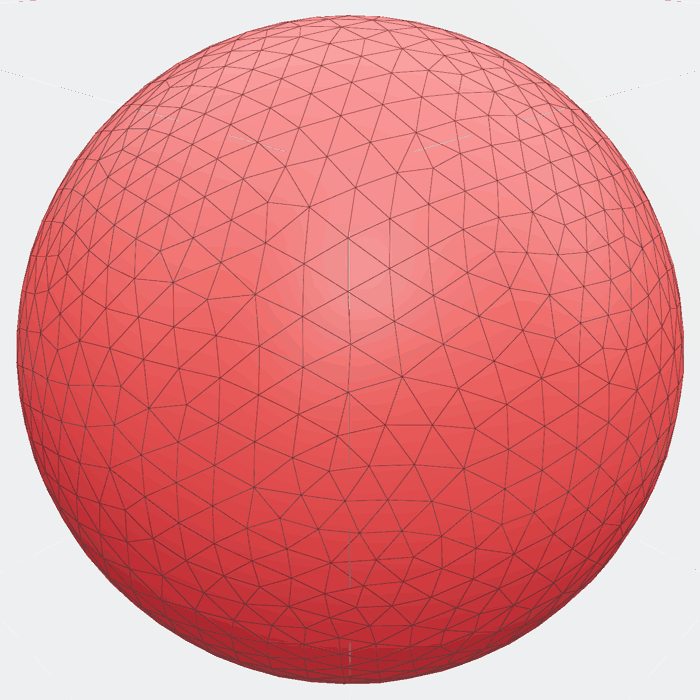

### Regularize Triangles

- **Regularize** keeps sharp edges and corners on the CPU's dual contouring, surface nets and marching cubes, as it does on GPU dual contouring: a box or a cylinder comes out with its edges where the clay has them, where before they were rounded. The GPU's surface nets and marching cubes still round them, as the box's tooltip says.
- **Keep edges**, a new box under Regularize and on to start, keeps a clay's sharp edges and the borders between its face groups where they are. Turned off, Regularize rounds them, as it did before. On surface nets and marching cubes, which take a little longer to find sharp edges, turning it off saves that time. A border that crosses a smooth blend keeps the steps of the triangles it runs along.
- **Regularize** keeps sharp edges and corners on the GPU's surface nets and marching cubes too, so every Bake method now gives a box or a cylinder its edges where the clay has them. Before, these two methods rounded them, and the box's tooltip said so.
- **Regularize** is offered on every Bake method, including the CPU's dual contouring, surface nets and marching cubes. A browser without WebGPU still regularizes, on the CPU, more slowly. Only GPU dual contouring tells Regularize where the sharp edges are; on the other methods it rounds them, as the box's tooltip says.
- **Regularize**, in the Refine row of Bake's clay card, remeshes the baked clay toward even, near-equilateral triangles and settles them back onto the clay. Far fewer irregular triangles line up where the surface turns past an axis, the seam dual contouring leaves there. It replaces Relax while it is on.
- **Keep sizes** holds each region's triangle size and changes only the shapes; **Even sizes** uses one edge length everywhere, with the triangle count about the same. **Iterations** sets how many passes run, from 1 to 12; five is where the shapes stop improving much.
- Sharp edges and corners that dual contouring finds stay where they are. Surface nets and marching cubes give Regularize no edges to keep, so it rounds their sharp edges.
- Where Regularize cannot change a mesh, Bake keeps the mesher's triangles and the card says why.
- Large bodies regularize to the same quality as small ones. **Settle** used to give a 1.2M-triangle body a fraction of what it gave a 12k one; it now raises the average smallest angle by about 3° more on large bodies, which end as close to equilateral as small ones or closer, and the surface stays as close to the clay.
- **Regularize** gives triangles closer to equilateral: the average smallest angle rises by up to 2°, and the thinnest triangles come out wider. The surface stays as close to the clay as before, or closer, and sharp edges stay where they were.
- A **Passes** row under Regularize turns each of its new passes on or off. **Settle** slides the triangles toward equilateral after the iterations and evens out their areas; **30° floor** fixes triangles with an angle under 30° at the end; both start on. **Pair defects**, off to start, gives more vertices six neighbors at a small cost in angles and time.

| | | |
|---|---|---|
| 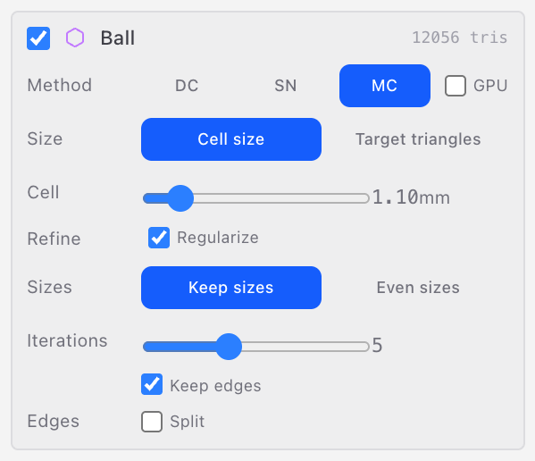 | 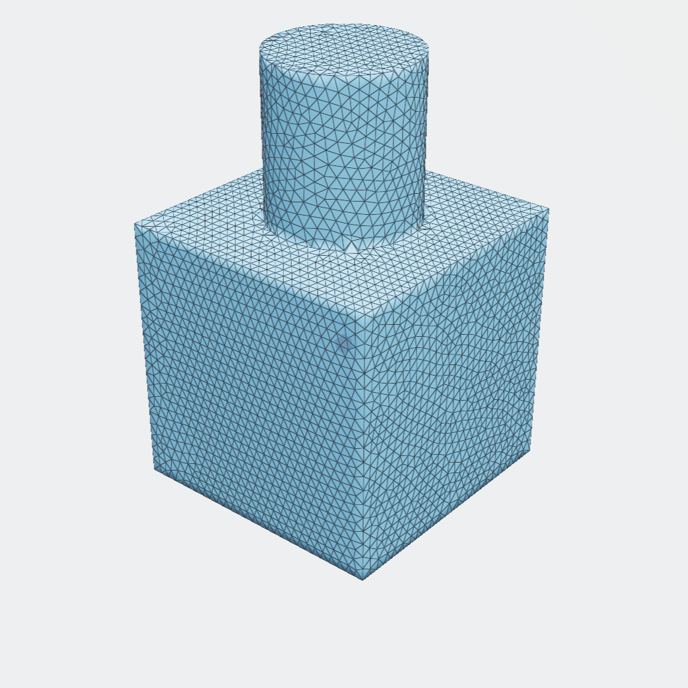 | 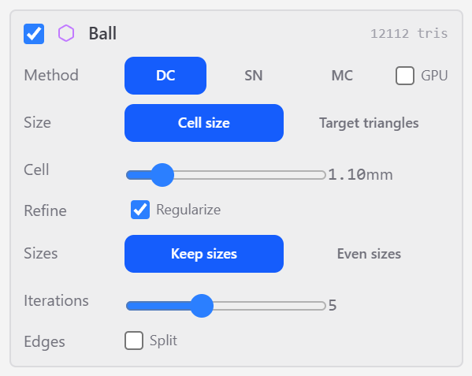 |
| 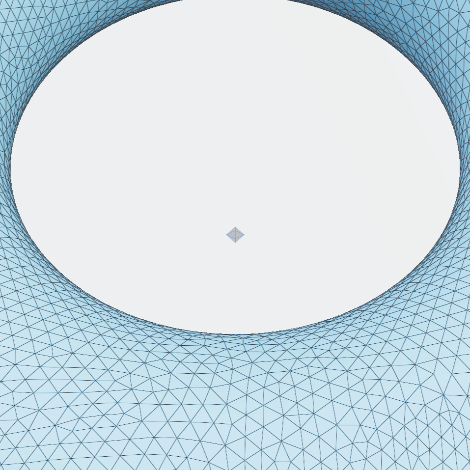 | 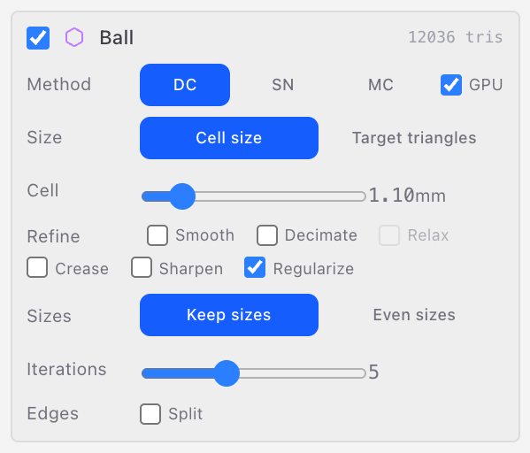 | 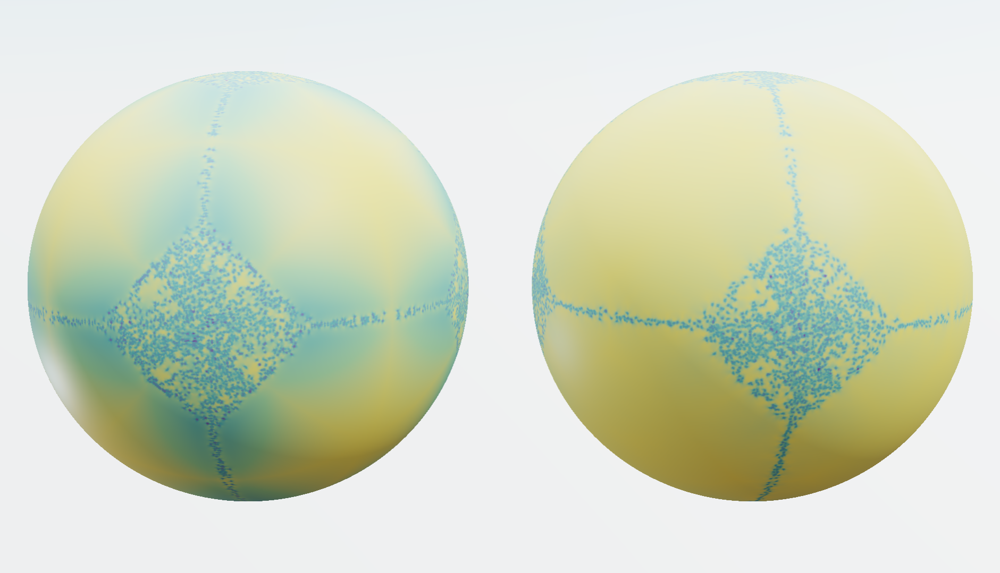 |
| 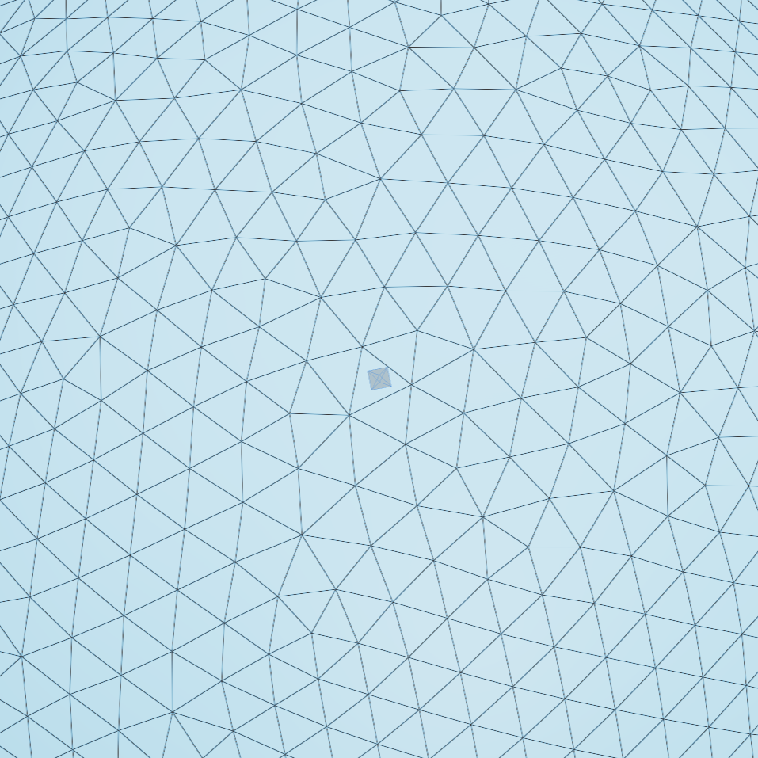 | 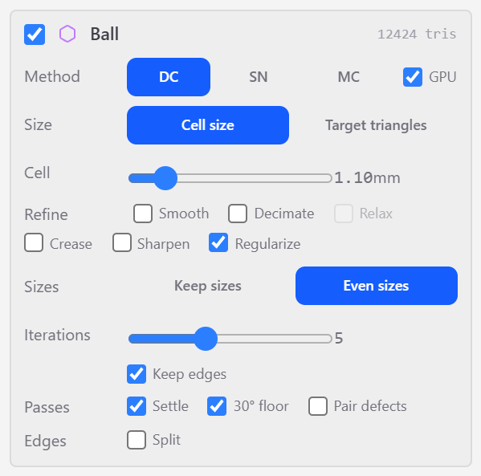 |  |

## Rig and Pose

Wiki: [Rig and Pose a Character](Workflow-Rig-and-Pose-a-Character)

- Dragging a bone or playing a clip on a large skinned mesh is smoother.
- Posing a large skinned mesh is faster.

## Objects and the interface

- A SpaceMouse cancels a camera fly-to (Home, Focus, a view) however long it has run.
- The font picker's search field takes focus as soon as it opens, in the font list and in the Fontsource browser.

## Rendering and performance

- A panel shows shader compiles in progress.
- Opening a large mesh with holes or other defects no longer freezes the page briefly while the "not manifold" warning counts them.
- The load screen's **Compiling shaders** and the status row's shader chip show the same count.
- The performance overlay's **GPU time** is the GPU time of a whole frame, every clay body's image included. It read the median single draw before, which on a scene of many clay bodies was a few hundredths of a millisecond while frames took 20 ms or more.
- Scenes with many clay bodies use less GPU memory and stay smoother while the view moves.
- Improved shader compilation performance on Windows.

### Wireframe

- A mesh's wireframe wipes in across it when the mesh first appears, also on a first visit, where the lines used to appear all at once while their shader compiled.
