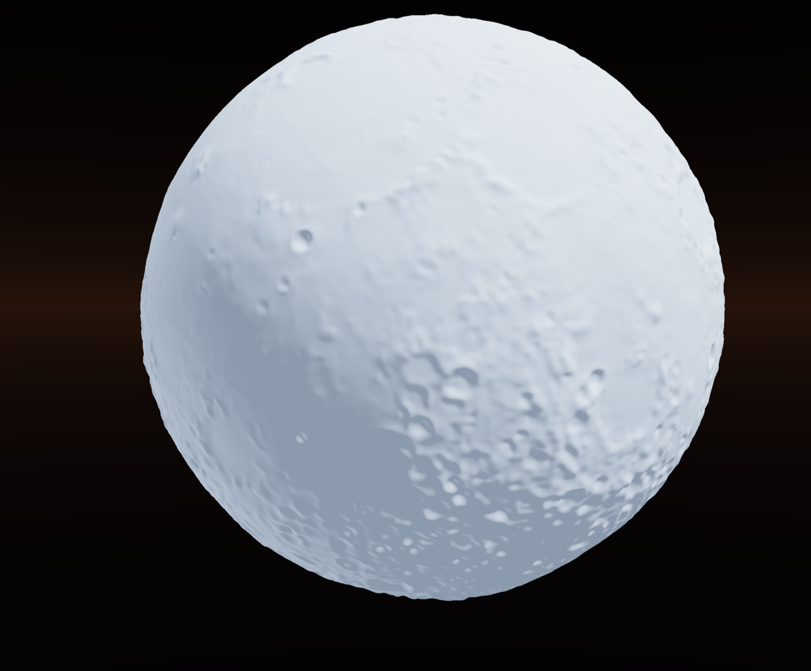
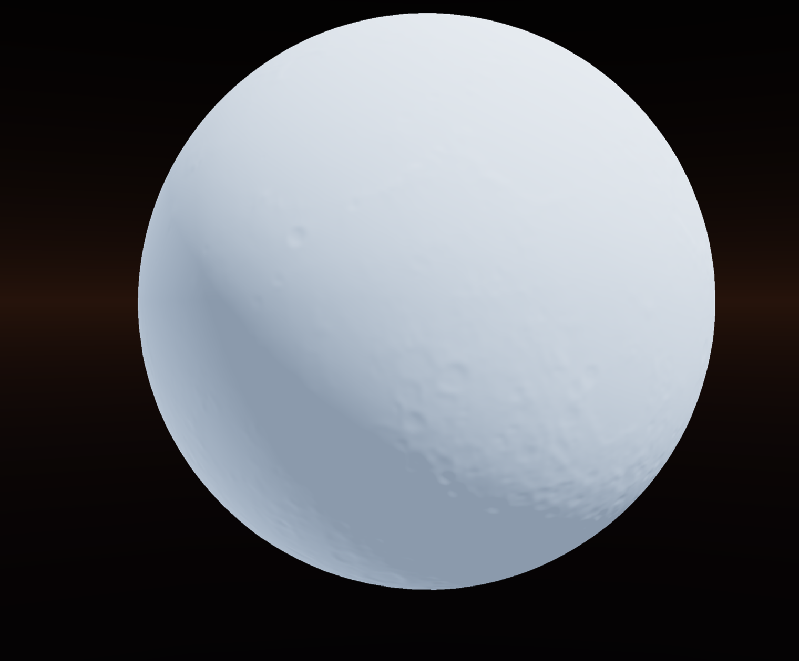
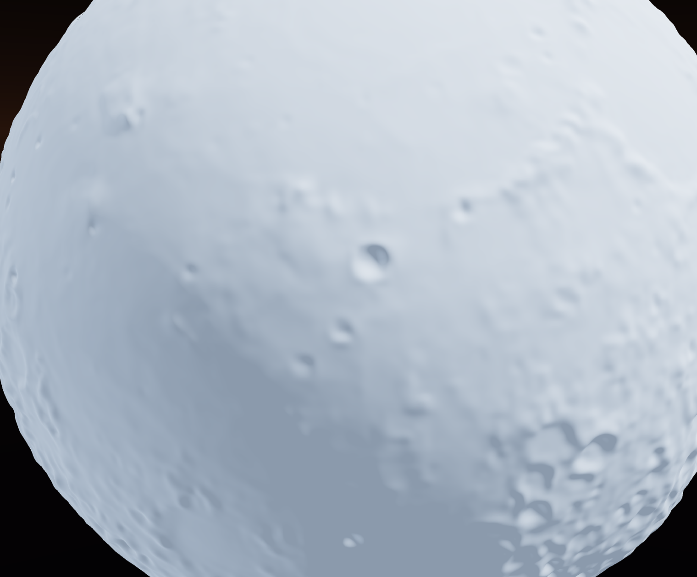
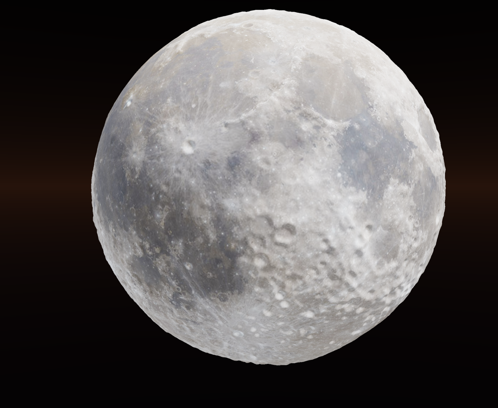
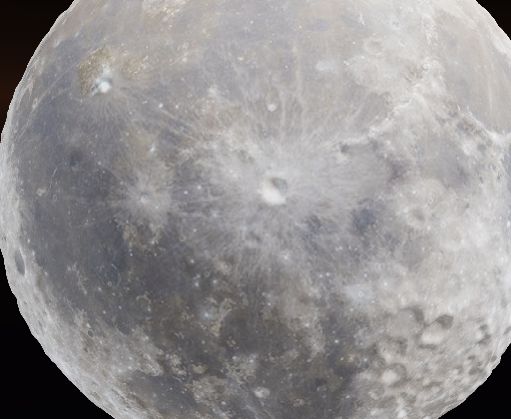

# Moon Relief Test

Displaced relief is where a mesher is most likely to break. A crater rim is a steep, narrow ridge, and exaggerating the relief makes it steeper still. The Moon is a useful test body for that reason: its elevation is mapped pole to pole and its craters are well known. The Moon relief test wraps lunar elevation onto a [clay](Workflow-Sculpt-with-Clay) sphere through a texture map, looks at the live relief, and can [bake](Workflow-Bake-an-SDF-to-a-Mesh) it at about a million triangles.

## The scene

| Part | Setting |
|---|---|
| Elevation data | The LOLA elevation maps of NASA's Scientific Visualization Studio CGI Moon Kit, at 16 pixels per degree (5760 × 2880) or 64 pixels per degree (23040 × 11520) |
| Data license | Public domain, credited to NASA's Scientific Visualization Studio |
| Layout | Equirectangular: longitude across from −180°, north at the top, heights in kilometers from a 1737.4 km sphere |
| Body | A clay sphere 100 mm across (50 mm radius); 1 km on the Moon is about 0.029 mm on the sphere |
| Displacement | A texture map in Displacement mode with the **Equirectangular** projection; the reference radius sits on the sphere's surface |
| Relief | **Scale** 4.5 mm with **Bias** at mid-gray, for a map that runs from the lowest to the highest point: the surface moves ±2.25 mm. The Moon's true relief at this size is about 0.57 mm, so 4.5 mm is about 8× |
| Detail filter | On, one cell wide |
| Bake (optional) | **Target triangles** 1,000,000 |

Kelcite neither ships nor hosts the elevation data. The maps come from [NASA's CGI Moon Kit](https://svs.gsfc.nasa.gov/4720), and each reader downloads them.

## Setting it up in the app

The scene can be built by hand in the live app. It needs an equirectangular height map as an image, which Kelcite does not supply, and the steps below assume one is on hand.

1. Place a clay **Sphere** with the [Clay tool](Tool-Create-and-Bake) (**A**) and scale it to 100 mm across.
2. Drag the height map onto empty ground in the view, away from any model. An image dropped onto a model is given a dithered palette, which reads a 16-bit map at 8 bits.
3. Select the sphere. In the Info panel's Modifiers section, click **Add Modifier**, choose [**Texture Map**](Workflow-Paint-Decals-and-Texture-Maps), and under **Image Source** choose the height map. Set **Projection** to **Equirectangular**.
4. Set **Scale** to the relief range on the sphere, times the exaggeration. The Moon's roughly 20 km of relief on a 50 mm radius is about 0.57 mm at 1×; the screenshots use 4.5 mm.
5. Set **Bias** to the gray level that should sit on the sphere's surface.
6. Leave **Detail filter** on.

The clay shows the relief live, with no bake. To get a mesh, continue:

7. Open [Bake](Workflow-Bake-an-SDF-to-a-Mesh), choose **Target triangles** and enter 1,000,000. Bake finds the cell size that reaches the target.

A height map keeps at most 2048 pixels on its longest side for meshing, and a larger image is averaged down. An 8-bit image gives the Moon's 20 km of relief steps of about 77 m, which terrace at high exaggeration. A 16-bit grayscale PNG with no image processing turned on keeps steps of about 0.3 m. A second texture map in **Color** mode can paint an albedo map onto the same sphere while the first one displaces it.

## Reading the relief

At true scale the Moon is almost smooth: the same view at **Scale** 0.57 mm shows only faint craters near the edge of the disc. Raising Scale to 4.5 mm makes craters and highlands readable on a sphere this small.

The live view samples a height map at 512 pixels on its longest side, so close-ups soften: the crater below is at the map's 16 pixels per degree, about 0.7° per pixel in the live view. Bake reads up to 2048 pixels.

## Adding the albedo map

A second texture map in **Color** mode paints an albedo map onto the same sphere while the first one displaces it. The screenshots below use the LROC color map of NASA's CGI Moon Kit (`lroc_color_2k.jpg`, 2048 × 1024, equirectangular), with **Projection** set to **Equirectangular** like the elevation map. The color adds what relief alone cannot show: the dark maria and the bright rays thrown out from young craters.

The color map is not hosted in this wiki; it comes from [NASA's CGI Moon Kit](https://svs.gsfc.nasa.gov/4720), and each reader downloads it.

## Viewing the high-resolution mesh

On an earlier test scene (a 150 mm sphere at 1×, 5× and 10×), a bake from the 16 pixel-per-degree map at the 1,000,000-triangle target takes about 18 seconds on an Apple M3 Max and produces about 981,000 triangles with 0.465 mm cells. The 64 pixel-per-degree map takes about 47 seconds and uses about 9 GB of browser memory. Both meshes are watertight. The two meshes lie 0.34 µm apart (RMS).

The baked mesh is an ordinary mesh node, so it can be orbited and zoomed like any other. Turn the ground plane and shadows off before looking at it: a sphere centered at the origin is cut at its equator by the ground, which reads as a ledge.
