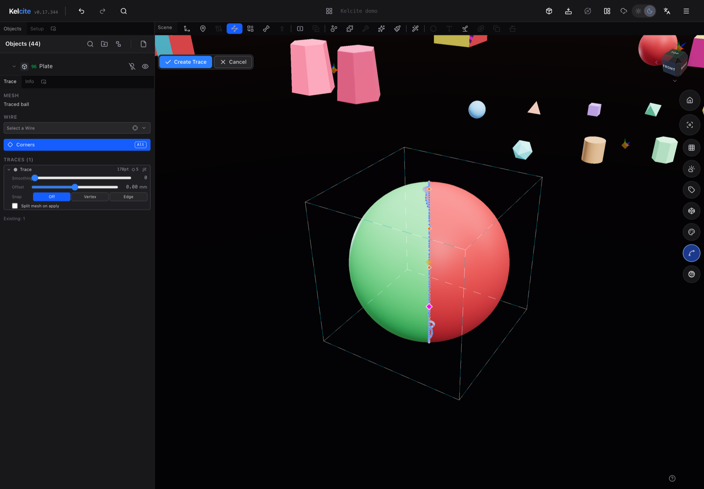

# Construction and Rigging Tools

The first group in the tool palette places things and relates them to each other: it moves objects, marks points on surfaces, measures between them, and holds parts in position. Pins are the common thread. A **pin** is an oriented attachment point on a surface, and wires, traces, constraints, text and arrays all attach to pins. **Alt+N** hides or shows every pin, wire and trace at once.

Right after an edit to a large mesh, Pin, Trace and Jig wait for the mesh to be ready for picking. The preview under the pointer appears once it is ready, and a click made meanwhile takes effect then.

| Tool | Key | What it does |
|---|---|---|
| [Move](#move) | **V** | Positions, rotates and scales the selection |
| [Pin](#pin) | **N** | Places oriented attachment points on surfaces |
| [Wire](#wire) | **W** | Connects pins with a straight or curved line |
| [Trace](#trace) | **Z** | Draws paths on a mesh surface |
| [Jig](#jig) | **J** | Sets up structural constraints |
| [Rig](#rig) | **I** | Builds a figure's skeleton and binds its meshes |
| [Pose](#pose) | **E** | Poses a rigged figure |

## Move

Move places the selection about a pivot, by gizmo or by typed values in the Tool panel.

- **V** cycles translate, rotate and scale.
- **Tab** cycles the pivot, which is listed under **Transform Origin**.
- While translating, hold **Shift** to snap to surfaces or **Alt** to snap to pins. A pin dragged with surface snap stands out of the surface along its normal.
- **W** toggles world and local space, and **U** toggles uniform scale.
- **S** toggles **Auto-solve constraints**, so constrained parts follow as you move.

Below **Transform Origin**, the Tool panel offers one-shot edits for the selection. The **Body** section's **Drop to ground** drops bodies **Onto** the ground, a plane or face, or the **Surface below**, touching by their **Bounds** or their **Surface**. The **Arrange** section's **Stack** piles bodies on each other, with the same **Contact** choice.

A body that cuts or joins another with a [Boolean modifier](Tool-Modifiers) lands on that body's surface as it is without the cut. This holds for surface snap, for **Surface below**, and for a **Surface** contact in Stack, so a moved tool does not dive into the hole it makes. A mesh that a drop or an Arrange edit lands on keeps its face groups, materials and paint where they were.

Move has nothing to apply; you click **Dismiss** or press **Space** when done.

- **Opening.** Opening the tool leaves the selection where it is, and an undo straight after opening does not move it.
- **What Move can move.** Selecting only something Move cannot move, such as a Trace or a Wire, closes the tool, and the toolbar shows Move unavailable. A selection that also holds a body keeps Move open on the body, and so does clearing the selection.
- **Rigs.** A selected rig moves, turns and scales as one body: the figure, its skeleton and its pose go together, from the gizmo, typed Position, Rotation and Scale values and the quick edits. Selecting the rigged mesh moves its rig, and each edit undoes on its own. **Drop**, **Align**, **Distribute** and **Stack** measure a rigged figure in the pose it stands in, not the shape it was bound in.
- **Groups.** Typed Position, Rotation and Scale values apply to a selected group.
- **Dragging.** Dragging a body updates only what depends on it: rigged characters, clay bodies with modifiers, hair walls, Lofts and note flags that the drag does not touch are not rebuilt, so a drag keeps up with the pointer. A rig being dragged is not posed again.
- **Pins.** A pin's red, green and blue arrows turn with it while you rotate it, and a clay body's split plane on that pin turns with it. A pin you rotated keeps its direction when you select something else with Move open.

## Pin

Pins mark where things attach. Some tools use a pin up: Text, for example, removes the pin it places its decal at. A pin's axes show which way it faces.

1. Select one or more meshes and press **N**.
2. Click a surface to place a pin. **Alt**+click snaps to a vertex, and **Shift+scroll** rotates the pin.
3. Press **N** again for **Loop** mode, which pins the center of a hole or a boss. Hover to highlight loops, then click.

**Alt+A** places a pin on every free face (**Pin Free Faces**).

## Wire

A wire measures the distance between pins and is a target for [constraints](Tool-Modifiers).

1. Press **W** and click two pins to create a wire.
2. Click more pins to extend it.
3. Use the **Tangent In** and **Tangent Out** sliders to curve each point.

The panel lists each segment's length and the **Total Length**.

A **Closed** switch in the Info panel returns the wire from its last pin to its first, so three pins or more bound a loop. A closed wire can lead a [Loft](Tool-Modifiers#loft), be the outline of Profile clay, and carry an Array all the way round it. A scene saved before this reads every wire as open.

## Trace

Trace draws paths on a mesh surface and can cut the surface along them into new face groups. Traces give [Paint](Tool-Surface-and-Refine) a smooth border to fill up to. Trace does not turn an SVG into geometry; that runs through a decal and a bake, as in [tracing an SVG to a mesh](Workflow-Trace-an-SVG-to-a-Mesh).

1. Select a mesh and press **Z**.
2. Make a path in one of three ways:
   - Click a face group to trace its border. **Loft** beside each picked group traces it and starts a [Loft](Workflow-Loft-Between-Shapes) from the outline.
   - Click a wire to lay it onto the surface, or choose one in the **Wire** picker. A closed wire gives a closed trace that follows it to a tolerance you set (0.05 mm to start). **Closest point** projects each point to the nearest surface; **Along up** casts from each point in the direction of its pins' up axes, so a loop above a concave face lands directly below it and keeps its outline. The panel names a wire with no surface along its up, and warns when the projected trace crosses itself.
   - Select pins before opening Trace to make a path through them.
3. Press **Z** again to cycle the snap mode.
4. Turn on **Split mesh on apply** to re-cut the faces along each path, and **Re-paint face groups** to recolor the regions it makes.
5. Click **Create Trace**, or press **Space**.

The border of a single named face group gets that group's name, such as "Top cap boundary". Tracing a face group's border gives one closed trace per loop, also where two of the group's regions touch at a corner. A trace snaps to the mesh's edges across seams and on an STL, and the regions it paints stop at the trace. Splitting cuts the faces on both sides of a seam alike, so the regions can be painted afterward. On a mesh with an edge shared by three or more faces, applying a trace removes the faces left over there (a fin, or a face stored twice) and keeps two parts that meet along that edge closed, the same way every time the mesh loads.

A trace's points can be **corners**, where the path turns sharply instead of curving. A trace made from a face group's outline gets a corner wherever the outline meets a different neighboring group, so the outline of a box's face has the box's four corners. Corners show as orange diamonds, and each trace in the panel shows its corner count.

- **Place or clear one:** hold **Alt** (Option on a Mac) and click a vertex, or turn on the **Corners** switch and click.
- **Tag corners:** places them wherever the trace crosses from one face group to another.

A [Loft](Workflow-Loft-Between-Shapes) divides its walls at a section's corners.

**Split mesh**, **Split all traces**, **Repaint edge** and the Create Trace split run in the background: the view keeps drawing, the body shows it is busy, and **Cancel** stops the split with the mesh as it was. Split mesh changes only the triangles along the trace and leaves the rest of the mesh as it was, so a mesh of millions of triangles splits in about the time it takes to draw the result. It no longer repairs holes, gaps and other defects far from the trace; [Repair](Workflow-Repair-a-Scan-for-Printing) handles those. A defect the cut itself reaches is still repaired, and if a repair needs more room than the split allows, Split mesh stops with the reason and leaves the mesh unchanged. A split that fails says which mesh and why.

A selected trace's Info panel reports how it sits on the mesh. **Split cache** describes what a split of the trace would use and reads **Cut into the mesh**, **Follows the nearest edges** or **Not computed**. It can read **Not computed** on a trace that a [Loft](Workflow-Loft-Between-Shapes) follows along the mesh's edges, because no split has been made. **Loop Type** reads one of four values:

| Loop Type | The trace |
|---|---|
| **Closed (single)** | Closes on itself |
| **Closed (with siblings)** | Leads round to its other end through the traces that meet it |
| **Open (with siblings)** | Touches other traces without closing a loop through them |
| **Open** | Meets no other trace |

The demo's **Trace** stop shows a path through four pins that splits a ball into two face groups.

## Jig

Jig is a wizard for constraints. Each item places the pins, wires and constraint modifiers for one task: a wire's length or direction, a pin's position, orientation or distance, or a bounding-box alignment.

1. Select a wire or pin and press **J**. Pressing **J** again adds an item from the selection.
2. Set up each item in the Tool panel.
3. Preview to run the solver, then apply.

**Anchor Orient** places a pin by a click on a surface or an existing pin, as Pin Orient does, and Preview and Apply add what its form turns on:

- **Stick to Surface**, on a plane, a mesh or a clay body, with an offset along the surface normal and **Align up to normal**.
- A **Position Lock**.
- An **Orient Lock**.

Its surface, Position Lock and Orient Lock targets are picked with the crosshair or the list, as other references are, and the offset is a slider in the display unit. The item names what is missing before Apply: no option turned on, no surface chosen, or Align up to normal beside an Orient Lock.

A pin's position constraint (Position Lock and Pin Position) and its surface snap move the pin's body to the target once, carrying the pin; Pin Distance does the same, and AABB Align moves a body's pins with it. During Preview, the pins of Pin Orient, Pin Position and Pin Distance items follow the solve, and deleting an item takes its pins and constraints out of the scene at once and solves again for the items that remain. **J** opens Jig with a pin on a mesh or clay body selected, such as the pin Apply just made, so a pin item can be added without selecting the body first.

In the demo's **Jig** stop, a bounding-box alignment holds a block on one end of a base, and moving the base moves the block with it.

## Rig

Rig and Pose let one figure print in many poses without resculpting. Rig builds a [skeleton](Architecture-Rigging-and-Pose) in three stages (**Skeleton**, **Weights**, **Test**) so the Pose tool can pose a figure. The skeleton comes from the **Humanoid** auto-rig, the **Generic** auto-rig, or joints placed by hand. A new rig stands upright in the scene, where up is Y, whatever **Up Axis** is set in Preferences. The automatic rigs treat parts that touch along an edge or across a face as separate parts, as [Part](Tool-Surface-and-Refine#part) does.

## Pose

Pose turns a rig's bones with rings or typed angles, pulls joints by IK, mirrors edits to the other side, and keys poses into animation clips on the Timeline. A posed figure becomes a printable mesh once [its pose is baked](Workflow-Rig-and-Pose-a-Character).
