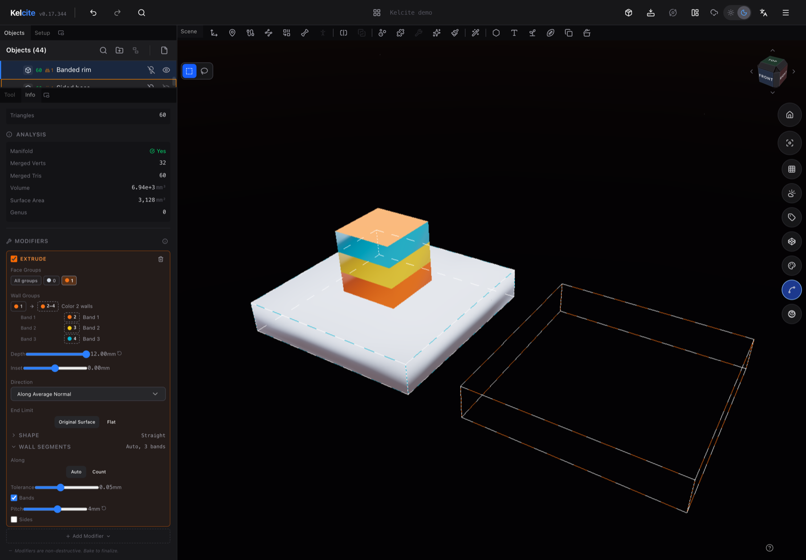
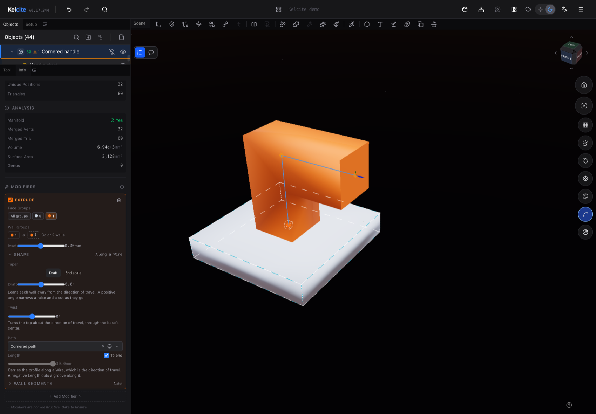

# Modifiers

A modifier changes an object without changing its underlying data, so it can be adjusted, turned off or removed at any time. Many Kelcite tools are [wizards that set up a modifier](Architecture-Tools-and-Modifiers) for you, and the Info panel's **Modifiers** section is where you adjust it afterward. [Bake](Workflow-Bake-an-SDF-to-a-Mesh) makes the result permanent.

## Working with modifiers

An object's modifiers apply in the order listed, from top to bottom.

- **See them:** select an object. Its modifiers are listed in the Info panel's **Modifiers** section.
- **Add one:** use **Add Modifier** in the Modifiers section, or search with **Ctrl+K** (Cmd+K on a Mac) for **Add Extrude modifier**, **Add Boolean modifier**, **Add Decal modifier**, **Add Texture Map modifier**, **Add Hair modifier**, **Add Lattice modifier** or **Add Loft**.
- **Limit one to a face group:** right-click a face group on the mesh, or in the Materials list, and choose **Extrude**, **Decal** or **Texture Map**.
- **Reorder:** drag a modifier's grip, or focus the grip and press **↑** or **↓**.
- **Turn one off:** uncheck it. It stays in the list.
- **Read what it does:** hover the modifier's title.
- **Undo a change:** **Ctrl+Z**. Each change on a card is one step, and a slider drag undoes as a whole.
- **Make it permanent:** Bake (**B**).

## Modifier types

Each modifier is usually made by a tool — [Combine](Tool-Cut-and-Join), [Clay](Tool-Create-and-Bake), [Jig](Tool-Construction-and-Rigging) and others — and its card in the Modifiers section keeps the tool's settings editable.

| Modifier | What it does | Usually made by |
|---|---|---|
| **Boolean** (Union, Difference, Intersect) | Joins tool shapes to this shape, cuts them out of it, or keeps only the volume they share. **Smooth** rounds the seam. | Combine |
| **Round** | Rounds this clay's edges and corners to the radius set. The clay keeps its size. | Clay |
| **Threshold** | Moves this clay's surface outward by the distance set; a negative distance moves it inward. | Clay |
| **Split Plane** | Cuts this clay at the plane through its pin, keeping the side the pin's up axis points to. | Split on clay |
| **Extrude** | Raises this mesh's face groups by the depth set; a negative depth sinks them. Draft, End scale, Twist and a Path shape the walls. | Right-click a face group |
| **Loft** | Builds a solid from a Trace, SVG, text, closed Wire or Pin through the sections after it, in order. The solid is a part of its own. | A face group's menu, or Add Loft |
| **Decal** | Projects the picture of an SVG, image or canvas onto this surface as color. | Dropping an SVG on a model, Text |
| **Texture Map** | Projects an image onto this surface and reads it as displacement, normals, density or color. | Dropping an image on clay |
| **Mask** | Clips this image to an SVG or image projected onto it; elsewhere the image is transparent. | An image's Info panel |
| **Hair** | Grows printable hair from the faces of one of this mesh's materials. Baking makes the hair separate bodies. | Hair |
| **Lattice** | Turns this mesh into a strut lattice, after its other modifiers. Baking replaces the mesh with the lattice. | Skeletonize |
| **Array** | Repeats this mesh, clay or rig's posed figure in a line, a ring or a grid, each copy changed by its variations. | Array |
| **Constraint** | Holds this node to a rule the solver keeps while things move. | Jig |

Decals, texture maps and masks are how Kelcite [puts images on a model](Workflow-Paint-Decals-and-Texture-Maps). A decal baked into face groups, then raised by an Extrude, turns a drawing [into relief](Workflow-Trace-an-SVG-to-a-Mesh).

### Booleans

A mesh's Difference, Intersect and Union show the result Bake will write, face for face. The faces a Difference cuts, a Union adds or an Intersect keeps from a tool take the tool's material, and Bake and export keep it there as one of the mesh's materials. On clay, a body cut, joined or intersected by a tool shows the tool's color where the tool shapes it. A boolean on a mesh that is not a closed solid is left out: the mesh shows without it, with a message saying why, as Bake would leave it. [Repair](Tool-Surface-and-Refine#repair) can close such a mesh. While you move a tool on a large mesh, the previous cut stays drawn until the new one is ready.

### Extrude

While you drag **Depth** or **Inset**, the view follows the drag, and letting go builds the final mesh. The **Wall Groups** rows on the card, in the Info panel and in the Hair panel update when you let go. Bake gives the result the preview shows, on a mesh with seams and on an STL alike.

Walls that rise straight are the exception on a printed part: a drafted wall releases from a mold, a twisted one grips, and a bent one makes a handle. A **Shape** section on the card leans, turns or bends the walls:

| Setting | Effect |
|---|---|
| **Draft** | Angles the walls from the direction of travel, up to 60° either way. A positive angle narrows a raise as it rises and a cut as it goes in; a negative angle widens it. |
| **End scale** | Sizes the top as a share of the base instead of an angle. |
| **Twist** | Turns the top about the direction of travel, up to two turns either way, and the walls follow in a spiral. Along Normals has no single direction to turn about, so Twist is off there. |
| **Path** | Sweeps the faces along a Wire, so a handle grows from a face and bends as the Wire does. |

A large draft on a small face would fold the top over. Kelcite holds the Depth short of the fold instead, and a line under Depth says how far.

**Add Sweep**, in the tool search and in a Trace's or an SVG's **Add Modifier** menu, carries the selected section along the selected open Wire as a body of its own, from where the section is to the Wire's end. Text, SVG shapes and Traces all sweep. A Trace on a part keeps its weld, so a channel swept into a case combines into it as a Difference. A Sweep that stays clay is described under [Sweep](Workflow-Sculpt-with-Clay#sweep).

**Wall segments** places the rings that carry a twist or a bend. **Auto** adds as many as keep the walls within a **Tolerance** of the true curve (0.05 mm to start), and **Count** sets the number. Dragging Depth, Draft, End scale or Twist moves the walls as you drag, on a mesh of a million triangles.

**Bands** and **Sides**, in the same section, divide the walls into wall groups of their own, so a rim can print in stripes or one side of a boss can take another color. Bands divides the walls into equal bands along the travel, at most one **Pitch** each; Sides divides them at every corner sharper than an **Angle**. With Bands on, the rings are placed so each band is a whole number of rings, and the card says when that raises a Count you set. The **Wall Groups** section lists a row for every side and band, with its number, its name and a color that sets the walls' material for that segment alone; a segment without a color of its own draws in its group's walls. Bake writes each segment into the mesh with the material the view drew, and a band or side can be picked as a [Hair](Workflow-Hair-and-Strands) region once the Extrude is baked. 

The demo's **Extrude bands** stop shows a rim in three bands and a boss with two colored sides.

With a Path set, the Wire is the direction, so Depth, Direction and End Limit give way to a **Length** along the Wire. Length runs to the Wire's end by default, and a negative Length cuts a groove. A sharp corner in the Wire, a pin with no tangent weight, takes a miter.

Where the Wire turns tighter than the profile is wide, the sweep is still built. Each fold is marked on the Wire in the print-warning color, and the card lists where along the Wire it sits.

**New wire from faces** starts a path for you. It places two pins at the faces' center and one face-width above, joins them with a Wire and picks it as the path; the Wire tool bends it from there. One undo covers all of it.

### Loft

A Loft turns a series of outlines into one solid: a Trace, an SVG or text, a closed Wire or a Pin leads it, and the sections after it are the outlines it passes through. The solid is a part of its own, which draws beside the node that carries the Loft, exports as a separate part, and Bake turns into a mesh that moves on its own.

| Setting | Effect |
|---|---|
| **Add Section** | Picks the next outline, including a mesh's face group, whose outline is traced for you. |
| **Blend**, **Twist**, **Tolerance** | **Ruled** or **Smooth** walls, the turn between each pair of sections, and how finely a curved span is cut into rings. |
| **Take-off**, **Strength**, **Start** | The direction each section leaves along, how far it keeps going before it bends, and where one outline meets the next. |
| **Matches** | Which point of one section meets which point of the next. |
| **Combine into** | Joins the body to the mesh its Trace is on, as a Union or a Difference. |
| **Tag corners for face groups**, **Groups** | Divide the walls into face groups, each with its own color. |

[Loft Between Shapes](Workflow-Loft-Between-Shapes) walks through each of these.

The card names the nodes it uses (sections, tool bodies, an outline) as gray chips that light the node in the viewport on hover or keyboard focus. What a build found reads as one line with an icon: a note, a warning (the result holds with something given up) or an error (nothing was built).

### Decals and texture maps

Hovering a Decal card outlines its projection on the surface. A **Wrap (LSCM)** projection, on a Decal or a Texture Map, is solved again after any edit to its mesh or face groups, such as Orient turning a few faces. Where a decal's wrap cuts a seam through the mesh's own seam or an STL's triangles, each side of the cut stays with the faces it belongs to.

A Texture Map's displacement and normal maps keep the mesh closed along its seams and its hard edges, as [Paint, Decals and Texture Maps](Workflow-Paint-Decals-and-Texture-Maps) describes. A decal or texture map whose preview cannot be made shows the reason on its card. A texture map or color map whose image holds no pixels fails Bake with that reason in an alert, and export with the reason in the Export dialog. A Mask whose chosen target image cannot be read still takes the target, and warns, with a link to the image, why it kept its source.

### Array

An Array stands in the scene's own frame, where up is Y, whatever **Up Axis** is set in [Preferences](Workflow-Keyboard-Shortcuts-and-Preferences); that setting says only how STL files are read and written. An array made in an older document while Up Axis was Z can open with its copies tipped a quarter turn onto their side, and an **Upright** one stands along the vertical. **Flip** and **Turn**, under **Orientation** on the Array card, stand the copies back.

## Constraints

Constraints keep parts in relation while you move them. Jig sets most of them up; **Add Constraint** in the Modifiers section adds one by hand.

| Constraint | Rule |
|---|---|
| **Position** | Holds this node at a target point, axis or plane. |
| **Orientation** | Holds this pin's orientation to a target direction, a wire's end or another pin. |
| **Distance** | Holds this pin at the distance set from a target. |
| **Surface** | Moves this pin to the nearest point of a surface, at the offset set. |
| **Centroid** | Holds this node's centroid at a target point. |
| **Wire Length** | Holds this wire at the length set. |
| **Wire Orient** | Keeps this wire collinear with, parallel to or perpendicular to a reference. |
| **Wire Lerp** | Places this pin at a fraction of the way along a wire. |
| **Pin Joint** | Lets this pin turn only around an axis. |
| **Ball Joint** | Holds this pin at a point and leaves it free to turn. |
| **Bracket Pos**, **Bracket Rot**, **Bracket Scale** | Keep this node's position, rotation or scale between the minimum and maximum set. |
| **AABB Align** (bounding-box alignment) | Lines up this node's bounding box with a target's, axis by axis. |
| **Collision** | Moves this node so its bounding box overlaps the targets', or stays clear of them. |
