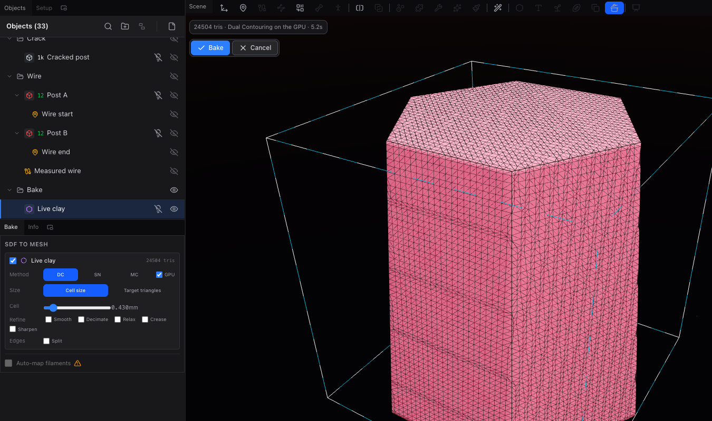

# Bake an SDF to a Mesh

A print file holds only triangles, and much of what Kelcite edits has none yet. [Clay](Workflow-Sculpt-with-Clay), Extrude, displacement, decals, hair, lattices and arrays are all live: Kelcite [recomputes them from their settings](Architecture-Geometry-Engine) each time they change. **Baking** turns them into an ordinary triangle mesh that a slicer can read. It trades editability for a fixed mesh, so it belongs at the end, once the shape is final — or on a copy, with the unbaked original kept.

## Running Bake

Bake works on the selection: the clay, or the mesh that carries live [modifiers](Tool-Modifiers). Its Tool panel shows one card for each operation that will be baked, each with its own settings and preview, and the clay's card is **SDF to Mesh**.

1. Select the objects to bake.
2. Press **B**, or click [Bake](Tool-Create-and-Bake) in the tool palette.
3. On the **SDF to Mesh** card, choose a **Method**. Its buttons carry the method's initials, and hovering one shows the full name:

   | Button | Method | Description |
   |---|---|---|
   | **DC** | Dual Contouring | Best all-around quality, sharp features and smooth curves |
   | **SN** | Surface Nets | Smooth meshes, fast and simple |
   | **MC** | Marching Cubes | Classic approach, uniform voxel grid |

   The **GPU** checkbox beside the buttons runs the method on the graphics card, where the browser has WebGPU.
4. Choose a **Size**. **Cell size** sets the largest cell the mesh may have, and a smaller cell gives more detail and more triangles. **Target triangles** sets the most triangles the mesh may have instead; Bake meshes the clay a few times to find the cell size that comes closest without going over, and shows the count and cell it reached. While the **Cell** slider is dragged, the preview stops meshing each position the slider leaves, so the position it stops on appears sooner.
5. Set **Detail** if the clay carries displaced relief. Where the relief varies by more than this across a cell, the cell is split, up to two levels finer. At 0 the mesh is even.
6. Turn on any clean-up passes the card offers, such as **Smooth**, **Relax**, **Decimate**, **Crease** or **Sharpen**. Hovering each shows what it does.
7. Check the preview, where a purple grid shows the volume being meshed.
8. Press **Space**, or click **Bake**.

A selection with nothing live gives **"No bakeable operations on selection"**. A target below what the shape can be meshed with gives **"No cell size gave N triangles or fewer in M meshes."**, followed by the fewest triangles reached, which is what Bake then makes; raising the target clears it.

The status line above the view gives the preview's triangle count, method and time. A GPU method falls back to the CPU when the graphics card cannot mesh the clay, and the status line then says why:

- **Meshed on the CPU: WebGPU is not available in this browser.**
- **Meshed on the CPU: the clay nests deeper than the GPU evaluates.**
- **Meshed on the CPU: the mesh needs buffers past this device's GPU limit.**
- **Meshed on the CPU: the GPU ran out of memory for this mesh.**
- **Meshed on the CPU: the GPU reported an error while meshing.**
- **Meshed on the CPU: the clay has nothing for the GPU to mesh.**

A decal or texture map whose preview cannot be made shows the reason on its card. A texture map or color map whose image holds no pixels is not baked, and an alert gives that reason. When a decal's **SVG sampler** is NanoSVG and NanoSVG cannot read the SVG, the card shows the reason, and Bake skips that decal with an alert that links to the mesh and the SVG. The **DOM** sampler reads the SVG the browser's way.

## What each live object becomes

Each clay node is replaced by a mesh. The demo's **Bake** stop shows a clay shape next to its baked mesh of 19,276 triangles. With every modifier turned off, baking clay that came from **Convert to Clay** returns the original mesh. A large baked mesh shows as a soft fog for a moment, in the space it will fill, until it is first drawn.

A mesh's Difference, Intersect and Union bake to the result the view shows, face for face, and an Extrude bakes as its preview shows it: the same triangles the viewport draws, where Bake used to rebuild the extrusion through a separate boolean and give a mesh with more triangles (47% more on a sphere's raised cap). An Extrude whose new faces cross the surface still bakes through the boolean. The faces a tool cuts or adds keep the tool's material, which joins the mesh's materials. A boolean that cannot be computed — most often because a mesh in it is not a closed solid — leaves the mesh unbaked, with its modifiers kept and an alert that gives the reason.

A baked clay keeps the names of its face groups (Top cap, Side 1, Side 2 and so on, Bottom cap), and Paint, Trace, the Inspector's Materials, the face group menu and the modifier cards show the names instead of numbers. The names show in the language Kelcite runs in, and a saved file keeps them. Baking a mesh's modifiers writes its booleans and extrudes into the mesh and keeps its decals, texture maps, masks and constraints. A selection whose only modifiers are constraints does not open Bake, which has nothing to bake there; a constraint beside a Boolean stays off the Boolean's card, and stays on the body after the bake. **Dual Contouring** keeps sharp ridges thinner than a cell, such as a star's points, as straight creases where they run across the grid, and the **Crease** option works on a Sweep's twisted or curved ridges.

| Live object | After baking |
|---|---|
| Clay color map | Vertex colors |
| SVG decal | [Face groups](Workflow-Paint-Decals-and-Texture-Maps) shaped like the SVG |
| Decal drawn from an image | Stays a decal |
| [Hair](Workflow-Hair-and-Strands) | Separate meshes of strands; the surface it grows from is unchanged |
| [Loft](Workflow-Loft-Between-Shapes) | A mesh that moves on its own, with a material for each wall and cap |
| Lattice | The strut mesh replaces its body |
| Posed [rig](Workflow-Rig-and-Pose-a-Character) | An ordinary mesh that keeps the pose |
| Array | One node per copy, in a group where the original stood |

A selected Loft's Trace, or the body its first section lies on, lists the Loft in the Bake panel. Its chip can combine the baked Loft with the body its first section lies on, with the body its last section lies on, or with both, and **Consume Traces** deletes its section Traces; all three start off and Bake remembers the last choice. [Loft Between Shapes](Workflow-Loft-Between-Shapes#baking-a-loft) has the details.

A hair that produces no strands — because it has no wall, or no strand reaches one — is left in place rather than baked.

A posed rig's card sets what becomes of its meshes under **Meshes**:

| Meshes | Result |
|---|---|
| **Keep separate** | Each mesh stays its own mesh, in the pose |
| **Union closed meshes** | The closed meshes are joined into one; meshes that are open stay out of the union, and an alert names them |
| **Make solid** | One solid from every mesh, by **Remesh** (one closed surface at the **Resolution** set) or **Patch and union** (each hole capped flat, then the meshes unioned) |

A mesh with a hole, a flipped face or a fin counts as open, and [Repair](Tool-Surface-and-Refine) can close it first. **Patch and union** gives two holes that meet at a single corner a cap each.

## Tuning the result

Cell size and **Detail** set the baked mesh's resolution. A baked mesh with too many triangles calls for **Target triangles**, a larger **Cell size**, or simplifying afterward with [Refine](Tool-Surface-and-Refine) (**T**). Fine relief that came out blocky or folded calls for a smaller cell size or a higher **Detail**; for a displacement map, the map's **Detail filter** should stay on.

With **Smooth** or **Decimate** on, a Dual Contouring bake can differ slightly from the mesh an earlier version of Kelcite baked from the same clay. Bakes without them come out the same.
