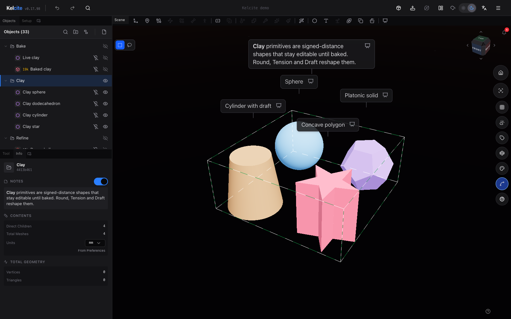
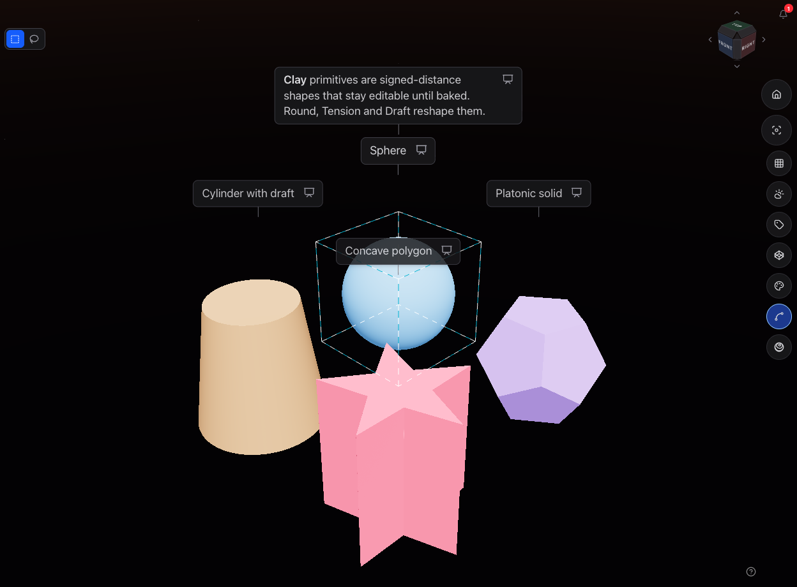

# Getting Started

Kelcite is a 3D modeling app for people who print what they make, and it runs in the browser at [kelcite.app](https://kelcite.app) with no installation or account. Everything it does happens on your computer, and your files stay in [your browser's storage](Architecture-Storage-and-Privacy). Once the page has loaded, it also works offline. A desktop browser is enough; a mouse with a middle button or wheel makes navigation easiest.

## The demo tour

The quickest way to see what Kelcite does, before you bring in your own files, is the demo scene — a tour of every tool, with a model for each one. On the start screen, you click **Click here to open the demo scene to learn more about Kelcite…** at the bottom right; from the document list, the same link reads **Open the tour**. The **Demo** entry is the last item of the **File** menu, and searching for Demo with the tool search opens it too. The tour is not saved as one of your files: an edit to it offers **Save a copy**, and the copy is yours. The arrows in the tour overlay step between stops, and each stop frames a model, selects it and shows a caption. Clicking the demo icon on a flag over the scene jumps straight to a stop. The tour's Interface stops point out where the file, settings, help, search, view, panel and library controls are.

The **×** at the top right of the tour overlay (**Hide demo**) hides the tour and leaves nothing over the view. To bring the controls back, you select the demo node in the Objects panel and click **Show demo** in its Info panel.

## Moving the view

The camera answers to the mouse and a few keys.

| Action | Input |
|---|---|
| Orbit | Right-drag |
| Pan | Middle-drag |
| Zoom | Mouse wheel |
| Reset the view | **H**, or the Home button |
| Frame the selection | **F**, or the target button |

The view cube turns the camera to look at one side. While you orbit or zoom, a diamond marks the point the view turns about. The options for this pivot, and **Trackpad Pan** for two-finger panning, live in [**Preferences → Controls**](Workflow-Keyboard-Shortcuts-and-Preferences).

Some work makes the view wait a moment, and Kelcite marks the wait. The 3D view can stop drawing while the graphics card compiles shaders, so **Preparing shaders — the view may pause briefly** shows at the top left of the view until the compiles are done. A large mesh that has just appeared, as after a Bake or an undo, shows as a soft fog in the space it will take until it is drawn. A click or hover on a large mesh that is not yet ready to be picked takes effect, where you made it, once the mesh is ready.

## The panels

Three panels carry most of the work beside the canvas.

| Panel | What it shows |
|---|---|
| **Objects** | The [scene](Architecture-Scene-Model) as a tree. Its **File** menu creates, opens, saves, imports and exports. |
| **Info** | The selection: its notes, transform and [modifiers](Tool-Modifiers). |
| **Tool** | The controls of the tool that is open. |

The tool palette sits at the top left. Hovering over a tool's icon shows what the tool does, with a picture and its key. The **?** at the bottom right lists the keyboard shortcuts, and the menu at the top right opens **Preferences**, **Keybindings** and **About**.

The version shows beside the Kelcite name at the top left and in About. A fix released between two versions has a fourth number, as in 0.17.3.1. A preview or test build adds the branch and commit it was built from, as in **v0.17.3 · dev@1a2b3c4**; kelcite.app shows the version alone.

## Selecting objects

A tool works on the selection, so selecting comes before almost everything else. You click an object in the scene or in the Objects panel to select it, and Shift-click or Ctrl-click (Cmd-click on a Mac) to add or remove one. Dragging with the left button across the scene draws a selection band; **'** (apostrophe) switches the band between a box and a lasso, Shift adds to the selection and Alt takes from it. **Escape** clears the selection — while a tool is open, Escape cancels the tool first.

A selected object is outlined by its selection box, bright cyan around one body and green around a group, in light and dark mode.

In a large scene, **Ctrl+F** (Cmd+F on a Mac) searches the Objects panel by name. The arrow keys move through the matches, and Enter selects the match and frames it.

## Running a tool

Most tools [preview their change](Architecture-Tools-and-Modifiers) before it is applied, so you can adjust a result before it touches your model. Running one takes four steps.

1. Select the object the tool should work on. Some tools treat the first object you selected as the target.
2. Open the tool from the palette, or press its key. **Ctrl+K** (Cmd+K on a Mac) searches tools and commands by name or by what they do.
3. Adjust the result in the Tool panel or directly in the scene. The status line at the top left says what the tool expects next.
4. Press **Space**, or click the blue button beside the status line, to apply. The button names what the tool does, such as **Apply**, **Bake** or **Create**, and **Cancel** leaves without changes.

Tools that have nothing to apply, such as [Move and Pin](Tool-Construction-and-Rigging), show **Dismiss** instead. Some tools need a particular selection and do nothing on any other: [Repair](Tool-Surface-and-Refine), for example, opens only on a mesh that is not manifold. When an icon seems dead, the status line says what is missing.

**Ctrl+Z** undoes, and **Ctrl+Shift+Z** (Mac) or **Ctrl+Y** (Windows and Linux) redoes. Each change in the Info panel is one undo step, and a slider drag undoes as a whole; adding, renaming, hiding and removing layers, and renaming objects in the Objects panel, undo too. Kelcite keeps your documents in this browser; Save, in the File menu, also writes the scene to a `.glb` file, which is Kelcite's own document format. If the panels end up in the wrong place, **Reset Panel Layout**, found with Ctrl+K, puts them back.

From here, most work starts by [importing a model](Workflow-Import-and-Export) or by [placing clay](Workflow-Sculpt-with-Clay), and ends by [preparing the result for a printer](Workflow-Prepare-for-Printing).
