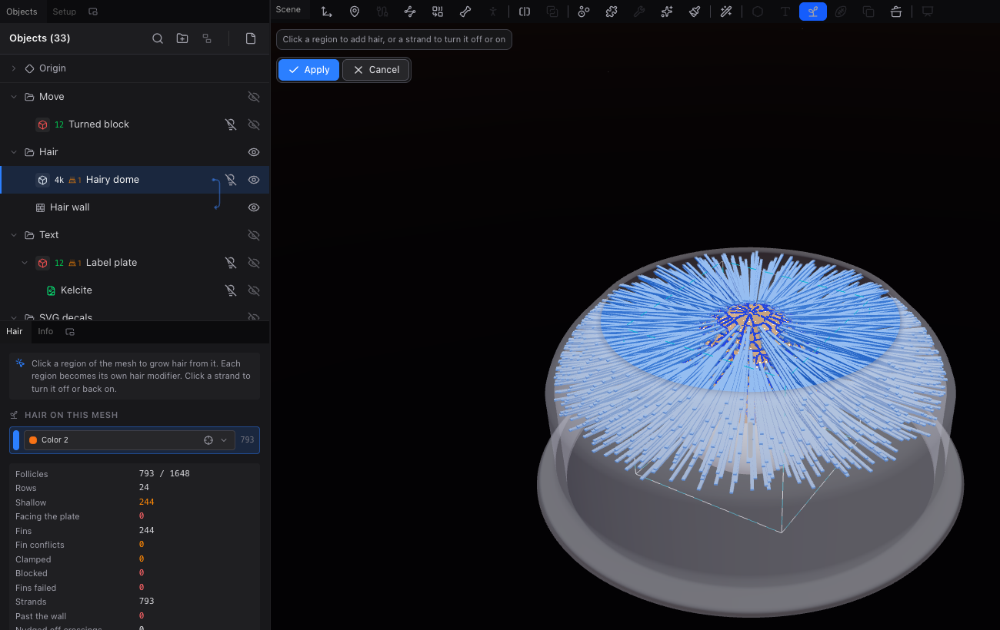
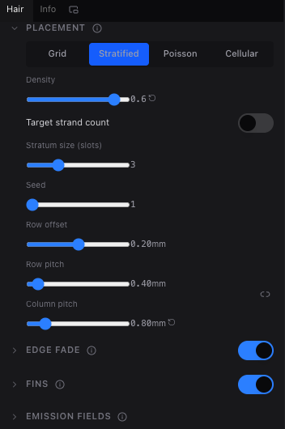

# Hair and Strands

Kelcite grows hair, fur and bristles for a printer rather than a renderer. Each strand runs from a colored region of the model out to a **wall** — a surface that holds the strand tips so the printer can bridge them. Kelcite checks strand spacing, width and the places where strands cross against what a slicer can print, and flags the strands that would fail.

Hair grows from a face group, so the region it grows from must first be [painted as its own face group](Workflow-Paint-Decals-and-Texture-Maps) on the mesh.

## Add hair to a region

The Hair tool is a wizard that adds a Hair modifier to the mesh.

1. Select the mesh and press **Y**.
2. Click the color region the hair should grow from. Kelcite adds a Hair modifier, with strands from the region out to a wall.
3. If the mesh has several Hair modifiers, press **Y** again to cycle through them. **M** cycles the surface preview.

## Strand placement

The **Placement** strategy decides where strands stand on the region, and so how the hair reads once printed. Hovering a tab shows a picture of its layout.

| Strategy | Layout | Suits |
|---|---|---|
| **Grid** | Rows at fixed heights, columns a pitch apart. No seed: the same settings always give the same layout. | Bristles, pile, repeating textures |
| **Poisson** | Random, but no two strands closer than **Minimum spacing**. At high density it places fewer strands than the others. | Natural-looking hair that prints without fusing |
| **Stratified** | Blocks of about **Stratum size** slots, each filled at random. | Fur that looks random without bare patches |
| **Cellular** | Clumps with bare gaps. **Iterations** sets clump size, and **Clumping** sets edge sharpness from 0 (scattered) to 1 (hard-edged). | Tufts, patchy fur, moss, grass |

**Density** sets how many strands grow. **Seed** picks a different random layout for the strategies that use one.

## Walls

A strand needs a wall to end on, so a hair without one builds no strands. The **Walls** section lists the hair's walls, and **Add wall** creates one or reuses one:

- A new **Hull** wall stands a set distance outside the whole body, seen from above. It is the default. New hull walls start split, leaving a gap so the wall does not close into a ring around the part.
- **Existing wall…** reuses a wall another hair already has.
- **Surface…** uses a mesh in the scene as the wall. You click one of its faces to start on that face's group. **Target faces** limits it to some groups, and **Share** weights how much of the hair it takes.

Each wall's row counts the strands that landed on it. In the demo, the **Hair** stop shows a dome with a hull wall, and the **Hair surface wall** stop shows a cube of hair parted between two smaller cubes.

## Shaping strands for printing

A strand's cross-section and its two ends decide whether the slicer can build it. Each section of the hair settings has an info button that explains it.

| Setting | What it is for |
|---|---|
| **Strand width** | Each strand's cross-section. |
| **2-lane strands** | Prints each strand as two side-by-side lanes, twice the width, so the slicer bridges it in both directions. On for new hair. |
| **Strain relief** | A cone where the strand leaves the surface. **Strain relief buried depth** sinks it into the model to anchor the strand. |
| **Wall cone** | A cone where the strand meets the wall. |
| **Minimum gap** | Strands in one layer closer than this are flagged, since they would likely fuse in the slicer. |

Flagged strands show where printing will fail: strands too close together, crossings without enough clearance, or strands that reach no wall. You turn off an unwanted strand by clicking it in the scene.

## Applying and baking

Pressing **Space** applies the hair setup, which stays live as a modifier. [Baking the mesh](Workflow-Bake-an-SDF-to-a-Mesh) turns the hair into printable meshes. Each hair becomes its own mesh of strands, and the surface it grows from is unchanged. A wall is baked once every hair that uses it is baked.

Kelcite remembers hair settings, so the next hair starts from your last choices.

## Common problems

| Symptom | Cause and fix |
|---|---|
| No strands appear | The hair has no wall, or no strand reaches it. Add a wall, or move it closer. |
| A strand shows a red follicle | It reaches no wall. It is counted under **Reaching no surface wall**. |
| Strands fuse in the slicer | Lower **Density**, switch to **Poisson**, or raise **Minimum gap** to find the problem strands. |
| A surface wall gets no strands | Its row says why: it is behind the hair, hidden by another mesh, farther than the maximum length, at no height the hair reaches, or seen from behind. |
| Bake leaves a hair in place | A hair that produces no strands is not baked. Fix its wall first. |
