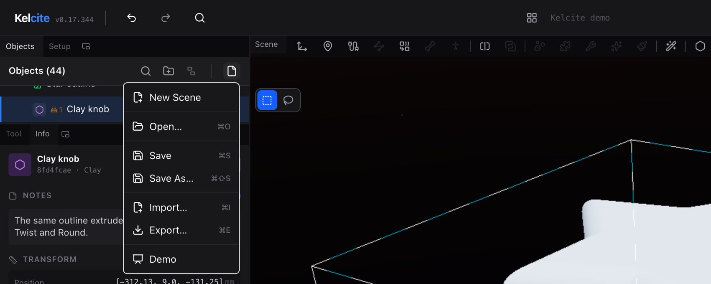
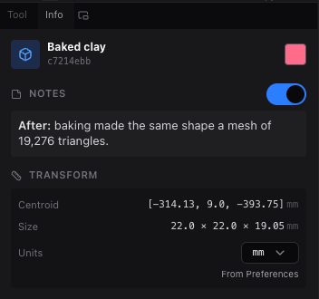

# Import and Export

A model's size depends on what one number in its file means. Some formats say (3MF, STEP), and some do not (STL, OBJ, PLY). Kelcite reads each file in the [unit it declares](Architecture-Units-and-Files), or in a unit you set for files without one, so an imported part lands at its real size.

## Formats

| Direction | Formats |
|---|---|
| Import | STL, 3MF, OBJ, PLY, glTF and GLB, FBX, STEP (`.step`, `.stp`), DAE, 3DS, AMF, and other formats the Assimp library reads |
| Import by drag and drop | Also SVG files and images |
| Export a scene | 3MF, STL, OBJ, GLB, FBX |
| Export selected images | PNG, JPEG, WebP |

GLB is Kelcite's own document format. A GLB written by Kelcite keeps [clay](Workflow-Sculpt-with-Clay), [modifiers](Tool-Modifiers) and [rigs](Workflow-Rig-and-Pose-a-Character) live when Kelcite opens it again.

STEP import is an optional download, because its component is too large to ship with the app. You open **Downloads** from the download button beside the Asset Library, from the start screen or from the document list. Once downloaded, it works offline.

## Units

The unit settings decide how every later import and export is read and written, so they are worth setting before the first import. They live under **Units** in **Preferences**, which the menu at the top right opens.

| Setting | What it says |
|---|---|
| **Scene Units** | What one of the scene's numbers is (mm, cm, m or in) |
| **Files Without Units** | What one number is in an STL, OBJ or PLY file — imports are read in it and exports are written in it |
| **Display Units** | The unit the panels show lengths in; **Alt+U** cycles it without opening Preferences |

## Importing

You import by dragging a file onto the Kelcite window, or by choosing **Import…** from the **File** menu in the Objects panel (**Ctrl+I**, or Cmd+I on a Mac). **Load Scene** is a grid button at the top, left of the scene's name, that lists your scenes to load; it is no longer in the **File** menu. During a large import, the loading screen lists each step as it runs. A notice appears afterward if the file held anything this version could not bring in, and it says what.

Kelcite checks each imported mesh and changes none of them on its own. A mesh that is not a closed solid gets a not-manifold notice, which can offer **Repair now**. [Repair a Scan for Printing](Workflow-Repair-a-Scan-for-Printing) explains the notice and the repair.

Some files bring more than their geometry, or come in with a warning.

| File | What Kelcite does |
|---|---|
| A model 3MF | Adds its filament profiles to the document, reusing any it already has, so its materials link to [filaments](Workflow-Manage-Filaments) that exist |
| A 3MF whose component names a part missing from the file | Opens without that component, with a warning that gives the part's path and the object that referred to it |
| A glTF or GLB that Kelcite's own reader cannot open | Tries the Assimp reader. When Assimp opens it, a warning gives the first reader's error, because the file's materials, rig and extensions may be missing |

Dropping a file onto a model changes what it becomes. An SVG dropped onto a model becomes a [decal](Workflow-Paint-Decals-and-Texture-Maps) on that surface; dropped anywhere else, it stands on the ground. An image dropped onto clay becomes a displacement map.

## Checking a model's size

Each model carries a **measure** — the unit its numbers are read in — and the **Units** row in the Info panel shows it, with where that measure came from. When a model comes in at the wrong scale (typically 25.4 or 10 times too large or small, because the file's unit differs from **Files Without Units**), you pick the unit its file was really written in. Kelcite rereads the model's numbers in that unit and resizes nothing until you commit. **Commit** then multiplies the model's numbers into the scene's unit.

## Exporting

Export writes the selection, or the whole scene when nothing is selected. You choose **Export…** from the **File** menu (**Ctrl+E**, or Cmd+E on a Mac), pick a **Format** and a **Filename**, set the format's options and click **Export**.

| Option | Effect |
|---|---|
| **Combine all objects into one file** | Writes one file; off, Kelcite downloads one file per object |
| **Compress the file** | 3MF only, on by default; makes the file about a seventh of the size |
| **Include bake snapshot to maximize compatibility** | GLB only; adds baked copies of clay, hair and lattices for software that cannot read Kelcite's live data |

STL and OBJ files are written in the **Files Without Units** setting. Every file Kelcite exports names the Kelcite version that wrote it. Export welds corners that coincide by rounding every coordinate to the nearest 0.0001 of the file's unit, so two copies of one point that differ only in the last digit become one vertex. An OBJ export downloads its `.mtl` and texture files as separate files, so the browser may ask to allow several downloads. 3MF and OBJ carry materials, and 3MF can also carry [filament assignments](Workflow-Manage-Filaments).

STL, 3MF and OBJ hold triangle meshes, while clay, Extrude and displacing texture maps have no triangles until they are [baked](Workflow-Bake-an-SDF-to-a-Mesh). The Export dialog refuses them, explains why and opens Bake on them. You can bake and export again, hide those objects, or export GLB to keep them editable.

### Normals

Normals decide how smoothly another app shades the surface. FBX and OBJ export write the normals an imported file brought, as they are, until an edit changes the mesh or its normals. They write every other mesh with the normals the viewport shades with, where a vertex between two face groups takes each group's normal. A saved document keeps computed normals, so a mesh reopened from one exports the viewport's.

A rigged model exports with the normals **Recompute normals** stores: its GLB shades smooth across texture seams, and its STL shades smooth.

### From the document list

The document list exports a document without opening it: **Download .glb**, **Export mesh** for 3MF, STL or OBJ, and **Download All**, a ZIP archive of every document. A failed export, or a document with no saved scene, shows a banner above the list that names the document and gives the reason. **Download All** lists the documents it left out of the archive, and makes no archive when none can be exported.

## When an import or export fails

| Message or symptom | Cause and fix |
|---|---|
| **"Kelcite doesn't recognize this kind of file."** | The format is not supported. Convert it to STL, 3MF, OBJ or GLB in another app. |
| **"It is too large for the memory this browser gives Kelcite."** | Try a desktop browser with more memory available, or reduce the model first in the app that made it. |
| **"It was saved by a newer Kelcite than this one."** | Open the Kelcite name at the top left, then **About Kelcite → Check for updates**. |
| A 3MF fails with the parser's reason | A model part of the file cannot be read, including a part another part refers to. Export the file again from the app that made it. |
| A 3MF reports that the browser ran out of memory | The file is too large to scan in this browser. Try a desktop browser with more memory available, or reduce the model in the app that made it. |
| A 3MF fails with a missing path in its reason | The file holds nothing but components that name parts missing from it. |
| **"GLTFLoader could not read the file (…), so Assimp opened it; its materials, rig and extensions may be missing"** | Kelcite's glTF reader refused the file, and the second reader opened what it could. Check the materials and rig, or export the file again from the app that made it. |
| **"“…” was not exported as …: …"**, in a banner above the document list | That document's export failed for the reason given. Fix what the reason names, then export again. |
| A texture map or color map fails because its image holds no pixels | Bake reports it in an alert and the Export dialog in its message. Choose an image with pixels for the map, or turn the map off. |
