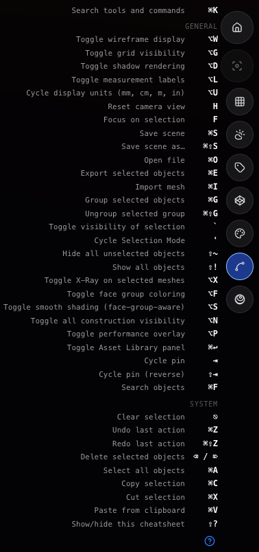
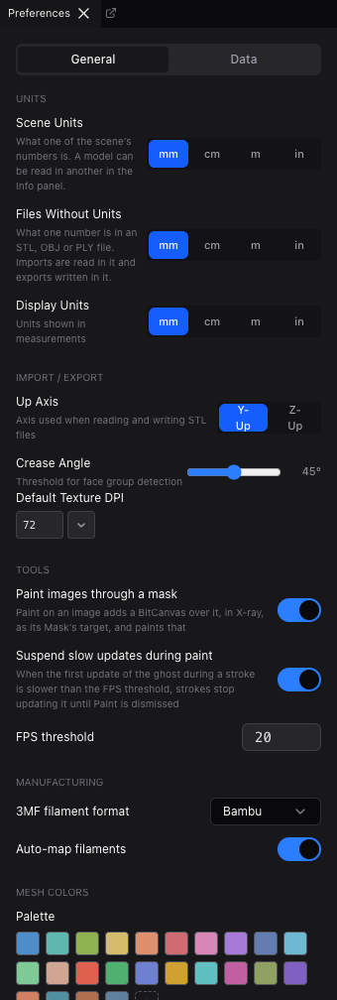
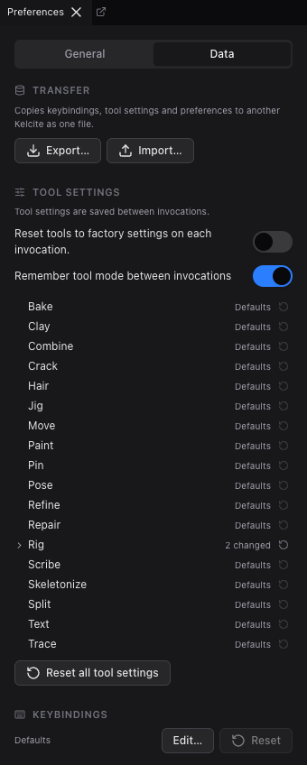

# Keyboard Shortcuts and Preferences

Every tool has a single-letter key, and pressing that key again while the tool is open runs the tool's most common action, such as cycling its mode. Knowing the keys of the tools you use most saves a trip to the palette for each step. On a Mac, **Ctrl** is **Cmd**: Kelcite treats the two as one modifier so the same bindings work on every platform.

Kelcite shows the keys in several places. **Shift+?**, or **?** at the bottom right, opens the keyboard cheatsheet. Hovering a tool's icon in the palette shows its key, the File menu shows the key beside each command, and **Ctrl+K** opens a search that lists every tool with its key. **Keybindings**, in the menu at the top right, changes them.

## Global keys

Global keys act on the document, the selection and the view rather than on one tool.

| Key | Action |
|---|---|
| **Space** | Apply the current tool (or dismiss a tool with nothing to apply) |
| **Escape** | Cancel the open tool, or clear the selection |
| **Ctrl+Z** | Undo |
| **Ctrl+Shift+Z** (Mac), **Ctrl+Y** (Windows, Linux) | Redo |
| **Ctrl+K** | Search tools and commands |
| **Ctrl+F** | Search objects in the Objects panel |
| **Ctrl+S** / **Ctrl+Shift+S** | Save / Save as |
| **Ctrl+O** | Open a file |
| **Ctrl+I** | Import a mesh |
| **Ctrl+E** | Export the selected objects |
| **Ctrl+A** | Select all objects |
| **Ctrl+C** / **Ctrl+X** / **Ctrl+V** | Copy / cut / paste |
| **Delete** or **Backspace** | Delete the selected objects |
| **Ctrl+G** / **Ctrl+Shift+G** | Group / ungroup |
| **`** (backtick) | Toggle visibility of the selection |
| **Shift+~** | Hide all unselected objects |
| **Shift+!** | Show all objects |
| **'** (apostrophe) | Cycle the selection mode (box or lasso) |
| **H** | Reset the camera view |
| **F** | Frame the selection |
| **Tab** / **Shift+Tab** | Cycle pins (forward / backward) |
| **Ctrl+Enter** | Toggle the Asset Library |
| **Shift+?** | Toggle the keyboard cheatsheet |

### View toggles

The **Alt** keys change what the view draws without changing the scene.

| Key | Toggles |
|---|---|
| **Alt+W** | Wireframe |
| **Alt+G** | Grid |
| **Alt+D** | Shadows |
| **Alt+L** | Measurement labels |
| **Alt+F** | Face group coloring |
| **Alt+S** | Smooth shading |
| **Alt+X** | X-ray on the selected meshes. With the wireframe also on, only the wires draw: the faces draw nothing, and every edge shows whether it faces you or not |
| **Alt+N** | All construction (pins, wires, traces) |
| **Alt+U** | Cycle display units: mm, cm, m, in |

## Tool keys

The palette orders the tools by what they work on: [placing and relating parts](Tool-Construction-and-Rigging), [cutting and joining solids](Tool-Cut-and-Join), [a mesh's own triangles](Tool-Surface-and-Refine), and [making new geometry and baking it](Tool-Create-and-Bake).

| Key | Tool | Pressing the key again |
|---|---|---|
| **Q** | Select | |
| **V** | Move | Cycles translate, rotate and scale |
| **N** | Pin | Switches to Loop mode |
| **W** | Wire | |
| **Z** | Trace | Cycles snap mode |
| **J** | Jig | Adds an item from the selected wire or pin |
| **I** | Rig | |
| **E** | Pose | |
| **S** | Split | Toggles translate and rotate |
| **C** | Combine | Cycles the boolean operation |
| **O** | Part | |
| **K** | Crack | Switches between crack lines and extraction |
| **R** | Repair | Cycles the patch strategy |
| **G** | Scribe | Adds an automatic seed |
| **P** | Paint | Toggles Fill and Brush |
| **T** | Refine | |
| **A** | Clay | Cycles the primitive type |
| **X** | Text | |
| **Y** | Hair | Cycles the mesh's Hair modifiers |
| **L** | Skeletonize | |
| **D** | Array | |
| **B** | Bake | |

### Keys inside tools

While a tool is open, some keys take a meaning of their own within it.

| Tool | Key | Action |
|---|---|---|
| Move | **R** | Reset the current transform component |
| Move | **W** | Toggle world or local space |
| Move | **U** | Toggle uniform scale |
| Move | **Tab** | Cycle the pivot point |
| Move, Clay | **Shift** / **Alt** while dragging | Snap to surfaces / pins |
| Pin | **Space** | Place a pin |
| Pin | **Alt+A** | Pin free faces |
| Split | **X**, **Y**, **Z** | Align the plane to an axis |
| Split | **↑** / **↓** (with Shift, ×10) | Move the plane |
| Split | `\` | Flip the plane |
| Repair | **Tab** | Patch and weld all detected holes and cracks, and fix normals; a hole that already has a patch keeps it and its strategy |
| Crack, Repair, Move | **Space** | On a focused row of Crack's list, Repair's hole list or Move's pivot list, selects it, as **Enter** does, and the tool stays open |
| Repair | **G** | Toggle face groups for patches |
| Paint | **Tab** / **Shift+Tab** | Cycle palette colors |
| Paint | **Shift+scroll** | Resize the brush |
| Paint | **Shift** with **+** | Add a color to the palette |
| Paint | **Shift** (held) | Hide the ghost of the mesh's modifiers |
| Scribe | **Tab** | Place a seed by clicking |
| Scribe | **Esc** | End seed placement and keep Scribe open with its seeds and clustering; a second **Esc** closes Scribe |
| Scribe | `\` | Switch output between face groups and traces |
| Hair | **M** | Cycle the surface preview |
| Rig | **Enter** | End the chain being placed |
| Rig | **E** | Start a chain from the selected joint |
| Pose | **Alt+L** | Lock or unlock the joint |
| Pose | **Alt+X** | Pose both sides |
| Pose | **Alt+F** | Flip the pose |
| Pose | **Alt+R** / **Alt+G** | Clear rotation / clear root offset |
| Array | **]** / **[** | One more / one fewer copy |

## Preferences

Preferences hold the settings that apply across documents: units, file defaults, colors and navigation. **Preferences**, in the menu at the top right, has two tabs, **General** and **Data**.

### General

The **Units** section sets what the scene's numbers mean and what [files without a unit](Architecture-Units-and-Files) are read in.

| Section | Settings |
|---|---|
| **Units** | **Scene Units**, what one of the scene's numbers is; **Files Without Units**, the unit for STL, OBJ and PLY files; **Display Units**, the unit panels show |
| **Import / Export** | **Up Axis**, the axis STL files are read and written with; **Crease Angle**, the threshold for face group detection; **Default Texture DPI** |
| **Tools** | **Paint images through a mask**; **Suspend slow updates during paint**; **FPS threshold** |
| **Manufacturing** | **3MF filament format** (Bambu or Slic3rPE); **Auto-map filaments** |
| **Mesh Colors** | The **Palette** and **Variance** (how far colors drift from the palette) used to read a model's colors on import, with **Reset to defaults** |
| **Display** | **Antialiasing**: **Auto** (the default), **On** or **Off**. Auto turns smoothing off on displays at a pixel ratio of 2 or more, such as Retina screens and phones, where edges already look smooth. Off saves about 80 to 100 MB of graphics memory on a desktop canvas at a pixel ratio of 2 and about 21 MB on a phone |
| **Wireframe** | **Wireframe Color** for light and dark mode; **Wireframe line weight**, to make the lines lighter or heavier |
| **Notes and Tour** | **Flag Font Size** and **Tour Font Size** |
| **Controls** | **Trackpad Pan**; **Show camera pivot**; **Orbit about the point under the cursor**; **Re-center the pivot after panning** |
| **Effects** | Effects when deleting objects, dragging files and importing |
| **Updates** | **Notify when a new version is available**; **Check for Updates** |

A few of these settings need more than their row says.

- **Up Axis** says only how STL files are read and written. The scene's own up is Y, so an [Array](Tool-Modifiers) and a [new rig](Workflow-Rig-and-Pose-a-Character) stand along Y whatever it is set to.
- **Suspend slow updates during paint** stops [Paint](Workflow-Paint-Decals-and-Texture-Maps) from updating the ghost of a mesh's modifiers during strokes when its first update in a stroke is slower than the **FPS threshold** (1 to 60, default 20). The ghost then updates once each time you let go, until Paint is dismissed. Turning the toggle off also ends a suspension already in effect.
- **Re-center the pivot after panning** moves the pivot to the body at the center of the view when a pan ends, and the pivot diamond lands there. A 6DoF controller never re-centers the pivot: its slides do not count as a pan, and a mouse pan that ends while the controller is moving keeps its pivot.
- **Antialiasing** redraws the view at once when it changes, and the scene, selection and camera stay as they were.
- **Check for Updates** also offers a fix released between two versions, which has a fourth number, as in 0.17.3.1.

### Data

The Data tab moves your setup between browsers and resets it. Kelcite keeps that setup in [this browser's storage](Architecture-Storage-and-Privacy).

- **Export…** and **Import…**, under **Transfer**, copy keybindings, tool settings and preferences to another Kelcite as one file.
- **Tool settings**: tools reopen on the options you last chose. **Reset all tool settings** returns every tool to factory defaults, and each tool has its own reset.
- **Reset tools to factory settings on each invocation** starts every tool from its defaults each time it opens.
- **Remember tool mode between invocations** reopens tools in the mode you left them in, such as Move's rotate.
- **Storage** shows how much this browser holds for Kelcite.
- **Reset everything…** clears documents, the Asset Library, settings and downloads from this browser. Export what you want to keep first; this cannot be undone.

