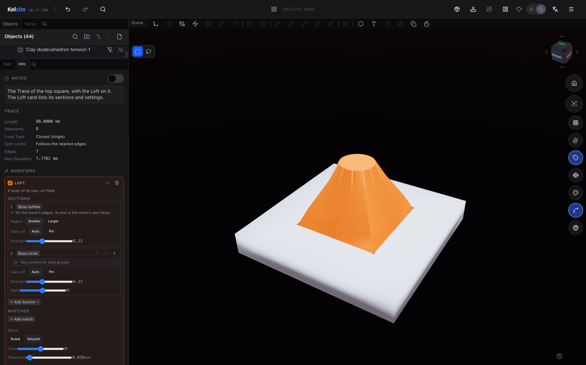
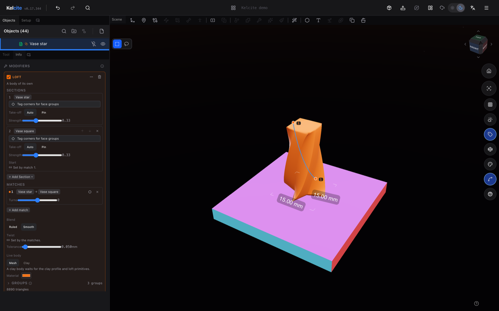

# Loft Between Shapes

A handle that grows from a square base into a round grip, or a vase that turns from a star into a circle as it rises, changes shape along its length, which an [Extrude](Tool-Modifiers#extrude) cannot do. A **Loft** builds that solid from the outlines it passes through, so the whole body is one part instead of a stack of extrusions. The loft stays live until you [bake](Workflow-Bake-an-SDF-to-a-Mesh) it, so a section can be moved, reshaped or reordered after the body exists.

## What can be a section

| Section | Where it comes from |
|---|---|
| **Trace** | The [Trace tool](Workflow-Trace-an-SVG-to-a-Mesh), or a face group's outline traced for you |
| **SVG or text** | An imported SVG or a [Text](Workflow-Trace-an-SVG-to-a-Mesh) node |
| **Closed Wire** | A [wire](Tool-Construction-and-Rigging) with its **Closed** switch on |
| **Pin** | A [pin](Tool-Construction-and-Rigging) |
| **Face group** | A mesh's face group, whose outline Loft traces when you pick it |

The first section carries the Loft: its card is where the loft's settings live, and the body draws beside that node. The solid is a part of its own, so it exports as a separate part and Bake turns it into a mesh that moves on its own.

## Making a loft

There are four ways in, and all of them end at the same card in the Info panel.

1. **From a face group.** Right-click a face (a long press on a touch screen), or open a Materials row in the Info panel, and choose **Loft**. Loft traces the group's outline, starts a Loft on the new Trace, and waits for the destination: the card's **Add Section** is on and reads "Select target section". Click or tap a face group, Trace, closed Wire, text, SVG or Pin to add the second section. **Escape**, **Cancel** beside the status, or pressing **Add Section** again leaves the Loft with its one section. The Trace tool also offers **Loft** beside each picked group.
2. **From a selection.** Select the nodes in the order the body should pass through them, then choose **Add Loft** in the tool search (**Ctrl+K**) or in the **Add Modifier** menu. The selection becomes the sections in order.
3. **From the card.** Once a Loft exists, **Add Section** adds the next outline, whether a Trace, closed Wire, text, SVG or Pin, or a face group: click a mesh in the view, where the group under the pointer lights up, or open the list and pick a group under its mesh. The group's outline is traced, added as the next section and selected, as one undo step. A group with no outline, or one that is already the Loft's own Trace, says so.
4. **From a split.** In the [Split](Workflow-Split-and-Cut-a-Model#joining-the-two-faces-with-a-loft) panel, a selected cut's **Loft split bodies** checkbox joins the two faces the cut leaves.

The two Traces that a face group's Loft and its destination pick make are named from their bodies, so the section picker and Objects tell them apart: bodies named "Left hand" and "Right hand" give "Trace_Left" and "Trace_Right", and two Traces on one body, or bodies whose names give no clear pair, give "Trace_A" and "Trace_B".

The card lists the sections, each with buttons to move or remove it. A node the card names (a section, a match) is a gray chip that lights the node in the viewport when you hover it or focus it with the keyboard.

## Shaping the walls

| Setting | Effect |
|---|---|
| **Blend** | **Ruled** runs straight from section to section; **Smooth** curves through them. |
| **Twist** | Turns each pair of sections against each other. |
| **Tolerance** | Sets how finely a curved span is cut into rings. |
| **Take-off** | The direction a section leaves along: **Auto** (the way its outline faces) or a Pin you aim. The last section reads its take-off Pin as facing back, as a Wire reads its last pin, so the Loft arrives into that face. |
| **Strength** | How far a section keeps going along its take-off before the body bends toward the next one. |
| **Start** | Turns where one section's outline meets the next. |

The walls are cut into rings along their length, so a long straight wall is made of short, even triangles and Wireframe shows a grid instead of streaks. Dragging **Twist**, a matching pin, a section or a take-off Pin redraws even a large Loft as you drag, and the Loft's shading is computed off the page. The card's top row shows the body's **Material** color.

## Following a spine

A loft between two sections leaves the path between them to the walls. A **spine** gives the body a path to follow, so a handle can bend between its ends. Pick a Wire in the Loft card's **Spine** row: the sections sit along the Wire where it passes closest to their centers, and the walls between them follow its bends.

A spine can be made three ways.

| Command | What it draws |
|---|---|
| **Add a guiderail wire**, in a Loft body's right-click menu and its row's menu in Objects | A Wire through a new pin at the center of each section, aimed the way the Loft leaves it and facing the way the section does, so the Loft keeps its pairing. Each pin becomes its section's take-off Pin. |
| **Link with Wire**, under the Spine picker while the Loft has no spine | A Wire through each section's take-off Pin, or the pin on its face (a Split cap's), adding a pin where a section has none. The Wire becomes the spine. |
| **Insert point on the Wire** on a spine's card | A pin that becomes a section of the Loft at that point. The shape does not change until you move or turn the pin: moving it bends the middle, turning it twists it. Removing the point removes the section. |

The spine's pins set the twist. Each pin's **North** fixes which way the outline faces at that pin, and between pins the outline turns evenly from one North to the next, so editing the Wire never flips the body or its ends. Turn a pin about its up to twist the Loft there; the card's **Twist** adds to that. **Upright**, in the Spine row, keeps the outline facing the way it does at the start instead.

Along a spine, each section's row has a **Section twist** slider in place of Start. It turns the section in quarter turns, up to ten turns either way, on top of the turn its pin's North gives, so a section can spin past 180°. Turn the pin for the fine angle and step the row for whole quarter turns. Spinning a section with the Move tool past 180° does not flip the walls: each time the pin's turn passes the half turn, Section twist takes a whole turn, and Undo takes back the move and the twist together. Along a straight spine, Ruled walls place their rings about as far apart as the points around the section, as they do without a spine.

### Guide rails

A spine fixes the path through the middle. A **guide rail** pins down a point on the outline as well. Once a Loft has a spine, each further **Add a guiderail wire** draws a rail: a Wire through a new pin on an outline vertex of each section, and the outline follows it between the sections. Move or aim the rail's pins and the walls turn and swell to keep that vertex on the rail; with several rails, each one's vertex stays on its own. From a body's right-click menu the rail starts at the outline vertex nearest where you clicked; from the card or Objects it starts across the widest gap between the rails already there.

- **Listing.** The card lists the rails under the Spine row. Hovering a rail lights its Wire, the **×** removes it from the Loft (the Wire stays in the scene), and **Add rail** draws another.
- **Rails that cannot be followed.** The rail's row says why, such as a rail that runs back along the Loft, two rails that cross, or pins in another order than the sections, and the Loft builds without it.
- **Pin placement.** A rail's pin can go anywhere. At each section the rail follows from the outline point nearest its pin, so dragging a pin round the outline moves where the rail starts; the point changes only once the pin is clearly nearer a new one.

## Matching points between sections

A star lofted to a square has no obvious answer to which tip meets which corner, so the loft picks one, and it may not be the turn you want. **Matches** say which point of one section meets which point of the next.

1. Choose **+ Add match**.
2. Click a point on each section's outline in turn.
3. Press **Done**, or **Escape**, once the match has two points.

A pin on a star's tip and another on a square's corner give the body the turn between them, and a pin at 90° on the second section is a 90° twist. Pins are orange dots with their number; the match being placed, or hovered in its row, draws in magenta, and the tracks between the sections draw in blue.

- **Adjust:** a pin drags along its outline with the card open, one undo step per drag. Pins follow a section that moves, snap to the nearest point of an outline that is edited, and stay with their sections through a reorder.
- **Spans:** two or more matches on a pair of sections split both outlines into spans at the pins, and each span maps onto its partner. A span with the same number of corners on both sides pairs them in order, so a square stays square.
- **Turns:** adds whole turns that still end at the pins, for a corkscrew.
- **Set by a match:** a match fixes its pair of sections, so **Start** and **Twist** leave those pairs alone and say "Set by match 1."
- **Crossing:** matches that would cross are refused. The card names them ("Matches 2 and 3 cross on Circle") and draws red rings around their pins, and the Loft builds nothing until one moves.

The demo's **Loft matching pins** stop shows a star lofted to a square with one pinned corner.

## Lofting from a mesh

A face group's outline is a Trace on the mesh's own edges, so a loft that starts there can end flush with the mesh instead of leaving a gap. The body's end closes with the mesh's own faces under the loop. **Region** chooses the smaller or the larger side of the loop.

- **A Trace off the mesh's vertices.** A Trace that lies on the surface but not on its vertices, such as a smoothed or projected one, closes on the mesh's faces cut along the Trace.
- **A Trace off the surface.** One that has left the surface closes flat, and the card says how far off it is. **Project onto surface** moves it onto the mesh.
- **A face of a platonic solid.** A face of a baked tetrahedron, octahedron, dodecahedron or icosahedron can be a section.

### Combining the loft with the mesh

A Loft on a Trace has a **Combine into** block, named for the mesh the Trace is on. It joins the body to that mesh as a **Union** (a boss or a handle) or a **Difference** (a pocket or a tunnel), when you press **Combine**. **Bake on apply** bakes the result as [Combine](Tool-Cut-and-Join) does. A Boolean that cuts with a Loft's body, Bake and export all take the body as it stands when a drag ends. A Loft body used as a Combine tool is hidden on its row once the Combine is applied, as the tool's Trace is. A line under the button says what the join did, such as "Joined at the Trace: 8 triangles of Joined plate replaced by the body."

Where the Trace is on the mesh, the join replaces the mesh's faces inside the Trace with the body and shares the Trace's vertices. The result is one closed solid with no gap or doubled wall at the Trace, and every other triangle of the mesh keeps its place, group and material. On a mesh of a million triangles, the join evaluates about four times faster than the same cut through the Boolean.

A body that cannot use the Trace joins through the ordinary Boolean, and the card says why:

- the Loft is already baked to a mesh,
- the body meets the mesh somewhere besides its Trace,
- the body lies on the other side of the surface from the operation, or
- a modifier sits ahead of the Boolean.

A Loft whose end is on a Trace of another part, such as the other half of a split, ends on that part's own faces. Moving the body under the far end keeps the end on it in every frame of the drag.

After an edit to the mesh, the join waits for the body to rebuild on the edited mesh and then welds again. The demo's **Loft combined** stop shows a boss joined to its plate.

## Colors and face groups on the body

A printer assigns filaments by face group, so the loft's walls divide into groups you can color.

1. On an SVG, text or Wire section, press **Tag corners for face groups**. It tags the corners where the outline turns by more than 40°, which show as orange diamonds while the Loft is selected. Press it again to clear them.
2. The walls divide into a face group between each pair of tagged corners that meet from one section to the next, so a loft from one box face to another gets four walls, plus a **Start cap** and an **End cap**. A section without tagged corners divides nothing.
3. The **Groups** section on the card lists the walls and caps and gives each its own color.

A Trace carries its corners as well: in the Trace tool, **Alt** (Option on a Mac) and a click on a vertex makes it a corner or clears it. A Trace made from a face group's outline gets a corner wherever the outline meets a different neighboring group, so a box face's outline has the box's four corners.

## Baking a loft

Select a Loft's Trace, or the body its first section lies on, and the Loft appears in the [Bake](Workflow-Bake-an-SDF-to-a-Mesh) panel. Bake turns it into a mesh and checks it (manifold, topology, weld); the body spins in the Object Browser until the check ends, and a check that fails stops the spinner and says why.

- **Combine with a body.** The Loft's chip can combine the baked mesh with the body its first section lies on, with the body its last section lies on, or with both, which merges two bodies into one solid.
- **Consume Traces** deletes the section Traces.
- **Defaults.** All three start off, and Bake remembers the last choice.
- **Visibility.** A Loft baked to a mesh keeps the visibility and X-Ray its row had.
- **A Loft reached from its last section.** A Loft reached only through the body its last section lies on shows a notice naming it and saying what to select to bake it. The Loft stays live.
- **From the scene.** Right-click the Loft's body without dragging (or hold a finger on it) for **Bake to a mesh**. A host's row in the Object Browser has the same entry.

Each wall and cap becomes a material in the baked mesh, named **Wall 1**, **Wall 2**, **Start cap** or **End cap**, so [Paint](Workflow-Paint-Decals-and-Texture-Maps) and the Info panel can address it.

## Viewing a loft

- **Following the sections.** The body follows its sections as you move them. Moving a section's Trace or SVG with the Move tool, editing a Trace's points, and Undo or Redo of either redraw the body at once. Moving the part that carries a Trace and the other sections moves the body without building it again.
- **Wireframe and X-ray.** The body draws the wireframe (**Alt+W**) as meshes do. A Trace, Wire or SVG that carries a Loft shows the X-Ray toggle in the Object Browser, and **Toggle X-Ray** (**Alt+X**) reaches it; with the wireframe on as well, the body draws wires only.
- **The body's row.** In the Object Browser a Loft's body has a row of its own under its Trace, SVG or Wire, in italics beside a dashed icon, numbered when the node has more than one Loft. The node gains a disclosure arrow that collapses these rows. The row cannot be dragged, renamed or moved; its menu offers **Bake to a mesh** and **Add a guiderail wire**.
  - The eye and X-Ray buttons on the row show, hide and X-Ray the body on their own, and each click can be undone. Hiding the Trace, SVG or Wire, or **Toggle all construction visibility**, leaves the body in view. A body hidden from its row is not exported, as a hidden object is not.
  - Clicking the row selects the Trace, SVG or Wire, as clicking the body in the view does, and hovering the row outlines the body in the view.
- **Shading.** **Zebra** stripes a Loft body, and Smooth shading off draws it flat, as for any other body.
- **Moving a joined body.** During a Move drag, a body and the Lofts that join it are drawn at the same step, so a Loft does not trail the body it follows.
- **Orbiting.** Orbiting about the point under the cursor, and the camera's re-pivot after a pan, land on the body.

## When a loft cannot build

A Loft that cannot build, or builds a broken body, puts a warning triangle on its own row in Objects, and on its Trace while the rows are collapsed. Hover it for the reasons the Loft card lists.

- Sections that sit on each other, as the two faces a split leaves do.
- A section, pin or spine with a point that is not a number.
- Walls that fold through themselves.
- A body that is open or not a clean solid.
- A build that fails or does not answer.

The warning goes away by itself once the Loft builds cleanly, for example when you move the split pieces apart. A Loft with no body yet appears while you drag a part apart, as soon as the gap allows it, and its warning clears at that moment.

## Troubleshooting

| You see | Cause and fix |
|---|---|
| "Matches 2 and 3 cross on Circle", and no body | Two matches would cross. Drag a pin along its outline until the red rings clear. |
| The end closes flat, and the card names a distance | The Trace has left the mesh's surface. **Project onto surface** moves it back. |
| **Combine into** joins through the Boolean | The card lists why: a baked Loft, a body that meets the mesh elsewhere, the wrong side of the surface, or a modifier ahead of the Boolean. |
| A group has no outline to add | The group has no closed outline, or it is already the Loft's own Trace. Pick another. |
| An older Kelcite says the scene was saved by a newer version | Scenes with a Loft, Profile clay, a clay Sweep, a closed Wire or Extrude's taper, twist and path record a newer file format. Open it at kelcite.app. |
