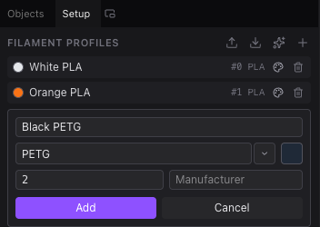
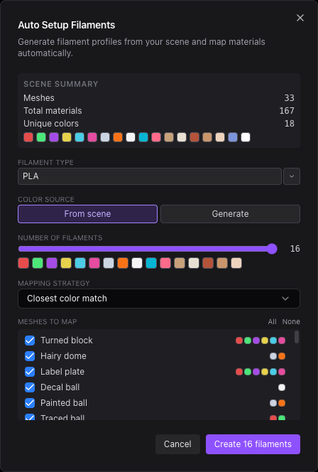
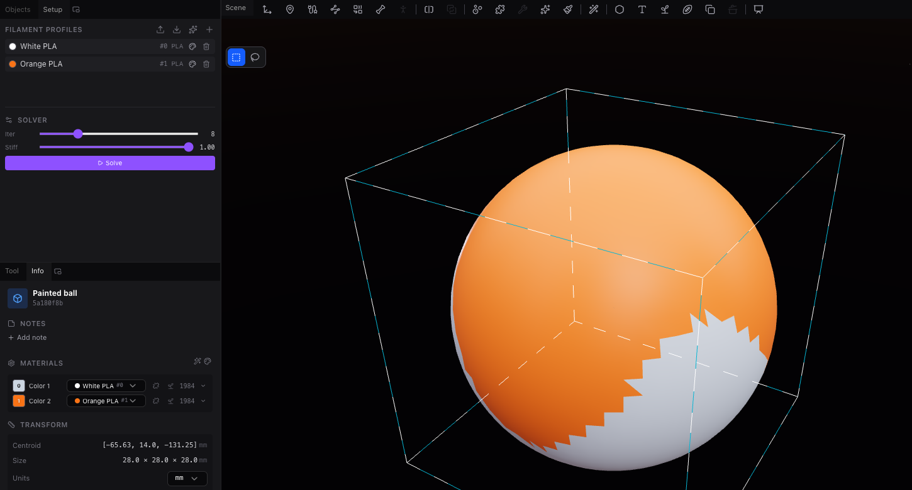

# Manage Filaments

A multi-material printer loads several spools at once, and the slicer has to know which spool prints each region of a model. Kelcite colors a model by [face groups](Workflow-Paint-Decals-and-Texture-Maps), each carrying one material, but a material's color on screen says nothing about the spool. A **filament profile** describes a spool: its name, type, color and slot. Each material links to one profile, and a 3MF export writes those links as the filament each triangle prints with.

## Filament profiles

Profiles belong to the document, so every mesh in the scene draws from the same list. They live in the **Setup** panel, the tab beside **Objects**, under **Filament Profiles**. Each row shows the profile's color, name, slot number (**#0**, **#1**, …) and type.

The section header holds four buttons, each named by its tooltip.

| Button | What it does |
|---|---|
| **Import filaments** | Adds profiles from a `.json` or `.3mf` file |
| **Export filaments (hold Alt for JSON)** | Downloads the list as a 3MF of color swatches, one cube per filament, or as JSON with **Alt** held; unavailable while the list is empty |
| **Auto setup** | Opens **Auto Setup Filaments**, which creates profiles from the scene's colors |
| **Add filament** | Opens the profile editor for a new profile |

To add a profile by hand:

1. Open the **Setup** tab and click **Add filament** in **Filament Profiles**.
2. Type a **Filament name**. The editor will not save a profile without one.
3. Type a filament type, or pick one from the presets beside the field: PLA, PETG, ABS, ASA, TPU, PA, PC, PVA or HIPS.
4. Click the color square and choose the filament's color.
5. Set **Extruder #**, the slot the spool sits in, counted from 0, and optionally a **Manufacturer**. A new profile starts at the slot after the highest one in use.
6. Click **Add**.

The palette button on a row (**Edit**) opens the same editor on that profile, with **Save** in place of **Add**. The trash button (**Delete**) removes the profile, and every material linked to it loses its link. Adding, editing, removing and assigning profiles can each be undone.

A filament JSON file holds a `filaments` list whose entries carry `name`, `type`, `color`, `density`, `manufacturer` and `extruderIndex`. A 3MF given to **Import filaments** supplies the filament names, colors and types it records, which is how a slicer project's spools come into Kelcite. Imported profiles join the end of the list. Each keeps the slot its file gives it when no other profile holds that slot, and otherwise takes the slot after the highest one in use. A file that cannot be read, or lists no filaments, adds nothing, and an alert names the file and gives the reason.

[Importing](Workflow-Import-and-Export) a model 3MF also adds its filament profiles, so the model's materials link to profiles that exist. A profile the document already has, with the same name, type and color, is reused, and the model's materials link to it.

## Auto Setup Filaments

Typing a profile per color is slow for a scene painted in many colors. **Auto setup** reads every mesh that has materials, hidden or not, and creates profiles from the colors it finds.

| Field | What it sets |
|---|---|
| **Scene Summary** | Counts the **Meshes**, **Total materials** and **Unique colors**, with a swatch for each color |
| **Filament type** | The type given to every new profile; each profile is also named after it |
| **Color source** | **From scene** takes the scene's colors first and fills any remaining profiles with generated hues; **Generate** spreads hues evenly instead |
| **Number of filaments** | How many profiles to create, from 1 to 16; it starts at the number of unique colors, at least 4 and at most 16 |
| **Mapping strategy** | How materials link to the new profiles (below) |
| **Meshes to map** | The meshes whose materials get linked, with **All** and **None** to check or clear the list |

The three mapping strategies decide which profile each material takes.

| Strategy | Each material links to |
|---|---|
| **Closest color match** | The new profile nearest its color |
| **Round-robin by group index** | The profile at its own position in the mesh's material list, wrapping around past the last profile |
| **No auto-mapping** | Nothing; the dialog only creates profiles |

The confirm button names the count, as in **Create 4 filaments** or **Create 1 filament**. It adds the profiles to the end of the list and replaces any earlier link on the checked meshes' materials. Profiles already in the list stay, and the new ones continue the slot numbering after the highest slot in use, so running Auto setup again gives every profile a slot of its own.

## Linking materials to filaments

The Info panel shows the link for one mesh at a time. A selected mesh with more than one material lists them under **Materials**, and once the document has profiles each row gains a **Filament** menu. The menu lists every profile with its slot, and **No filament** clears the link; so does the row's **Unlink** button.

Two buttons sit at the right of the **Materials** header. **Auto-map filaments** links each material that has no filament to the profile nearest its color, and leaves linked materials as they are. **Manage filaments** opens the Setup panel. Changing a material's color with its color chip keeps its filament link.

Tools that rewrite a mesh's materials carry links forward by color: a new material takes the filament of an old material of the same color. The faces a mesh's Difference, Union or Intersect [modifier](Tool-Modifiers) cuts, adds or keeps from the tool show the tool's material, and Bake and export add that material to the mesh's. New colors still need linking, which the next section covers.

## Automatic mapping after Bake and Scribe

A bake can create face groups that did not exist before — a decal's colors or a texture map's palette, for example. [Bake](Workflow-Bake-an-SDF-to-a-Mesh) and [Scribe](Tool-Surface-and-Refine), when Scribe paints rather than creating traces, each have an **Auto-map filaments** checkbox. With it checked, the new mesh's unlinked materials take the profile nearest their color as soon as the tool commits. The checkbox follows **Auto-map filaments** under [**Preferences → Manufacturing**](Workflow-Keyboard-Shortcuts-and-Preferences) each time the tool opens, and that preference is on by default.

Without profiles the checkbox is unavailable, with the tooltip **"No filament profiles available."** A warning button beside it opens Setup at Filament Profiles.

Automatic mapping leaves a notice when profiles are missing or too few.

| Notice | Cause |
|---|---|
| **"No filament profiles defined. Create them under Filament Profiles first, then auto-map."** | The document has no profiles. The link opens Setup at Filament Profiles. |
| **"Auto-map is incomplete: … material colors and … filament profiles. Add more under Filament Profiles to cover every color."** | There are fewer profiles than new material colors. Every material is still linked, so some colors share a profile. |

Baking [Hair](Workflow-Hair-and-Strands) removes a material instead of adding one. A hair region is a material of its own, and once its hair is baked it merges into the material around it. The baked strands and wall take that same material, so the hair prints with the surface's filament and without a filament swap.

## What a 3MF export writes

A 3MF is the format that carries filament assignments to a slicer; STL holds geometry only. The [Export dialog](Workflow-Import-and-Export) writes one when **3MF** is the format. The **3MF filament format** setting under **Preferences → Manufacturing** picks the dialect.

| Format | What the file records |
|---|---|
| **Bambu** (the default) | Each triangle's filament as a paint color, which Bambu Studio reads, and each object's extruder |
| **Slic3rPE** | Each triangle's filament in the Slic3r PE multi-material dialect, with a color group per filament |

Both formats write the filament list with each profile's name, color and type. A slicer numbers filaments by their position in the file, so the file lists profiles in **Extruder #** order, and editing a profile's Extruder # moves it to that slot in the slicer. Two profiles given the same Extruder # keep their order in the Filament Profiles list.

A triangle's filament is its material's link. A material without one takes a profile of exactly its color; failing that, it takes the mesh's first material's filament, or the first profile.

A document without profiles still exports in color. Each distinct material color becomes a filament of its own, named after the material, with the type PLA. A scene that resolves to a single filament exports without multi-material data.

How you set up profiles and links is part of the document. How the file is written is a preference of the browser.

| Setting | Stored in |
|---|---|
| Filament profiles and material links | The document: autosaved in the browser, and written into a saved Kelcite GLB |
| **3MF filament format**, **Auto-map filaments** | The [browser's local storage](Architecture-Storage-and-Privacy), with the other Preferences |

## Limits

- Profiles cannot be reordered in the list, which keeps the order they were added in. The 3MF follows **Extruder #** instead, so the slots are set by editing each profile.
- Mapping by color measures distance in plain RGB, so two close shades can both land on the same profile.
