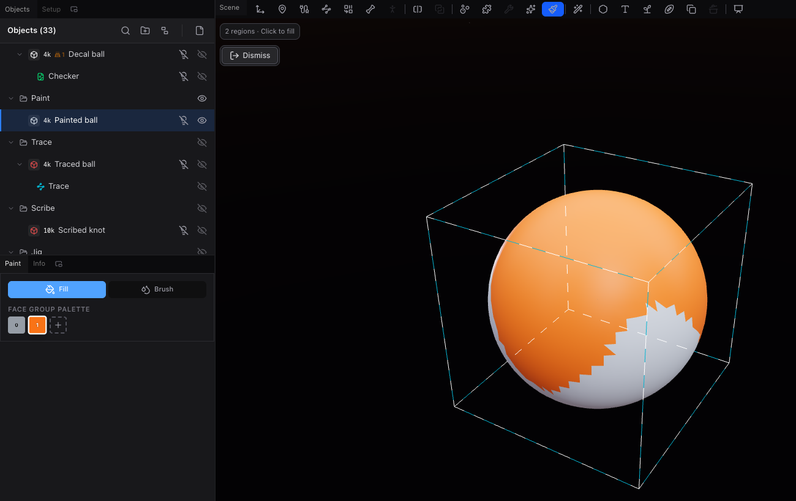
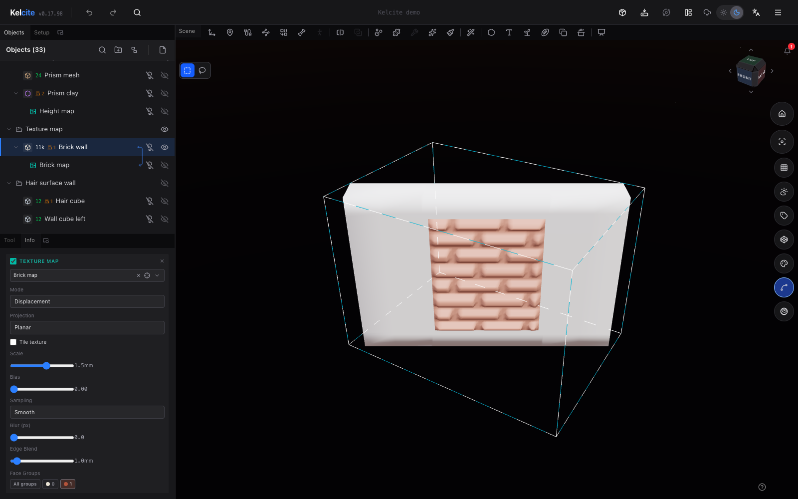

# Paint, Decals and Texture Maps

A multi-material printer assigns a filament to each region of a model, so color in Kelcite is a matter of regions. Kelcite colors a mesh by **face groups** — sets of triangles that each carry one material. A face group is also what [other tools read](Architecture-Tools-and-Modifiers): [Hair](Workflow-Hair-and-Strands) grows from one, and Extrude, Decal and Texture Map can be limited to one. Decals and texture maps add pictures and relief on top of that, without changing the mesh until you [bake](Workflow-Bake-an-SDF-to-a-Mesh).

**Alt+F** shows or hides face group coloring in the view.

## Painting face groups

[Paint](Tool-Surface-and-Refine) needs a manifold mesh and refuses one with **"Mesh is not manifold"**; a scan usually needs [repair](Workflow-Repair-a-Scan-for-Printing) first. Painting picks a color, then a mode that decides how the color spreads.

1. Select the mesh and press **P**.
2. Choose a color from the **Face Group Palette**. **Tab** cycles the palette, **Shift+Tab** cycles it backward, and **Shift** with the **+** key adds a color. Undo removes an added color and puts the palette back as it was.
3. Choose a mode; pressing **P** again switches between them. **Fill** floods a region bounded by traces and existing face-group borders, when you click the region. **Brush** paints the triangles under a sphere, and **Shift+scroll** resizes the brush.
4. Click **Dismiss** when you are done.

Paint works triangle by triangle, so a brushed border follows the triangle edges. A smooth border comes from drawing it first with [Trace](Tool-Construction-and-Rigging), then filling the region it bounds. Only traces and face-group borders stop the brush and the fill: both cross the separate triangles of an STL and the seams where a mesh's vertices are split, as on a mesh made in Kelcite.

When Paint cannot prepare a large mesh for the brush, an alert gives the reason, and the next press on the mesh tries again.

### Painting under modifiers

A mesh's [modifiers](Tool-Modifiers) change what prints, so Paint shows their result as a **ghost** over the mesh while you paint the mesh itself. **Ghost Opacity** sets how visible the ghost is, and holding **Shift** hides it. A negative-depth Extrude shows in the ghost as the cut it makes.

On a mesh with a Difference, Intersect or Union modifier, Paint shows the boolean's result, with the faces its tools cut or add in the tools' materials. The faces the cut leaves of the mesh take the color you paint as you paint it, and keep it through Undo and Redo.

Rebuilding the modifiers behind every stroke can slow painting on a large mesh, so Paint holds the ghost back when it is slow:

- While the ghost is hidden (Shift held, or **Ghost Opacity** at 0), strokes do not rebuild it. It updates once when it shows again, and stays hidden until it matches the mesh.
- When the ghost updates slower than the **FPS threshold** during your first stroke, it stops updating while you paint. It hides for each stroke and updates once when you let go, until you close Paint. A ghost that updates quickly keeps updating during strokes.

**Suspend slow updates during paint** and **FPS threshold** (1 to 60, default 20) are in [Preferences](Workflow-Keyboard-Shortcuts-and-Preferences), under **General → Tools**. Turning the toggle off keeps the ghost updating during strokes, and ends a suspension already in effect.

Each face group becomes a material of the mesh. A 3MF export carries the materials, ready to [map to filaments](Workflow-Manage-Filaments).

## Finding regions from the shape

**Scribe** divides a surface into regions from its shape alone, for when the regions should follow the model's form rather than a hand-drawn border.

1. Select the mesh and press **G**, then wait for the shape analysis.
2. Press **G** again to add a seed automatically, or **Tab** to place one by clicking.
3. **Shift+scroll** over a region adjusts its bias.
4. Press `\` to choose whether Scribe writes face groups or boundary traces.
5. Press **Space** to apply.

## Decals

A **decal** projects the picture of an SVG, an image or a BitCanvas onto a surface as color. The quickest way to add one is to [import](Workflow-Import-and-Export) the SVG by dragging it onto the model, where it becomes a Decal [modifier](Tool-Modifiers) on that surface. You then adjust it in the Info panel's Modifiers section, where hovering the decal's card outlines its projection on the surface.

A decal can also be added to an existing model with **Add Decal modifier** from search (**Ctrl+K**), or with **Add Modifier** in the Modifiers section. Right-clicking a face group, on the mesh or in the Materials list, limits a decal to that group. On [clay](Workflow-Sculpt-with-Clay), a decal projects planar, spherical or cylindrical.

Baking an SVG decal turns it into face groups by the SVG's shapes, so it prints in its own materials, and an Extrude modifier can then [raise or sink those face groups](Workflow-Trace-an-SVG-to-a-Mesh) as relief. A decal stays live and editable until baked, but SVG decals must be baked before a 3MF or OBJ export.

### Text

The [Text](Tool-Create-and-Bake) tool writes a decal from typed text, placed by a pin.

1. Place a pin on the mesh where the text goes: press **N**, then click the surface.
2. With the pin selected, press **X** to open Text.
3. Type the text. The panel sets the font, size, alignment and spacing, and Markdown sets bold and italic.
4. Press **Space**, or click **Create**.

The text becomes a Decal modifier on that surface, and the pin is used up. Without a pin selected, the text is an outline standing on the ground.

## Relief from an image

A **texture map** reads an image's brightness as height, and light parts rise. It moves the mesh's own vertices, so a mesh needs enough vertices across the area to hold the relief; on a mesh with too few, the relief looks faceted. Clay has no such limit, because its resolution is set when it is baked. A coarse mesh can become clay through **Convert to Clay** in its right-click menu, or you can start from a denser mesh.

1. Select the mesh. If only part of it should take the relief, paint that area as its own face group.
2. In the Info panel's Modifiers section, use **Add Modifier** to add a **Texture Map**.
3. Choose the image in the card's image selector.
4. Set **Mode** to **Displacement** and set **Scale**, the most the light parts rise above the **Bias**.
5. Under **Face Groups**, switch on only the painted group, to keep the relief to that area.

Displacement keeps a mesh closed. Each point of the surface moves once, along the normal of every face around it, so the seams of a mesh and the separate triangles of an STL stay joined. Where a mesh stores a different normal on each side of an edge, each side keeps the normal of its own faces, so a hard edge stays hard and closed. **Edge Blend** fades the relief to nothing toward the boundary of the area it maps. It measures across the surface, so a mesh's seams and an STL's triangle edges are not boundaries. A normal map gives every copy of a seam vertex the same normal, and its shading runs unbroken across seams.

On clay, dropping an image onto it adds the image and a displacing texture map in one step. The demo's **Texture map** and **Displacement** stops show both. A displacing texture map stays live until baked, and has to be baked before exporting for print.

## Painting pixels

A **BitCanvas** is an image you paint pixel by pixel, for example to mask where another image shows. Painting an ordinary image does nothing unless **Paint images through a mask** is on in Preferences, so an image to paint is first converted.

1. Right-click an image in the Objects panel and choose **Convert to BitCanvas**.
2. Select it and press **P**.
3. Click to paint, Shift-click to erase, and Alt-click to pick a color.

With **Unproject** on, Paint paints the canvas where it is projected onto a mesh or clay. Bake turns a BitCanvas back into an ordinary image.
