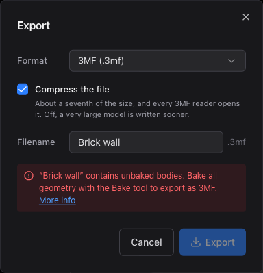
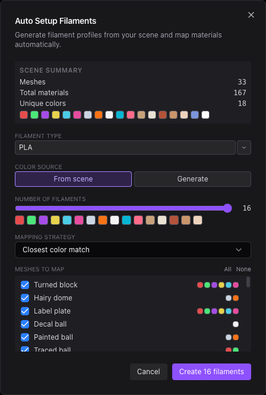
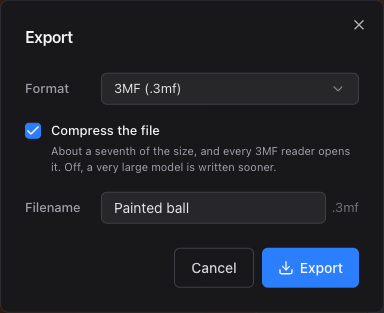

# Prepare for Printing

Most failed prints from an edited model trace back to a few causes: the wrong unit, an open surface, live geometry that never reached the file, or more triangles than the slicer can handle. Overhangs, supports and wall thickness stay with your slicer, which knows your printer.

## Size

A model read in the wrong unit prints tiny or huge. STL files carry no [unit](Architecture-Units-and-Files), so Kelcite and the slicer each assume one.

1. Press **Alt+L** to show measurement labels on the model.
2. Select the model and check the **Units** row in the Info panel. If the model came in at the wrong scale, read it in the right unit and click **Commit**, as when [importing](Workflow-Import-and-Export).
3. Confirm **Files Without Units**, under **Preferences → Units**, matches what your slicer expects for STL files. Most slicers read STL in millimeters.

## A closed surface

Cutting and painting tools refuse open meshes, so a mesh has to be manifold before anything else. A notification says when a mesh is not manifold and names it. When the mesh has fins, duplicate faces or faces wound against their neighbors, the notice's **Repair now** fixes those in one step you can undo. Holes need [repairing](Workflow-Repair-a-Scan-for-Printing) in the Repair tool before going further.

## Fitting the bed

A model larger than the bed, or one that would need heavy supports, can be [cut into pieces](Workflow-Split-and-Cut-a-Model) with Split (**S**). Each cut face gets a pin, which marks where the pieces meet.

## What prints as one part

Touching shapes print as one solid once [Combine](Tool-Cut-and-Join)'s **Union** (**C**) joins them. Loose pieces print separately once [Part](Tool-Surface-and-Refine) (**O**) separates them. Meshes merged with Part stay intersecting where they overlap, and most slicers merge such overlaps on their own.

## Live geometry

Clay, Extrude, displacement, hair, lattices and arrays have no triangles until [baked](Workflow-Bake-an-SDF-to-a-Mesh). You select them and press **B**. The Export dialog refuses STL, 3MF and OBJ while any of these are visible and unbaked, and opens Bake on them for you.

## Triangle count

A mesh denser than the printer's resolution slows the slicer without adding detail. Refine reduces it: you select the mesh, press **T**, choose **Simplify**, and set **Tolerance**, the largest distance the surface may move.

## Colors and filaments

For a multi-material print, each material of the mesh becomes a [filament assignment](Workflow-Manage-Filaments) in the 3MF file.

1. Open the **Setup** panel and find **Filament Profiles**.
2. Click **Add filament** for each filament you will load, or use **Auto setup** to generate profiles from your scene and map its materials to them. Its **Mapping strategy** can be **Closest color match**.
3. Check each profile's **Extruder #** against the slot its spool sits in. The 3MF lists filaments in Extruder # order, which is the order the slicer numbers them.
4. To have new materials, such as the face groups a bake creates, take the closest-colored filament as they appear, turn on **Auto-map filaments** under **Preferences → Manufacturing**.
5. In **Preferences → Manufacturing**, set **3MF filament format** to match your slicer: **Bambu** or **Slic3rPE**.

## Export

A 3MF opens in the slicer with its parts, materials and filament slots. An STL holds geometry only, written in the **Files Without Units** unit.

1. Open the **File** menu in the Objects panel and choose **Export…** (**Ctrl+E**, or Cmd+E on a Mac).
2. Choose **3MF** to keep materials and filament assignments, or **STL** for a plain single-color mesh.
3. Leave **Compress the file** on for 3MF; the file is about a seventh of the size.
4. Click **Export**.

## Common problems

An export problem shows up either as a message in Kelcite or as a wrong result in the slicer.

| Symptom or message | Cause and fix |
|---|---|
| The part is tiny or huge in the slicer | The file unit and the slicer disagree. Check **Files Without Units** and the model's **Units** row. |
| **"This file cannot be exported: STL can't hold clay."** | Bake the clay first, or hide it to export the rest. |
| **"No filament profiles available."** | Click the notice to open Setup at Filament Profiles, then add profiles. |
| Auto-map is incomplete | There are more material colors than filament profiles. Add profiles until every color is covered. |
| The slicer reports open edges | A mesh was exported without repair. Run Repair and export again. |
