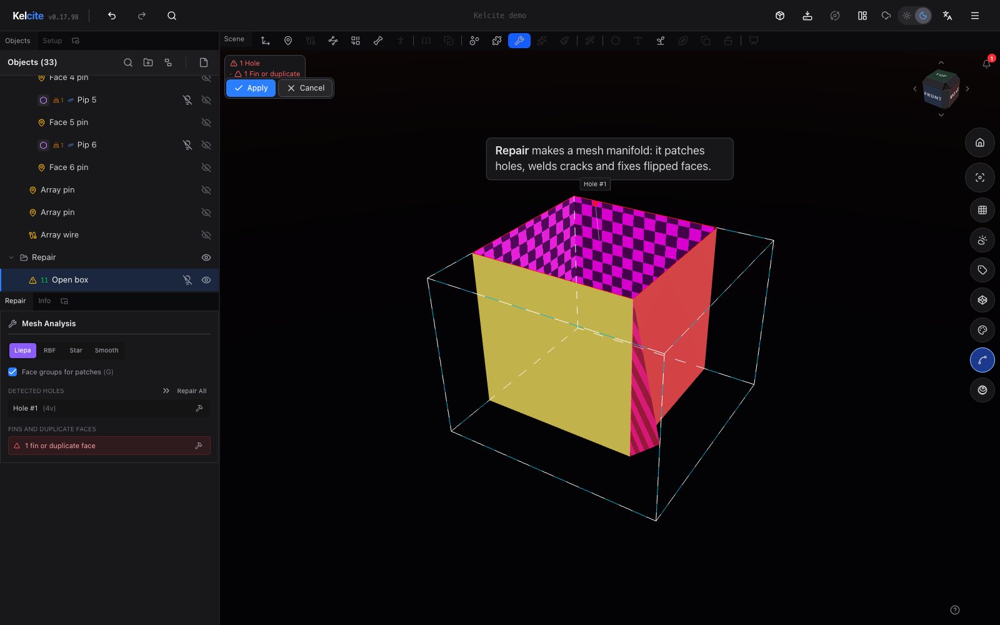
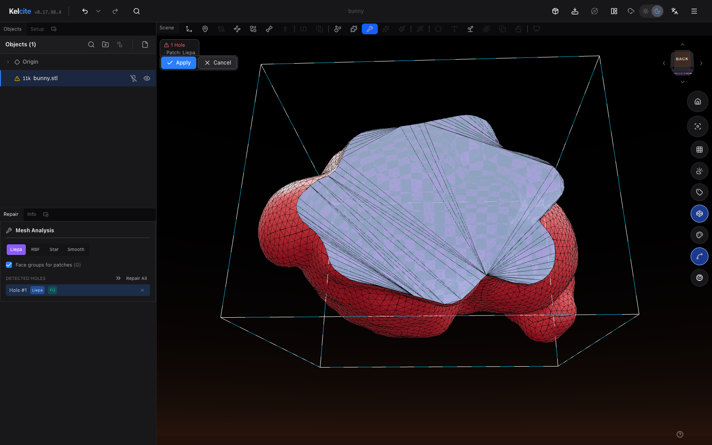
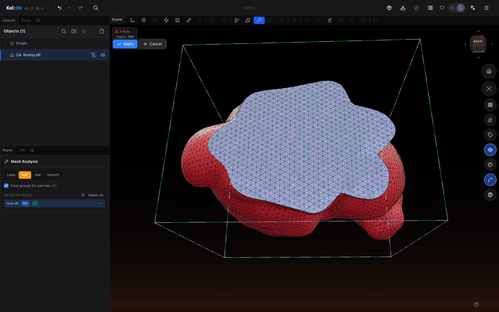
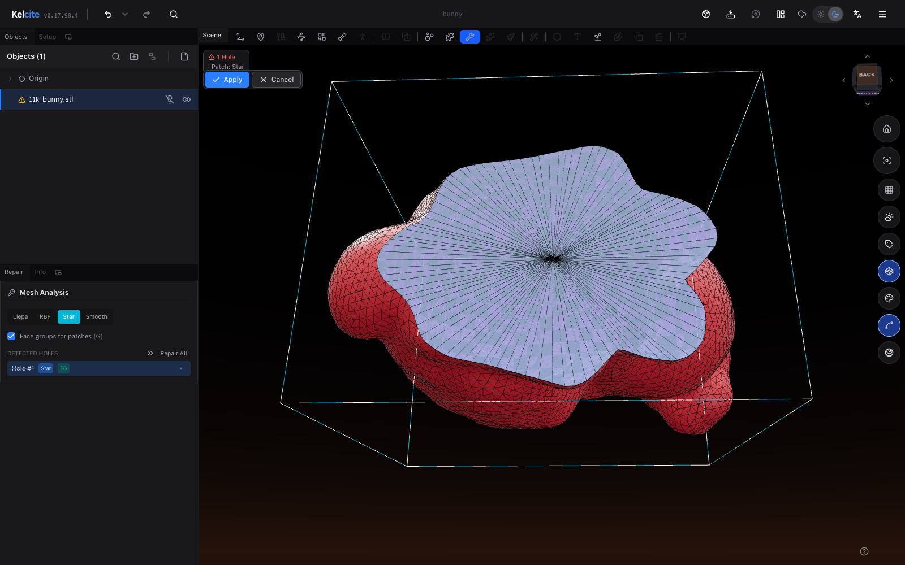
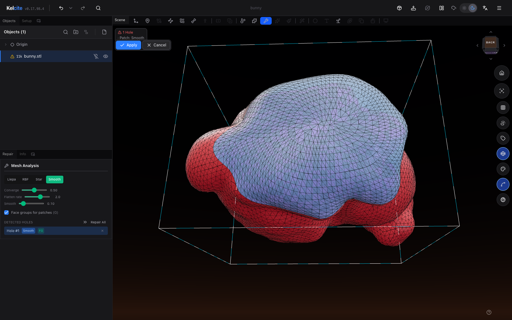

# Repair a Scan for Printing

A slicer needs a closed surface to tell inside from outside. Scans and downloaded meshes usually arrive open: holes where the scanner could not see, cracks where patches failed to meet, flipped faces, fins and loose debris. Most Kelcite tools that cut or combine also refuse a mesh that is not **manifold** — a single closed surface — so repair comes before any other edit. The work runs in three passes: close the surface, remove fragments, then reduce the triangle count, which only a manifold mesh allows.

## What Repair finds

Repair sorts a mesh's defects into four kinds, each with its own fix. A row appears in the panel only when the mesh has that kind of defect.

| Row | What it lists | Fix |
|---|---|---|
| **Detected Holes** | Openings in the surface, each outlined in red in the scene | Patch each hole, or **Repair All** |
| **Detected Cracks** | Seams where the surface's edges lie together without being joined | **Weld All Cracks** |
| **Flipped Normals** | Faces wound inside out | **Fix Normals** |
| **Fins and Duplicate Faces** | The faces left over where three or more faces share an edge: a **fin**, a face sticking out from such an edge, or a face stored twice | **Remove fins and duplicate faces** |

A fin's open edges count toward its own row, not as a hole. Flipped faces are found part by part, so the inner wall of a hollow part, which faces into its cavity, is not reported as flipped. A part with a small hole that is wound wholly inside out is reported as flipped. A sheet, or a part open across a quarter of its surface or more, is left as it is wound.

## The not-manifold notice

Kelcite checks a mesh when you [import](Workflow-Import-and-Export) it, and never changes it on its own. If the mesh is not manifold, a notification names the mesh as a link and counts its defects, among them open edges, edges shared by three or more faces and pinched corners. The counts match the Repair panel's.

When the mesh has fins, duplicate faces or faces wound against their neighbors, the notice offers **Repair now**. It removes the extra faces and winds every face outward, in one step you can undo. It does not patch holes, which need the Repair tool. A rigged mesh does not get the offer, since its weights belong to its vertices as they are.

## Closing holes and cracks

Repair opens only on a mesh that is not manifold. If it does not open, or says **All meshes are already manifold**, the mesh is closed already and the next pass is removing loose pieces.

With the mesh selected, the repair goes in this order.

1. Press **R**, or click [Repair](Tool-Surface-and-Refine) in the tool palette.
2. Wait for **Mesh Analysis** to finish. The status line at the top left counts the defects, as in **1 Hole · 2 Flipped**, and the panel lists each kind under its own row.
3. Pick a patch strategy. Pressing **R** again cycles through them.

   | Strategy | Behavior |
   |---|---|
   | **Liepa** | Triangulates the rim's own vertices, with no new points; fast and triangle-efficient |
   | **RBF** | Adds interior points at the rim's edge length and places them on a surface fitted through the rim; stable on curved rims |
   | **Star** | Fans triangles from one new point at the hole's center; the fastest, and the least careful |
   | **Smooth** | Grows the patch inward from the rim along the surrounding surface, then relaxes it; follows the body's shape |

   Choosing between them is covered in [Choosing a patch strategy](#choosing-a-patch-strategy).

4. Click a hole to patch it, or press **Tab** to patch every hole, fix normals and remove fins and duplicate faces at once (**Repair All**).
5. If the panel still lists cracks, flipped faces, or fins and duplicate faces, use **Weld All Cracks**, **Fix Normals** and **Remove fins and duplicate faces**.
6. Press **Space**, or click the blue apply button, to keep the repair.

A large scan should not stop the view while it is repaired, so Repair works in the background. The panel finds a mesh's holes, cracks and wrongly wound faces there, so opening Repair on a large mesh does not freeze the view. **Accept**, **Repair now** and the Repair script operations repair the mesh there too: the view keeps drawing and the body shows it is busy. At 5 million triangles the view used to stop for about six seconds. While it runs, the tool stays open and its panel shows a progress line with **Cancel**, which puts the scene back as it was before Accept; change your choices and accept again. A repair that fails says which mesh and why, and leaves the mesh unchanged.

## Choosing a patch strategy

A hole's rim says where the surface stops, and says nothing about what lay across it. Each strategy makes a different guess, and the guesses differ most on a large hole. The examples below patch the open bottom of a low-poly Stanford bunny: one hole, 102 vertices around its rim, in a mesh of 10,996 triangles. The wireframe is on in each image so the triangle layout shows.

Clicking the hole shows its patch as a preview, and the panel row names the strategy used. The **x** on the row removes the patch, so you can try each strategy on the same hole and keep one.

### Liepa

Liepa joins the rim's own vertices into triangles and adds none, so the patch has exactly as few triangles as the rim allows. Among the possible triangulations it picks the one with the least area and the smoothest turns between neighboring triangles. On the bunny it gives a flat fan of long, thin triangles that run from a few rim vertices across the hole. That keeps the triangle count low, and it suits small holes and rims that are nearly flat. A long, thin triangle shades and slices poorly, so a large hole is better served by a strategy that adds points.

### RBF

RBF adds interior points on a hexagonal grid spaced at the rim's average edge length, so the patch has the same triangle density as the mesh around it. It places each point at the height of a smooth surface fitted through the rim's vertices and their surface normals. A rim that curves gives a curved patch. This bunny's rim is nearly flat, so its RBF patch is flat too, as a regular grid of near-equilateral triangles. If the fit cannot be solved, RBF falls back to a flat patch at the rim's average height, and Repair reports it.

### Star

Star adds one point at the hole's center and fans a triangle to it from every rim edge. It is the simplest patch, which makes it the choice for a hole that will be [remeshed](Tool-Surface-and-Refine) afterward or sit out of sight. Its triangles are long spokes that meet at one point, and a hole that is large or far from round gives thin, uneven ones.

### Smooth

Smooth builds the patch from the surface around the hole. It reads the normals of the triangles that meet the rim and grows rings inward along the direction the surface was heading, so the patch continues the body's shape instead of cutting across it. It then fills the middle and relaxes the new vertices. On the bunny, Smooth is the one strategy that closes the bottom as a dome, with the finest triangles near the rim and larger ones in the middle. **Converge**, **Flatten rate** and **Smooth** appear under the strategy buttons for tuning it.

### Which to use

| The hole | Start with |
|---|---|
| Small, or its rim is nearly flat | **Liepa**, for the fewest triangles |
| Large, with a curved rim | **RBF**, or **Smooth** where the patch should continue the surface |
| Any size, as a placeholder you will remesh | **Star** |

A patch that looks dented or bulged can be removed and redone with another strategy.

Accepting a repair winds every face as its neighbors are, and turns each separate part outward on its own. Each patch is wound to match the triangles around it.

Repair keeps what the mesh carried on the faces it keeps: texture coordinates, vertex colors, [face groups](Workflow-Paint-Decals-and-Texture-Maps) and their materials. **Face groups for patches** (or **G** in the tool) gives each patch a face group of its own, numbered after the mesh's existing groups, so you can find and recolor the patched areas later. If the repaired mesh shades oddly, **Recompute normals** in the mesh's right-click menu in the Objects panel fixes it.

A repaired mesh shows no red outlines in Repair, and the not-manifold notice no longer appears. Tools that need a closed mesh — [Split](Tool-Cut-and-Join), Refine and Paint among them — accept it, and a tool that refused it with **"Mesh is not manifold. Repair it first."** opens normally.

## Removing loose pieces

Scans often carry floating fragments that would print as separate debris. [Part](Tool-Surface-and-Refine) (**O**, with the mesh selected) splits a mesh into separate meshes, and its panel shows how many parts it found. Shells that touch only at a corner, along an edge or across a face count as separate parts, and so does a fin standing off a solid. After you apply it, each fragment is its own object, and you delete the ones you do not want.

## Reducing the triangle count

Scans are often far denser than a printer can reproduce, which makes every later step slower. **Refine** (**T**) works only on a manifold mesh, which is why it follows the repair. Its **Simplify** mode takes a **Tolerance** — the largest distance the surface may move — and a lower tolerance keeps more detail. The panel shows the triangle counts before and after, so you can compare them before applying. Simplify removes texture coordinates, so a scan's texture no longer maps onto the result.

When Refine cannot simplify a mesh — one that is not a closed solid, or when memory runs out — the panel shows the reason under its options. Accepting then leaves the mesh as it was, with an alert that links to the mesh and gives the reason.

The repaired mesh is then ready to [prepare for printing](Workflow-Prepare-for-Printing).
