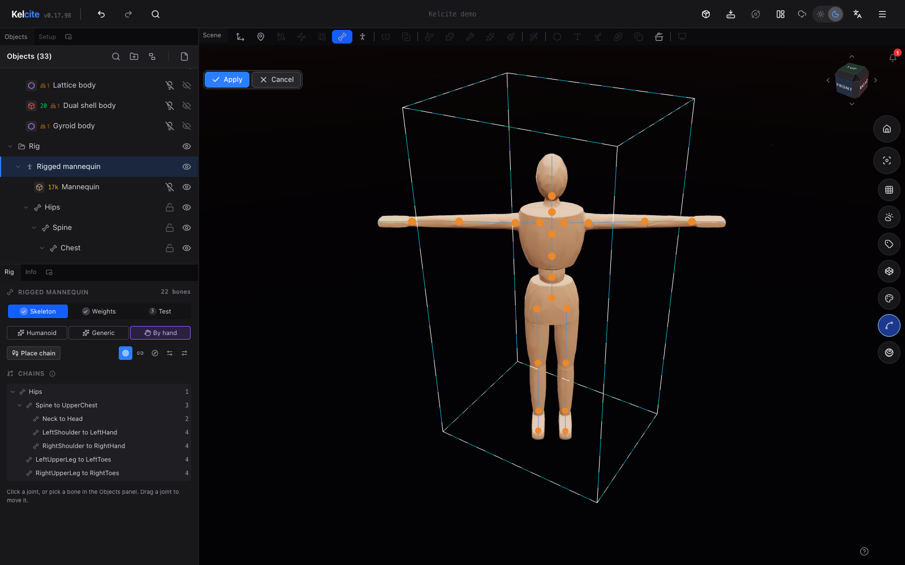
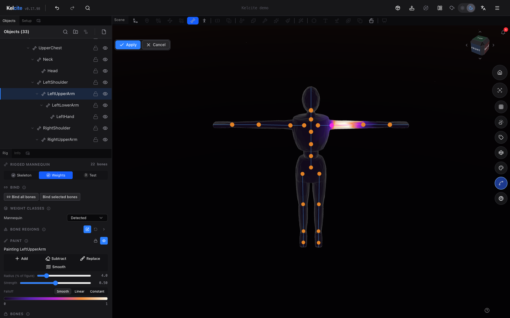
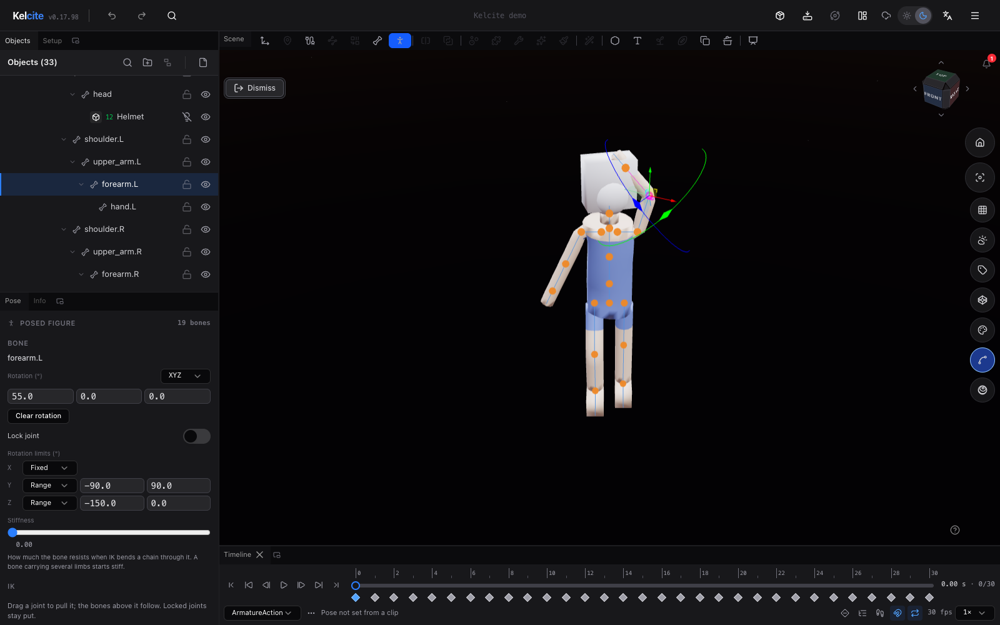

# Rig and Pose a Character

A static figure prints in one pose. Rigging it once lets you print it in any pose, or in several, without resculpting. Kelcite's [Rig tool](Tool-Construction-and-Rigging) builds a skeleton and binds the mesh to it, and the Pose tool turns the bones. Bake then fixes the pose as an ordinary mesh for printing.

The starting point is a figure mesh in the scene, or a rigged character [imported](Workflow-Import-and-Export) from FBX or glTF. An imported rig can go straight to the Pose tool.

## Rigging the figure

The Rig tool works in three stages, shown in the Tool panel: **Skeleton**, **Weights** and **Test**.

### Skeleton

You select the meshes to rig and press **I**. The **Skeleton** stage offers three ways to make the skeleton:

| Method | Use it for |
|---|---|
| **Humanoid** | A person-shaped figure. Fits a humanoid skeleton from a few markers placed on the figure. |
| **Generic** | A creature, a robot or any other figure. Finds its limbs automatically. |
| **By hand** | Any figure, joint by joint. |

A new rig stands upright in the scene, where up is Y, whatever **Up Axis** is set in [Preferences](Workflow-Keyboard-Shortcuts-and-Preferences); that setting says only how STL files are read and written. A rig made while Up Axis was Z, in an older document, lies along the scene's Z, and Move turns its group to stand it up.

For **Humanoid**, you pick each marker in the panel, then click its place on the figure. Once you place one side, the other mirrors until you place it too. **Guess markers** proposes the markers you have not placed, from the shape of the body, for you to confirm or drag. Then you build the rig.

**Generic** reads a figure as organic (one body, its limbs found from a core) or as a robot (rigid parts, cut where they touch), and the **Robot path** switch corrects its reading. Parts that touch along an edge or across a face count as separate parts, as they do in [Part](Tool-Surface-and-Refine#part).

For **By hand**, each click on the figure places a joint of a chain. Each joint goes midway through the body; holding **Shift** puts it on the surface. **Enter** or **Esc** ends the chain, and **E** starts another from the selected joint.

The chain list shows the result. Picking a chain or joint shows the edits that apply to it, such as **Re-fit**, **Add chain** and **Add fingers**.

### Weights

Weights say how strongly each bone moves each part of the mesh.

1. Switch to the **Weights** stage.
2. Click **Bind all bones** (or **Bind selected bones** for the picked bones). Kelcite binds each mesh to the bones with automatic weights.
3. Turn on **Show weights** to see a bone's weight, from none to full.
4. Drag on the figure to paint a correction. Alt-click picks the bone under the cursor, and **Shift+scroll** resizes the brush.

Clothing and rigid parts such as props, eyes or a helmet are weighted when you bind, but do not affect the skeleton fit.

### Test

The **Test** stage tries stock poses on the figure, which shows whether the weights hold up. When the rig behaves, **Open in the Pose tool** hands it over.

## Posing the figure

Pose turns bones directly or pulls joints by IK, the bones above a pulled joint bending to follow.

1. Select the rigged figure and press **E**.
2. Click the figure, a joint, or a bone row to pick a bone.
3. Turn the bone with the rings, or type its angles.
4. Drag a joint, or the arrows beside it, to pull it by IK.

A few keys handle locking, mirroring and clearing:

| Key | Action |
|---|---|
| **Alt+L** | Lock or unlock the joint, so IK leaves it in place |
| **Alt+X** | **Pose both sides**: mirror each edit to the other side |
| **Alt+F** | **Flip pose** left to right |
| **Alt+R** | Clear the bone's rotation |
| **Alt+G** | Clear the root bone's offset |

### Presets

Presets such as **Victory** pose the figure on its own proportions. They need the rig mapped to a humanoid first: you open the **Humanoid** section, check the mapping, and confirm it. Shift-clicking a preset mirrors it.

### Saved poses and animation

**Poses** keeps named poses with the rig. The **Timeline** opens with the Pose tool and plays and scrubs the rig's clips. **Key pose at playhead** writes the posed bones as keys into the clip shown, and **New clip from pose** starts a clip of your own. Dragging a key moves it, and Shift-clicking it deletes it. The clip menu — the **…** button beside the clip name — renames, duplicates, trims, reorders and deletes clips.

Rigs and authored clips are saved with the document and export to GLB and FBX. A rigged mesh exports with the normals that **Recompute normals** (in its right-click menu in the Objects panel) stores, so a GLB of it shades smooth across texture seams.

## Printing the pose

A pose lives in the [skin](Architecture-Rigging-and-Pose) until baked, so printing it means [baking](Workflow-Bake-an-SDF-to-a-Mesh) the figure.

1. Select the posed figure and press **B**.
2. Bake the pose. Each skinned mesh keeps the pose it stands in, as an ordinary mesh. A mesh with holes, a flipped face or an extra fin bakes as an open mesh.
3. Read the overlap report. Places where the pose makes the figure pass through itself are marked in orange. Most slicers merge overlapping volumes on their own.
4. [Export for printing](Workflow-Prepare-for-Printing).

A part hung on a bone, such as the helmet in the demo's **Rig** stop, follows the pose. To print several poses side by side, the [Array tool](Tool-Create-and-Bake) (**D**) can repeat a rig's figure with a different animation frame per copy.

## Common problems

| Symptom or message | Cause and fix |
|---|---|
| **"Bind the meshes on the Weights stage first."** | Pose needs bound meshes. Bind on the Weights stage. |
| A preset does nothing, or says required bones are not mapped | Map the rig in the Pose tool's **Humanoid** section. |
| **"The figure is too thin for the auto-rig to find its middle."** | Try the robot path the message offers, or rig by hand. |
| A tool refuses to edit a posed mesh | It says to bake the pose first, because the tool would change the mesh the skin follows. |
