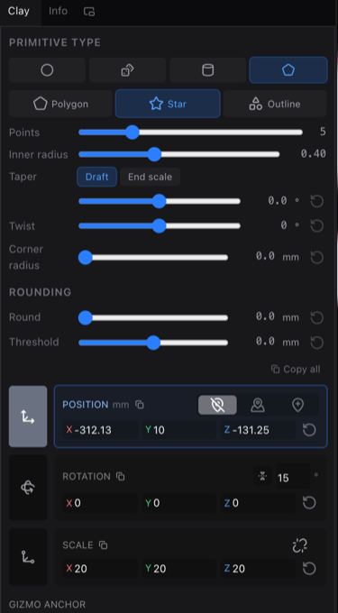

# Sculpt with Clay

A shape built from triangles loses its history: once an edge is rounded or a hole is cut, the triangles are all that remain. **Clay** keeps the history instead. It is a signed-distance (SDF) shape, which Kelcite [computes from a primitive and its modifiers](Architecture-Geometry-Engine) rather than storing triangles, so a rounded edge or a cut stays editable after you make it. The price is that clay has no triangles until it is [baked](Workflow-Bake-an-SDF-to-a-Mesh), and an STL, 3MF or OBJ export refuses it until then.

## Placing a primitive

Every clay shape starts from a primitive, which the [Clay tool](Tool-Create-and-Bake) places.

1. Press **A**, or click Clay in the tool palette.
2. Pick a **Primitive Type**: **Sphere**, **Platonic**, **Cylinder** or **Profile**. Pressing **A** again cycles through them. **Platonic** offers a tetrahedron, octahedron, cube, dodecahedron and icosahedron; **Profile** has three shapes of its own, described under [Profile clay](#profile-clay).
3. Click in the scene to place the clay, then drag the gizmo to position it. Holding **Shift** snaps to surfaces, and **Alt** snaps to pins.
4. Press **Space**, or click **Create**.

While Clay is open, **T** cycles the gizmo between translate, rotate and scale, and **U** toggles uniform scale.

## Shaping it

Each primitive takes its own shape controls. **Round** and **Threshold** apply to every primitive, **Tension** to Platonic and Cylinder, **Draft** to Cylinder, and **Taper**, **Twist** and **Corner radius** to every Profile shape. The Clay tool's panel shows the ones that apply to the primitive being placed. On a selected clay shape, the Info panel shows Tension, Draft and the Profile controls with the primitive's other parameters, while Round and Threshold are modifiers in its Modifiers section, which **Add Modifier** can add later.

| Control | Effect |
|---|---|
| **Round** | Softens edges and corners with a fillet radius. The clay keeps its size. |
| **Tension** | Morphs between sharp facets and a smooth sphere: −1 is spiky, 0 is flat, +1 is round. |
| **Draft** | On a Cylinder, tapers the shape from bottom to top: 0 is straight sides, 1 is a pointed tip. |
| **Taper** | On a Profile, a **Draft angle** or an **End scale** (up to 2, for a wider top). |
| **Threshold** | Grows or shrinks the surface evenly. A negative value moves it inward. |
| **Twist** | Turns a Profile's section about its up axis over its height. |
| **Corner radius** | Rounds a Profile's corners in its plane before it is extruded. |

### Profile clay

A flat outline has no thickness, so a polygon, a star, an SVG, text, a closed Trace or a closed Wire needs a height before it prints. A **Profile** gives it one as clay. It has three shapes, and switching between them keeps the height, twist, taper, Corner radius and Round modifier, so a shape can be tried without setting everything again. Choosing Profile starts on a five-sided Polygon.

| Shape | What it extrudes | Its own settings |
|---|---|---|
| **Polygon** | A regular polygon | **Sides**, **Radius**, **Height** |
| **Star** | A star | **Points**, **Inner radius**, **Radius**, **Height** |
| **Outline** | An SVG, text, closed Trace or closed Wire | The source picked in the **Outline** row, and **Height** |

Clay bodies saved as polygons or stars open as Profile's Polygon or Star, unchanged. All three shapes share **Taper**, **Twist** and **Corner radius**, below their own settings.

- **Taper** is a **Draft angle** or an **End scale** on all three. A Polygon's or Star's Draft leans its walls by that angle at any size and keeps it when the body is resized.
- **Twist** turns the section about the shape's up axis over its height.
- **Corner radius** rounds every corner of a Polygon, a Star's points (its inner corners stay sharp), or an Outline's convex corners, keeping the size. The **Round** modifier, which rounds every edge of the body, stays a modifier of its own, and the two do not change each other.

#### Outline

An Outline follows its source. Reshaping the SVG, text, Trace or Wire it reads updates the clay at once, and moving, turning or tilting an SVG or text carries the clay with it, with no rebuild and no lag behind the drag. The clay stands on an SVG or text at no offset, raised half its height, so the body lies over the shapes path for path; moving the clay moves it off the SVG, and the SVG then carries it from there.

Opening the Clay tool with one SVG, text, closed Trace or closed Wire selected opens **Profile → Outline** on it, with the body previewed there, and **Create** makes the clay. With nothing like that selected, or several nodes selected, Clay opens as before.

- **Several paths.** An SVG or text with several paths lists them with checkboxes. Check one path, several or all; several join as one outline, a hole stays a hole while the path around it is checked, and hovering a row lights that path in the scene. An SVG path's holes cut through the Outline as they show in the SVG, so the counter of an "O" or an "e" stays open.
- **Outline strokes.** On by default, it counts the SVG's strokes, outlined the way the SVG's own Outline strokes outlines them, so a stroked open path can be checked. Off, the Outline reads the SVG's fills alone.
- **Clearing the source.** The × in the source picker clears it. The Outline keeps its place and every setting, draws nothing until a source is picked, and the Inspector says so. Picking the same source again brings the body back on it where it now is, and picking another keeps the clay where it is and shows the new shape there.
- **Size.** An Outline's selection box, measures and **Size** are its body's, through its taper and twist.

An Outline, and a Sweep of an SVG or text, follows the drawing's own curves, so a circle is round instead of showing a flat face every two SVG units. Overlapping shapes, strokes and a Corner radius still read the outline as they did. A Corner radius that rounds away the whole Outline says so under the slider, and the body stays empty until the radius is smaller. Dragging Corner radius keeps the interface responsive, and the body shows the last value when you let go.

### Sweep

A **Sweep** carries a section along a Wire as clay, so it bends with the Wire and stays editable until baked. The section is an SVG, text, a closed Trace or a closed Wire, and the Path is the Wire. The Sweep's card in the Info panel picks the **Section** and the **Path** and sets **Taper** and **Twist** over its length. It follows its section and its Wire as they change, and it shades smooth along a bend; a sharp corner, where a pin's tangent weight is 0, stays an exact miter. Where the Wire bends tighter than the section is wide, the Sweep keeps its last shape and the card says where the Wire folds. A scene with a clay Sweep saves as file format version 5, so an older Kelcite opens it as far as it can and says it came from a newer one. A large Sweep draws a still view once, and while the camera moves or a pin or slider is dragged it draws at a quarter of the pixels, sharpening when you stop. The demo's **Clay sweep** stop shows one.

A baked Profile has a face group for each wall (each side of a Polygon, each facet of a Star, each run of an Outline between corners) and one for each cap, so [Paint](Workflow-Paint-Decals-and-Texture-Maps) and [Trace](Workflow-Trace-an-SVG-to-a-Mesh) can pick a wall or a cap's rim. The demo's **Clay profile** stop shows a star outline and the twisted, rounded knob made from it.

## Joining and cutting clay

[Combine](Tool-Cut-and-Join) sets up a live Boolean, so the tool shapes stay movable after the cut. Combine reads the selection order: the first object selected is the target, and the rest are the tools.

1. Select the target clay first.
2. Ctrl-click (Cmd-click on a Mac) the clay pieces that act as tools.
3. Press **C** to open Combine.
4. Choose **Union**, **Difference** or **Intersect**. Pressing **C** again cycles them.
5. Apply. The tools move under the target and drive a Boolean modifier on it.

Where a tool shapes the target, the target takes the tool's color. While a tool is dragged, or a displacement map's **Scale** slider is scrubbed, the view keeps the last shape on screen until the next one is ready.

When Combine says the target has no meshes, or asks for tools, the selection order was wrong. A Boolean modifier's **Smooth** control blends the seam over a distance, for a filleted join instead of a sharp crease. To slice clay with a plane, [Split](Workflow-Split-and-Cut-a-Model) adds a **Split Plane** modifier to it.

## The modifier stack

Every [modifier](Tool-Modifiers) on the clay is listed in the Info panel's Modifiers section, and they [apply from top to bottom](Architecture-Scene-Model). Their order therefore changes the result. Dragging a modifier's grip reorders it, and so does focusing the grip and pressing ↑ or ↓. Unchecking a modifier turns it off without removing it.

## Turning a mesh into clay

An existing mesh becomes clay through **Convert to Clay** in its right-click menu in the Objects panel. You can then round, offset, cut, join and blend it like any other clay. **Exact edges**, in the Info panel, keeps the mesh's sharp edges sharp, and the **Read exactly** row gives the share of the surface it reads that way. Exact edges need a closed mesh: on an open one, the Info panel says the field reads its samples instead. A face wound the wrong way is read from samples too, around that face only. Seams whose copies of a point differ only by rounding still count as closed.

Converting a large mesh takes seconds because the browser's graphics card builds the mesh's distance field, where WebGPU is available. A mesh of a million triangles shows its clay in about a second and one of 5 million in about 2 seconds; the mesh stays on screen, marked as updating, until the clay's data has reached the card. Where there is no WebGPU, or the card cannot hold the mesh, the field is built on the processor as before, and the Info panel says so and why. A **Round** on mesh clay takes about 0.6 s at a million triangles and about 1.4 s at 5 million, and each step of the Round slider takes about 0.3 s. The slider saves its value to the document about a second after it rests, so reopening the document finds it.

## Surface detail

Dropping a file onto clay adds surface detail. An image dropped onto clay raises its surface by the image's brightness — a [Texture Map](Workflow-Paint-Decals-and-Texture-Maps) in displacement mode. An SVG dropped onto clay projects onto it as a decal.

## Baking

When the shape is final, Bake (**B**) turns it into a mesh for printing. Some clay saved by earlier versions of Kelcite reads differently after updates, so clay from an older document is worth checking before you bake it again.
