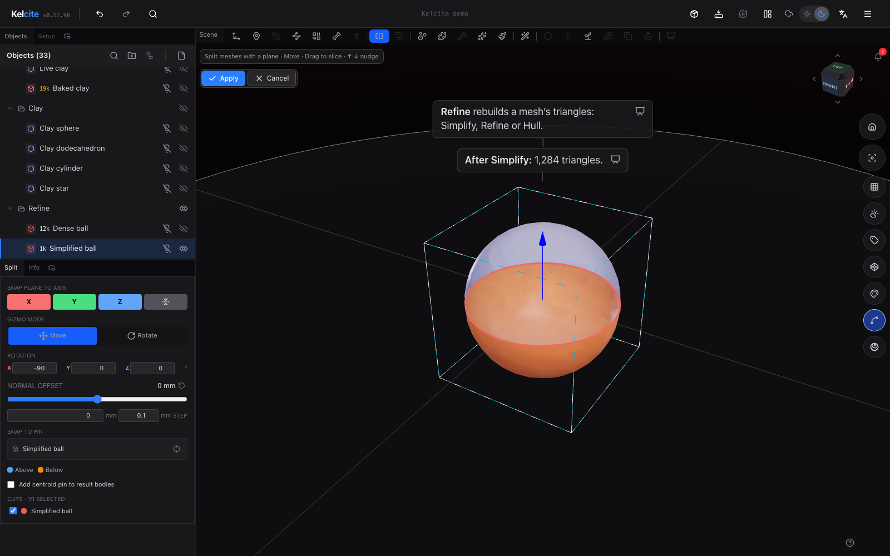
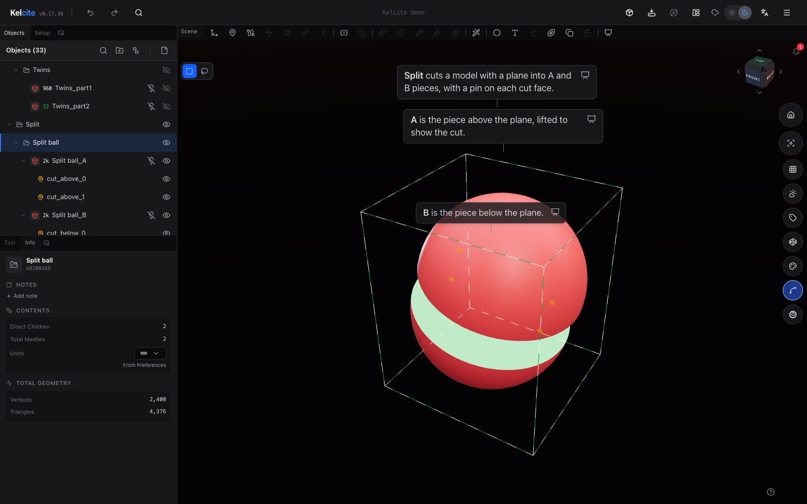
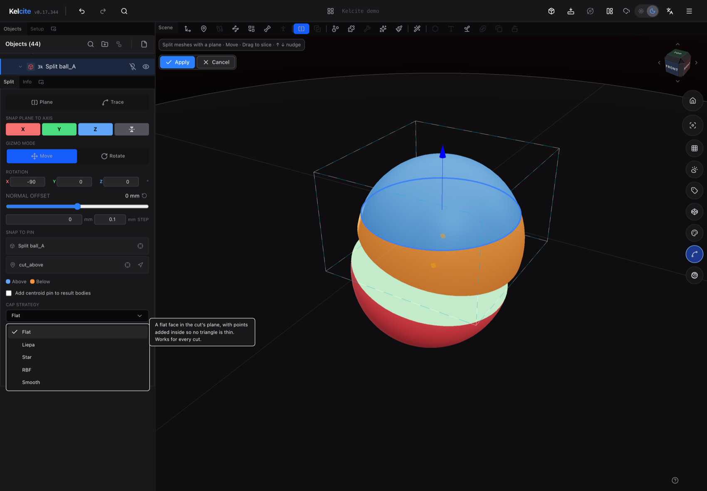
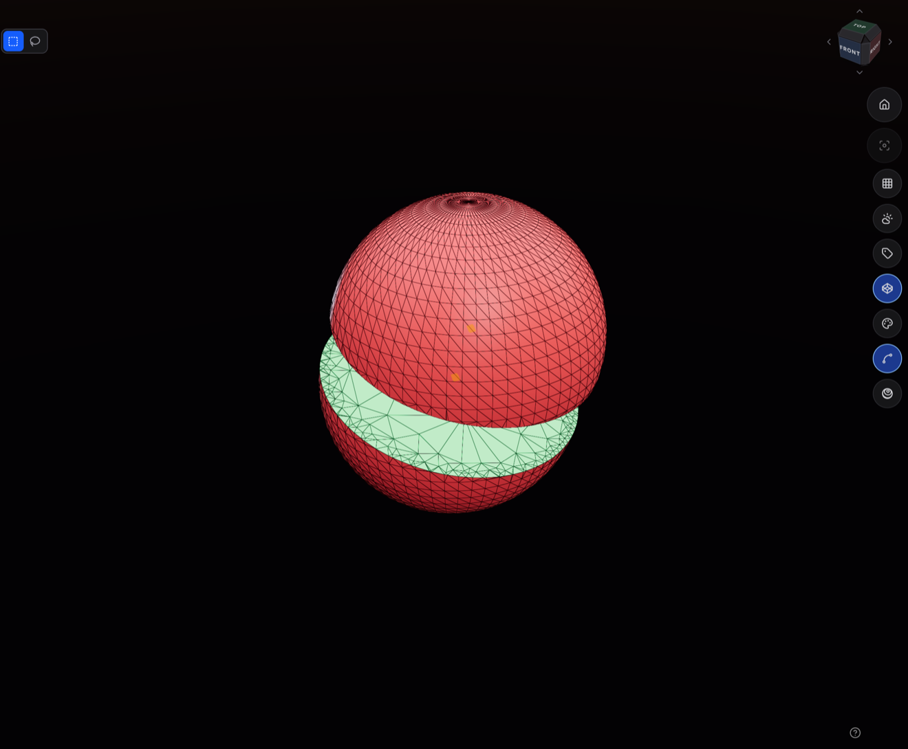
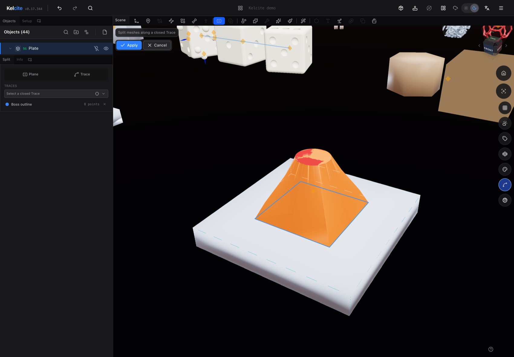

# Split and Cut a Model

A model often has to be cut before it prints: to fit the print bed, to print without supports, to subtract one shape from another, or to lift a region out as its own part. Kelcite has a tool for each shape of cut. A flat cut uses Split, a cut shaped like another object uses Combine, and a cut along the model's own creases uses Crack. Parts that are already separate, or touch only at a corner, an edge or a face, come apart with Part.

| You want to | Tool | Key |
|---|---|---|
| Cut along a plane | [Split](Tool-Cut-and-Join) | **S** |
| Subtract, intersect or join shapes | [Combine](Tool-Cut-and-Join) | **C** |
| Cut along creases into capped pieces | [Crack](Tool-Surface-and-Refine) | **K** |
| Separate parts, or merge meshes | [Part](Tool-Surface-and-Refine) | **O** |

Split needs a manifold mesh and refuses one that needs repair with **"Mesh requires repair before using this tool"**. A scan or download usually has to go through [Repair](Workflow-Repair-a-Scan-for-Printing) first. A few triangles wound inside out do not stop Split: it cuts the mesh and winds the pieces outward.

## Cutting with a plane

Split cuts the selected model along a plane you draw, then lets you refine the plane before applying it.

1. Select the model and press **S**.
2. Drag a line across the view to set the plane.
3. Refine the plane. **X**, **Y** or **Z** aligns it to an axis. **Shift+scroll**, or **↑** and **↓**, offsets it along its normal; Shift with the arrow keys moves ten times as far, and **R** resets the offset. `\` (backslash) flips the plane, and pressing **S** again switches the gizmo between translate and rotate.
4. Check the cut loops listed under **Cuts**. Clicking a loop in the scene leaves it uncut, for a partial cut.
   - **Rows.** The list has one row per part of the cut that separates the body, each with its loop count. A cut that leaves the body in one piece, such as one cut of a ring that crosses the plane several times, shows why under its row and keeps Apply off until another cut of the ring is selected.
   - **In the scene.** Selected loops draw as construction wires, the loop under the pointer (and its row) in the selected-construction color, and loops left out dashed in gray.
5. Turn on **Add centroid pin to result bodies** for a pin at the center of each piece.
6. Choose how each cut face is closed (see [Closing the cut faces](#closing-the-cut-faces)), then press **Space** to apply.

A plane that misses the model shows **"No cuts on this plane"**, and offsetting or realigning it brings the cuts back. If every loop has been clicked off, Split shows **"No cuts selected — select at least one cut loop"** until one is clicked back on.

When Split cannot cut a mesh, the mesh stays as it was, and an alert links to it and gives the reason. This happens when the cut cannot be computed, or when the pieces on either side of a loop you clicked off cannot be joined again.

The model becomes an **A** piece, above the plane, and a **B** piece, below it. Both are closed, so each prints as a solid part. Accept closes the tool at once: the body waves in the scene and spins in the Object Browser while the pieces compute, and **Cancel** on the spinner puts the body back. You can keep working in the scene meanwhile. A hollow body cut above its cavity gives two pieces, with the cavity kept inside the lower one. Each cut face carries a [pin](Tool-Construction-and-Rigging) — a ready attachment point for aligning the pieces or placing a connector.

On [clay](Workflow-Sculpt-with-Clay), Split adds a **Split Plane** modifier instead, which keeps the side the pin's up axis points to and stays editable.

## Closing the cut faces

A cut leaves a hole in each piece, and the two pieces must close it in the same way or they will not fit back together. By default the cut faces are flat caps that both pieces share, so the pieces mate exactly and each is a closed, watertight body. A **Cap strategy** menu chooses another way to close each cut face.

| Strategy | Use it for |
|---|---|
| **Flat** | The default: a flat face in the cut's plane, with points added inside so no triangle is thin. It works for every cut, and suits two pieces that glue or press together |
| **Liepa**, **Star**, **RBF**, **Smooth** | A cut face that should follow the surface around it, as in [Repair's patch strategies](Workflow-Repair-a-Scan-for-Printing#choosing-a-patch-strategy) |

Hovering a strategy says what it does and when it falls back to Flat. The choice is remembered, and undoing a split and redoing it from history reproduces the strategy and the clearance it used.

**Clearance** sets how close to the plane a surface point may lie before the cut treats it as on the plane. It runs from two lattice steps up to 0.1 mm and starts at 5 µm. Points within the clearance move onto the plane, so a plane that only grazes a body makes a flat cut or no cut instead of a sliver. A line under the slider says how many vertices the cut moved onto the plane and the largest move.

A cut that cannot be closed cleanly, such as a plane that skims a surface closer than the finest detail the model can hold, is refused with the place and the reason, and the body stays as it was. A plane that passes exactly through a mesh's vertices finds its cut; the plane the tool places when it opens, through the center of a UV sphere, is one.

## Names and Loft joins

Each piece keeps the names of the face groups it came with, and the face a cut closes is named **Cut face**. The pieces list in Objects in the order of their names, the Above side's first, so after a horizontal split the upper piece is the upper row and the names read `_A`, `_B` down the list (`_A0`, `_A1`, `_B0`, `_B1` when a side has several pieces).

### Joining the two faces with a Loft

A printed part that was split to fit the bed often needs a bridge between its halves once they move apart. Each selected cut in the Split panel has a **Loft split bodies** checkbox. Checked, the split puts a Trace on each of the two faces the cut leaves, named **Trace_A** on the piece above the plane and **Trace_B** on the piece below, and joins them with a [Loft](Workflow-Loft-Between-Shapes) on the lower piece. The Loft's sections take off from pins Split places on those faces: it leaves one face straight out and arrives straight into the other. It has no length until the pieces are moved apart, and it appears while you drag them, as soon as the gap allows. A cut whose face has a hole is not lofted, and an alert says so.

## Cutting along a Trace

A plane is flat, and a cut along a model's own outline is not. A [Trace](Workflow-Trace-an-SVG-to-a-Mesh) drawn on the model sets that outline, and Split cuts along it.

1. Select the model, press **S**, and choose **Trace** at the top of the Split panel.
2. Pick a closed Trace on the body. A Trace that is part of a closed loop of Traces picks the whole loop.
3. Check the preview: the Trace is drawn in the construction blue, and a translucent preview of the cut face appears over the body.

4. Apply. The body is cut into two pieces along the Trace.

The face that closes a Trace cut is a smooth surface stretched across the loop, so a Trace that does not lie in one plane gets a curved cut face. Where a face would touch the body's surface, it is pushed into the body until it clears. The two pieces share the same cut face, so they fit back together.

When a Trace cut cannot be made, the Trace's row in the panel says why, and Apply stays off:

- the Trace does not close along the surface,
- the Trace does not divide the body,
- the cut face folds or will not settle,
- the body is too thin for the face to fit, or
- the cut faces of two Traces cross each other.

Traces that cross or touch each other cannot be cut together yet: Split says so and cuts nothing.

## Subtracting one shape from another

Combine cuts with the shape of other objects. It reads the selection order: the model to cut comes first, and the shapes that cut it follow. When Combine finds no tools, the target was not selected first.

1. Select the model to cut.
2. Ctrl-click (Cmd-click on a Mac) the shapes that cut it.
3. Press **C** and choose **Difference**. **Union** joins, and **Intersect** keeps the shared volume.
4. Turn on **Bake on apply** to get one finished mesh. With it off, the tools stay live under a Boolean [modifier](Tool-Modifiers), and you can still move them.
5. Apply.

The faces a tool cuts or adds take the tool's material, which joins the mesh's materials. A boolean of large meshes builds in the background, with a progress bar of its steps; closing Combine stops it. Apply keeps the result the preview built.

While you drag a tool body of a mesh union, intersect or difference with the Move tool, the curves where the two bodies meet are drawn through both bodies and follow the drag. On large meshes the result itself is computed once the drag stops. When two bodies touch over too much of their surfaces to trace within a frame (noisy scans crossing at a shallow angle, surfaces that nearly coincide, flat faces that lie on each other), the curves stop for the rest of that drag, and Move and Combine say so, with the count of pairs to test past which they stop. When you stop dragging, the translucent curves turn opaque and close, and they stay until the new result appears.

A live Boolean stays editable until [Bake](Workflow-Bake-an-SDF-to-a-Mesh) turns it into a fixed mesh, and the view shows the same result Bake writes. Moving a tool rebuilds the cut, and the previous cut stays drawn until the new one is ready. A Boolean on a mesh that is not a closed solid is left out of the view, and an alert says why; Bake would leave that mesh as it is.

[Move](Tool-Construction-and-Rigging)'s snapping treats the cut mesh as uncut. A body dragged with **Surface snap** over it lands on its surface without the cut rather than in the hole, and **Drop to ground** and **Stack** land the same way.

The demo's **Combine** stop shows a cube with a hidden sphere subtracted from it.

## Lifting a region out as a piece

Crack cuts along the folds of a single mesh, so the pieces follow the model's own shape.

1. Select a single mesh and press **K**.
2. Click a face to grow a crack line. **Crease angle** sets how sharp a fold must be to start a group.
3. Press **K** again to switch to extraction.
4. Click the [face groups](Workflow-Paint-Decals-and-Texture-Maps) to lift out. Each becomes a capped piece.
5. Apply.

**Cap holes** closes each cut, so Crack pieces are closed while it is on. **Curved cap** makes the cap meet the surface at its slope instead of lying flat. The cap continues the surface the way the surface faces, also on a piece that curves toward its outside, such as the inside wall of a cup. Two regions that touch at a single corner keep a crack and a cap each.

On a mesh that already has face groups, Crack shows every boundary between two groups as a crack when it opens.

## Separating or merging meshes

Part works in both directions. With one mesh selected, it splits the mesh into separate meshes: shells that are disconnected, parts that touch only at a corner, along an edge or across a face, and any fin standing off a solid; with several selected, it merges them into one. You press **O** and apply. Merged meshes stay intersecting where they overlap, so overlapping volumes that should fuse need Combine's **Union** instead.
