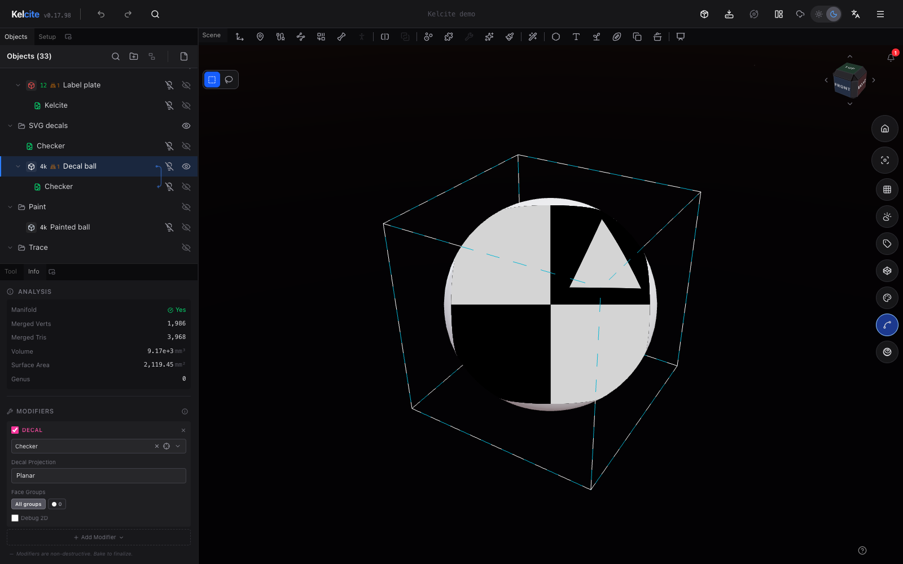
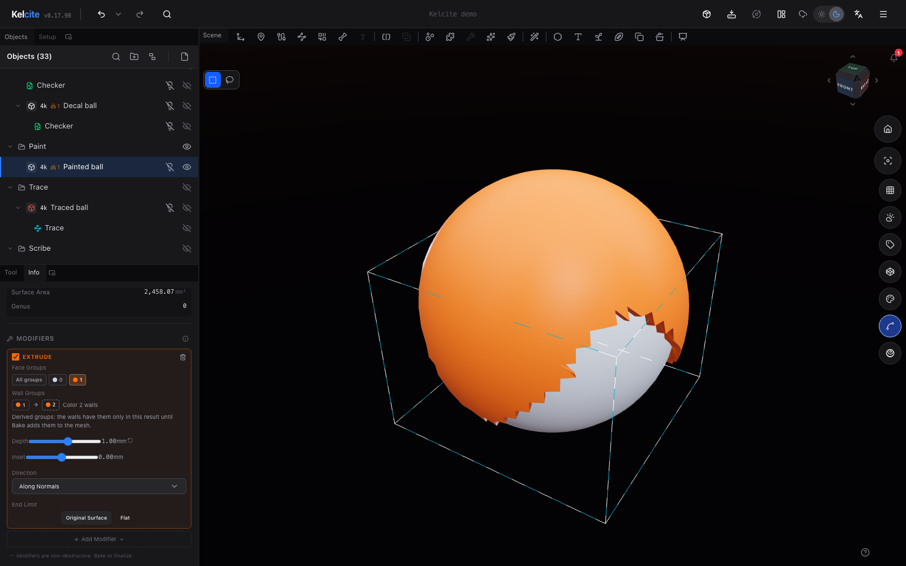

# Trace an SVG to a Mesh

An SVG is flat outlines with no thickness, so a logo or drawing needs a surface and a depth before it can print. Kelcite has no one-step trace from SVG to geometry. Its **Trace** tool is something else — it [draws paths on a mesh surface](Tool-Construction-and-Rigging). Instead, Kelcite brings an SVG onto a model in three stages: it projects the drawing onto the surface as a decal, bakes the decal into face groups shaped like the drawing, then raises or sinks those face groups with an Extrude modifier. Each stage is useful on its own: the face groups alone give a multi-color print, and the extrusion gives relief.

The model has to be [manifold](Workflow-Repair-a-Scan-for-Printing) to receive the drawing. An SVG made of shapes works best; strokes need converting first.

## Putting the SVG on the model

Dragging the SVG file onto a model in the scene turns it into a [Decal modifier](Tool-Modifiers) on that surface. With the model selected, the Info panel's Modifiers section adjusts the decal's placement.

An SVG dropped anywhere other than a model stands on the ground as its own node. **Add Modifier** in a model's Modifiers section adds a decal to it afterward, and so does searching **Add Decal modifier** with **Ctrl+K**.

## Strokes and pixels

A decal draws an SVG from its shapes when it can. When the SVG uses features its shapes cannot express, such as strokes, the decal draws from pixels instead, and its card says so and why. A decal drawn from pixels cannot become face groups. If the reason is strokes, you select the SVG and turn on **Outline Strokes** in its Info panel to turn them into shapes.

## Baking the decal into face groups

You select the model, press **B** and bake. The SVG decal becomes face groups shaped like the drawing. A decal drawn from an image, or from a masked SVG, stays a decal.

The face groups are materials of the mesh. A multi-color print can stop here, with each one [mapped to a filament](Workflow-Prepare-for-Printing).

## Raising or sinking the drawing

Relief comes from an Extrude modifier, which raises a face group off the surface or sinks it in.

1. Right-click one of the new face groups, on the mesh or in the Materials list, and choose **Extrude**. Kelcite adds an Extrude modifier limited to that group.
2. Set **Depth**. A positive depth raises the group; a negative depth sinks it.
3. Set **Inset** and **Direction** if the walls should taper or the extrusion should run along a particular axis. **Along Average Normal** raises the patch straight off its surface.
4. Repeat for each group that should change height.

The extrusion's side walls get a face group of their own, which baking turns into a material named after the top's. While you drag **Depth** or **Inset**, the view follows the drag; the **Wall Groups** rows update when you let go.

## Baking the relief

An Extrude is live until baked, and STL, 3MF and OBJ exports refuse it. [Baking](Workflow-Bake-an-SDF-to-a-Mesh) the model once more writes the relief the preview shows into the mesh, on a mesh with seams and on an STL alike. Each step stays undoable, and the decal and Extrude stay editable until their bake.

## Other routes

For lettering, the Text tool makes the decal for you, as part of [decals and painting](Workflow-Paint-Decals-and-Texture-Maps). An SVG that sits under a mesh in the Objects panel has **Split & Paint from SVG** in its right-click menu, which splits the mesh along the SVG's outlines and paints the regions in one step.

## Common problems

| Symptom or message | Cause and fix |
|---|---|
| The decal does not become face groups | A decal drawn from pixels stays a decal. Read the reason on its card; for strokes, turn on **Outline Strokes**. |
| **"This decal draws the SVG from pixels."** | The SVG uses gradients, filters or other effects, or has more detail than its shapes can be drawn with. Its edges are only as sharp as the SVG's **Texture Resolution**. Simplify the SVG in a vector editor for clean face groups. |
| The export is refused | The Extrude or the SVG decal is still live. Bake it. |
| **"The decal of … on … was not baked: NanoSVG could not sample it"** | Bake's **SVG sampler** is set to **NanoSVG**, which cannot read this SVG, and the decal's card gives the reason. Choose **DOM** as the sampler to read it the browser's way. |
